# refactor(cli): replace DI container with owned runtime factories

## Why

jig built its run and sandbox runtimes with an Awilix container in `src/app/container.ts`. That
put adapter and observer imports in production app, kept cradle types and registration helpers
alive, and left the construction question of #49 open. This change decides it: **composition
constructs both runtimes with explicit factories, and jig uses no DI container.** (Sandbox
_containers_ — the Docker containers sandcastle runs agents in — are unchanged; only the
dependency-injection container goes.)

The factory decision rests on these reasons:

- **Equivalent behaviour.** The factories build the same adapters, observers and lifetimes the
  container registered; the application integration specs keep every assertion and pass unchanged
  in substance.
- **No production container disposers.** The container's scopes registered no disposers. Every
  lifetime that mattered (session close, reporting disposal, the run lock, the throwaway branch)
  was already owned by app's lifecycle wrappers, so the container added indirection only.
- **Compile-time dependency checking.** A factory's input is a TypeScript type: a missing or
  mistyped dependency fails `tsc`, where a missing registration failed only when resolved.
- **Singleton settings capture.** Singleton registrations captured the config and environment of
  the first resolve; `sandboxFor` closures now capture each sandbox's own config and environment.
- **Stale graphs after registration overrides.** Overriding a registration after a singleton had
  resolved left the earlier graph in place; a factory is rebuilt over the inputs it is given.
- **Incompatible cleanup semantics.** Container disposal releases in registration order with no
  notion of a failed start or a panic part-way; jig needs the app-owned order of
  `releasingOnPanic`, `withResource` and `releaseInOrder`.

## What

### Moved concepts and their owners

| Concept                                                                                           | Before                                                 | Now                                                                                                                                                                                                                                                                         |
| ------------------------------------------------------------------------------------------------- | ------------------------------------------------------ | --------------------------------------------------------------------------------------------------------------------------------------------------------------------------------------------------------------------------------------------------------------------------- |
| Run and sandbox runtime construction                                                              | `app/container.ts` (Awilix container, scopes, cradles) | `composition/run-runtime.ts`, `composition/sandbox-runtime.ts`                                                                                                                                                                                                              |
| Factory inputs                                                                                    | one container cradle                                   | narrow wiring in `composition/runtime-wiring.ts`: `ConsoleWiring`, `ImageWiring`, `SessionWiring`, `SettingsWiring`; `RunRuntimeWiring` takes all four, `SandboxRuntimeWiring` no settings, image dependencies only `ImageWiring`, a throwaway sandbox only `SessionWiring` |
| Run scope acquisition order, retry under `transientRetryPolicy`, release on failed start or panic | container resolution                                   | `app/run-scope.ts` (`acquireRunScope` over `RunScopeParts`)                                                                                                                                                                                                                 |
| Observer attachment                                                                               | `app/observed-events.ts`                               | `composition/observed-events.ts`                                                                                                                                                                                                                                            |
| Image rebuild policy                                                                              | `app/sandbox-image.ts`                                 | `app/sandbox-image.ts` (policy only)                                                                                                                                                                                                                                        |
| Portable recipe and image capabilities                                                            | `app/sandbox-image.ts`                                 | `ports/sandbox-images.ts`                                                                                                                                                                                                                                                   |
| Dockerfile access, host identity, package metadata, image naming, label serialization             | `app/sandbox-image.ts`                                 | `adapters/sandbox-image/repository-image-recipe.ts`                                                                                                                                                                                                                         |
| Application response data                                                                         | `ports/run-records.ts`                                 | `ports/run-records.ts`, unchanged                                                                                                                                                                                                                                           |

Opening either runtime opens no sandbox, image or run log. Each run gets its own events, metrics
and workspace; the console log is shared; run logs stay open for the process lifetime; existing
disposal contracts are kept. The application integration specs build their runtime with
`runRuntimeFactory` and typed `openSession`, `images`, `consoleLog` and `runSettings` inputs, with
fake sessions over the real workflow.

### Dependency enforcement

The request named `check-dependencies` files; this repository has none, and none were added. The
actual enforcement paths are:

- `.dependency-cruiser.mjs` (`npm run lint:dependencies`, first pass over `src`):
  `app-imports-no-infrastructure` rejects any production app import of an adapter, observer or CLI
  module — value, type-only, re-export or dynamic — and
  `logging-and-tracing-libraries-stay-in-reporting-and-wiring` keeps Pino and OpenTelemetry in
  adapters, observers and composition. `app-public-entry-exposes-no-infrastructure` and
  `app-internals-are-private-to-app-and-composition` keep the public app entry restriction.
- `.dependency-cruiser.specs.mjs` (second pass over specs), unchanged.
- `scripts/lint-dependencies.integration.spec.ts`, which proves the rules reject direct, nested,
  type-only, re-export and literal dynamic imports without incidental cycles, and accept
  composition wiring and adapter imports in app specs.
- `eslint.config.js`: the `awilixOnlyInApp` restriction and both of its uses are removed.

Awilix is gone from `package.json`, `package-lock.json`, ESLint and source. The development
version `0.0.0-development` is unchanged and no release tag was created.

### Documentation

`docs/architecture.html`, `docs/workflow-ownership.md`, `docs/specs/application-boundaries.md`,
`CONTRIBUTING.md`'s code map, `CLAUDE.md`/`AGENTS.md` current picks and the callee-ownership,
parse-at-the-edge and testing rules describe the factories in place of the #49 deferral.
Explicitly historical records are kept.

## How

The diagram compares the merge base with the first commit of this branch; the follow-up commit
only changes the composition specs to import `RunRuntimeWiring`/`SandboxRuntimeWiring` from their
factories instead of `runtime-wiring.ts`.

96 added (solid green) · 66 removed (dashed red)

```mermaid
flowchart LR
  m0["adapters/filesystem/config-source.ts"]
  m1["adapters/filesystem/preset-source.ts"]
  m2["adapters/git/branch.ts"]
  m3["adapters/git/git-workspace.ts"]
  m4["adapters/git/run-history.ts"]
  m5["adapters/git/throwaway-branches.ts"]
  m6["adapters/local-store/local-run-records.ts"]
  m7["adapters/local-store/metrics-log.ts"]
  m8["adapters/local-store/run-lock.ts"]
  m9["adapters/local-store/run-paths.ts"]
  m10["adapters/logging/create-logger.ts"]
  m11["adapters/run-store/repository-run-stores.ts"]
  m12["adapters/sandbox-image/docker-images.ts"]
  m13["adapters/sandbox-image/image-recipe.ts"]
  m14["adapters/sandbox-image/latest-agent-versions.ts"]
  m15["adapters/sandbox-image/repository-image-recipe.spec.ts"]
  m16["adapters/sandbox-image/repository-image-recipe.ts"]
  m17["adapters/sandbox-image/starter-files.ts"]
  m18["adapters/sandcastle/agent-credentials.ts"]
  m19["adapters/sandcastle/agents.ts"]
  m20["adapters/sandcastle/open-session.ts"]
  m21["adapters/telemetry/open-telemetry.ts"]
  m22["app/api.ts"]
  m23["app/build-image.spec.ts"]
  m24["app/container.spec.ts"]
  m25["app/container.ts"]
  m26["app/implement-issue.integration.spec.ts"]
  m27["app/lifecycle.ts"]
  m28["app/observed-events.spec.ts"]
  m29["app/observed-events.ts"]
  m30["app/run-jig.integration.spec.ts"]
  m31["app/run-jig.ts"]
  m32["app/run-operation.ts"]
  m33["app/run-scope.spec.ts"]
  m34["app/run-scope.ts"]
  m35["app/sandbox-image.spec.ts"]
  m36["app/sandbox-image.ts"]
  m37["app/sandbox-runtime.ts"]
  m38["app/throwaway-sandbox.ts"]
  m39["composition/main.ts"]
  m40["composition/observed-events.spec.ts"]
  m41["composition/observed-events.ts"]
  m42["composition/run-runtime.spec.ts"]
  m43["composition/run-runtime.ts"]
  m44["composition/runtime-wiring.ts"]
  m45["composition/sandbox-runtime.spec.ts"]
  m46["composition/sandbox-runtime.ts"]
  m47["config/agent-policy.ts"]
  m48["config/config-source.ts"]
  m49["config/environment.ts"]
  m50["config/errors.ts"]
  m51["config/load-config.ts"]
  m52["config/preset-source.ts"]
  m53["domain/events.ts"]
  m54["domain/run-state.ts"]
  m55["domain/settings.ts"]
  m56["failures/retry.ts"]
  m57["flow/engine.ts"]
  m58["flow/retry-policy.ts"]
  m59["observers/logging-observer.ts"]
  m60["observers/metrics.ts"]
  m61["observers/run-events.ts"]
  m62["observers/tracing-observer.ts"]
  m63["ports/agent-session.ts"]
  m64["ports/git-failures.ts"]
  m65["ports/local-state.ts"]
  m66["ports/observability.ts"]
  m67["ports/run-session.ts"]
  m68["ports/run-store.ts"]
  m69["ports/sandbox-images.ts"]
  m70["ports/workspace.ts"]
  m15 --> m13
  linkStyle 0 stroke:#15803d,stroke-width:2px
  m15 --> m16
  linkStyle 1 stroke:#15803d,stroke-width:2px
  m15 --> m63
  linkStyle 2 stroke:#15803d,stroke-width:2px
  m16 --> m13
  linkStyle 3 stroke:#15803d,stroke-width:2px
  m16 --> m17
  linkStyle 4 stroke:#15803d,stroke-width:2px
  m16 --> m19
  linkStyle 5 stroke:#15803d,stroke-width:2px
  m16 --> m47
  linkStyle 6 stroke:#15803d,stroke-width:2px
  m16 --> m51
  linkStyle 7 stroke:#15803d,stroke-width:2px
  m16 --> m63
  linkStyle 8 stroke:#15803d,stroke-width:2px
  m16 --> m69
  linkStyle 9 stroke:#15803d,stroke-width:2px
  m23 --> m16
  linkStyle 10 stroke:#15803d,stroke-width:2px
  m26 --> m43
  linkStyle 11 stroke:#15803d,stroke-width:2px
  m26 --> m51
  linkStyle 12 stroke:#15803d,stroke-width:2px
  m30 --> m32
  linkStyle 13 stroke:#15803d,stroke-width:2px
  m30 --> m43
  linkStyle 14 stroke:#15803d,stroke-width:2px
  m33 --> m34
  linkStyle 15 stroke:#15803d,stroke-width:2px
  m33 --> m37
  linkStyle 16 stroke:#15803d,stroke-width:2px
  m33 --> m50
  linkStyle 17 stroke:#15803d,stroke-width:2px
  m33 --> m54
  linkStyle 18 stroke:#15803d,stroke-width:2px
  m33 --> m63
  linkStyle 19 stroke:#15803d,stroke-width:2px
  m33 --> m65
  linkStyle 20 stroke:#15803d,stroke-width:2px
  m33 --> m66
  linkStyle 21 stroke:#15803d,stroke-width:2px
  m34 --> m27
  linkStyle 22 stroke:#15803d,stroke-width:2px
  m34 --> m31
  linkStyle 23 stroke:#15803d,stroke-width:2px
  m34 --> m37
  linkStyle 24 stroke:#15803d,stroke-width:2px
  m34 --> m54
  linkStyle 25 stroke:#15803d,stroke-width:2px
  m34 --> m55
  linkStyle 26 stroke:#15803d,stroke-width:2px
  m34 --> m56
  linkStyle 27 stroke:#15803d,stroke-width:2px
  m34 --> m57
  linkStyle 28 stroke:#15803d,stroke-width:2px
  m34 --> m58
  linkStyle 29 stroke:#15803d,stroke-width:2px
  m34 --> m66
  linkStyle 30 stroke:#15803d,stroke-width:2px
  m34 --> m67
  linkStyle 31 stroke:#15803d,stroke-width:2px
  m34 --> m68
  linkStyle 32 stroke:#15803d,stroke-width:2px
  m34 --> m70
  linkStyle 33 stroke:#15803d,stroke-width:2px
  m35 --> m16
  linkStyle 34 stroke:#15803d,stroke-width:2px
  m39 --> m43
  linkStyle 35 stroke:#15803d,stroke-width:2px
  m39 --> m46
  linkStyle 36 stroke:#15803d,stroke-width:2px
  m40 --> m10
  linkStyle 37 stroke:#15803d,stroke-width:2px
  m40 --> m41
  linkStyle 38 stroke:#15803d,stroke-width:2px
  m40 --> m53
  linkStyle 39 stroke:#15803d,stroke-width:2px
  m41 --> m53
  linkStyle 40 stroke:#15803d,stroke-width:2px
  m41 --> m61
  linkStyle 41 stroke:#15803d,stroke-width:2px
  m42 --> m43
  linkStyle 42 stroke:#15803d,stroke-width:2px
  m42 --> m44
  linkStyle 43 stroke:#15803d,stroke-width:2px
  m42 --> m49
  linkStyle 44 stroke:#15803d,stroke-width:2px
  m42 --> m51
  linkStyle 45 stroke:#15803d,stroke-width:2px
  m42 --> m53
  linkStyle 46 stroke:#15803d,stroke-width:2px
  m42 --> m66
  linkStyle 47 stroke:#15803d,stroke-width:2px
  m42 --> m69
  linkStyle 48 stroke:#15803d,stroke-width:2px
  m43 --> m2
  linkStyle 49 stroke:#15803d,stroke-width:2px
  m43 --> m3
  linkStyle 50 stroke:#15803d,stroke-width:2px
  m43 --> m4
  linkStyle 51 stroke:#15803d,stroke-width:2px
  m43 --> m6
  linkStyle 52 stroke:#15803d,stroke-width:2px
  m43 --> m7
  linkStyle 53 stroke:#15803d,stroke-width:2px
  m43 --> m8
  linkStyle 54 stroke:#15803d,stroke-width:2px
  m43 --> m9
  linkStyle 55 stroke:#15803d,stroke-width:2px
  m43 --> m10
  linkStyle 56 stroke:#15803d,stroke-width:2px
  m43 --> m11
  linkStyle 57 stroke:#15803d,stroke-width:2px
  m43 --> m20
  linkStyle 58 stroke:#15803d,stroke-width:2px
  m43 --> m21
  linkStyle 59 stroke:#15803d,stroke-width:2px
  m43 --> m22
  linkStyle 60 stroke:#15803d,stroke-width:2px
  m43 --> m34
  linkStyle 61 stroke:#15803d,stroke-width:2px
  m43 --> m36
  linkStyle 62 stroke:#15803d,stroke-width:2px
  m43 --> m41
  linkStyle 63 stroke:#15803d,stroke-width:2px
  m43 --> m44
  linkStyle 64 stroke:#15803d,stroke-width:2px
  m43 --> m54
  linkStyle 65 stroke:#15803d,stroke-width:2px
  m43 --> m59
  linkStyle 66 stroke:#15803d,stroke-width:2px
  m43 --> m60
  linkStyle 67 stroke:#15803d,stroke-width:2px
  m43 --> m62
  linkStyle 68 stroke:#15803d,stroke-width:2px
  m43 --> m64
  linkStyle 69 stroke:#15803d,stroke-width:2px
  m43 --> m66
  linkStyle 70 stroke:#15803d,stroke-width:2px
  m44 --> m5
  linkStyle 71 stroke:#15803d,stroke-width:2px
  m44 --> m10
  linkStyle 72 stroke:#15803d,stroke-width:2px
  m44 --> m12
  linkStyle 73 stroke:#15803d,stroke-width:2px
  m44 --> m14
  linkStyle 74 stroke:#15803d,stroke-width:2px
  m44 --> m16
  linkStyle 75 stroke:#15803d,stroke-width:2px
  m44 --> m20
  linkStyle 76 stroke:#15803d,stroke-width:2px
  m44 --> m22
  linkStyle 77 stroke:#15803d,stroke-width:2px
  m44 --> m41
  linkStyle 78 stroke:#15803d,stroke-width:2px
  m44 --> m49
  linkStyle 79 stroke:#15803d,stroke-width:2px
  m44 --> m51
  linkStyle 80 stroke:#15803d,stroke-width:2px
  m44 --> m55
  linkStyle 81 stroke:#15803d,stroke-width:2px
  m44 --> m59
  linkStyle 82 stroke:#15803d,stroke-width:2px
  m44 --> m66
  linkStyle 83 stroke:#15803d,stroke-width:2px
  m44 --> m67
  linkStyle 84 stroke:#15803d,stroke-width:2px
  m44 --> m69
  linkStyle 85 stroke:#15803d,stroke-width:2px
  m45 --> m44
  linkStyle 86 stroke:#15803d,stroke-width:2px
  m45 --> m46
  linkStyle 87 stroke:#15803d,stroke-width:2px
  m45 --> m49
  linkStyle 88 stroke:#15803d,stroke-width:2px
  m45 --> m69
  linkStyle 89 stroke:#15803d,stroke-width:2px
  m46 --> m0
  linkStyle 90 stroke:#15803d,stroke-width:2px
  m46 --> m17
  linkStyle 91 stroke:#15803d,stroke-width:2px
  m46 --> m18
  linkStyle 92 stroke:#15803d,stroke-width:2px
  m46 --> m22
  linkStyle 93 stroke:#15803d,stroke-width:2px
  m46 --> m44
  linkStyle 94 stroke:#15803d,stroke-width:2px
  m69 --> m63
  linkStyle 95 stroke:#15803d,stroke-width:2px
  m23 -.-> m36
  linkStyle 96 stroke:#b91c1c,stroke-width:2px
  m24 -.-> m0
  linkStyle 97 stroke:#b91c1c,stroke-width:2px
  m24 -.-> m25
  linkStyle 98 stroke:#b91c1c,stroke-width:2px
  m24 -.-> m37
  linkStyle 99 stroke:#b91c1c,stroke-width:2px
  m24 -.-> m49
  linkStyle 100 stroke:#b91c1c,stroke-width:2px
  m24 -.-> m50
  linkStyle 101 stroke:#b91c1c,stroke-width:2px
  m24 -.-> m51
  linkStyle 102 stroke:#b91c1c,stroke-width:2px
  m24 -.-> m63
  linkStyle 103 stroke:#b91c1c,stroke-width:2px
  m24 -.-> m65
  linkStyle 104 stroke:#b91c1c,stroke-width:2px
  m25 -.-> m0
  linkStyle 105 stroke:#b91c1c,stroke-width:2px
  m25 -.-> m1
  linkStyle 106 stroke:#b91c1c,stroke-width:2px
  m25 -.-> m2
  linkStyle 107 stroke:#b91c1c,stroke-width:2px
  m25 -.-> m3
  linkStyle 108 stroke:#b91c1c,stroke-width:2px
  m25 -.-> m4
  linkStyle 109 stroke:#b91c1c,stroke-width:2px
  m25 -.-> m5
  linkStyle 110 stroke:#b91c1c,stroke-width:2px
  m25 -.-> m6
  linkStyle 111 stroke:#b91c1c,stroke-width:2px
  m25 -.-> m7
  linkStyle 112 stroke:#b91c1c,stroke-width:2px
  m25 -.-> m8
  linkStyle 113 stroke:#b91c1c,stroke-width:2px
  m25 -.-> m9
  linkStyle 114 stroke:#b91c1c,stroke-width:2px
  m25 -.-> m10
  linkStyle 115 stroke:#b91c1c,stroke-width:2px
  m25 -.-> m11
  linkStyle 116 stroke:#b91c1c,stroke-width:2px
  m25 -.-> m12
  linkStyle 117 stroke:#b91c1c,stroke-width:2px
  m25 -.-> m14
  linkStyle 118 stroke:#b91c1c,stroke-width:2px
  m25 -.-> m17
  linkStyle 119 stroke:#b91c1c,stroke-width:2px
  m25 -.-> m18
  linkStyle 120 stroke:#b91c1c,stroke-width:2px
  m25 -.-> m20
  linkStyle 121 stroke:#b91c1c,stroke-width:2px
  m25 -.-> m21
  linkStyle 122 stroke:#b91c1c,stroke-width:2px
  m25 -.-> m27
  linkStyle 123 stroke:#b91c1c,stroke-width:2px
  m25 -.-> m29
  linkStyle 124 stroke:#b91c1c,stroke-width:2px
  m25 -.-> m31
  linkStyle 125 stroke:#b91c1c,stroke-width:2px
  m25 -.-> m32
  linkStyle 126 stroke:#b91c1c,stroke-width:2px
  m25 -.-> m36
  linkStyle 127 stroke:#b91c1c,stroke-width:2px
  m25 -.-> m37
  linkStyle 128 stroke:#b91c1c,stroke-width:2px
  m25 -.-> m38
  linkStyle 129 stroke:#b91c1c,stroke-width:2px
  m25 -.-> m48
  linkStyle 130 stroke:#b91c1c,stroke-width:2px
  m25 -.-> m49
  linkStyle 131 stroke:#b91c1c,stroke-width:2px
  m25 -.-> m51
  linkStyle 132 stroke:#b91c1c,stroke-width:2px
  m25 -.-> m52
  linkStyle 133 stroke:#b91c1c,stroke-width:2px
  m25 -.-> m54
  linkStyle 134 stroke:#b91c1c,stroke-width:2px
  m25 -.-> m55
  linkStyle 135 stroke:#b91c1c,stroke-width:2px
  m25 -.-> m56
  linkStyle 136 stroke:#b91c1c,stroke-width:2px
  m25 -.-> m57
  linkStyle 137 stroke:#b91c1c,stroke-width:2px
  m25 -.-> m58
  linkStyle 138 stroke:#b91c1c,stroke-width:2px
  m25 -.-> m59
  linkStyle 139 stroke:#b91c1c,stroke-width:2px
  m25 -.-> m60
  linkStyle 140 stroke:#b91c1c,stroke-width:2px
  m25 -.-> m61
  linkStyle 141 stroke:#b91c1c,stroke-width:2px
  m25 -.-> m62
  linkStyle 142 stroke:#b91c1c,stroke-width:2px
  m25 -.-> m64
  linkStyle 143 stroke:#b91c1c,stroke-width:2px
  m25 -.-> m66
  linkStyle 144 stroke:#b91c1c,stroke-width:2px
  m25 -.-> m67
  linkStyle 145 stroke:#b91c1c,stroke-width:2px
  m25 -.-> m68
  linkStyle 146 stroke:#b91c1c,stroke-width:2px
  m25 -.-> m69
  linkStyle 147 stroke:#b91c1c,stroke-width:2px
  m25 -.-> m70
  linkStyle 148 stroke:#b91c1c,stroke-width:2px
  m26 -.-> m0
  linkStyle 149 stroke:#b91c1c,stroke-width:2px
  m26 -.-> m25
  linkStyle 150 stroke:#b91c1c,stroke-width:2px
  m28 -.-> m10
  linkStyle 151 stroke:#b91c1c,stroke-width:2px
  m28 -.-> m29
  linkStyle 152 stroke:#b91c1c,stroke-width:2px
  m28 -.-> m53
  linkStyle 153 stroke:#b91c1c,stroke-width:2px
  m29 -.-> m53
  linkStyle 154 stroke:#b91c1c,stroke-width:2px
  m29 -.-> m61
  linkStyle 155 stroke:#b91c1c,stroke-width:2px
  m30 -.-> m20
  linkStyle 156 stroke:#b91c1c,stroke-width:2px
  m30 -.-> m25
  linkStyle 157 stroke:#b91c1c,stroke-width:2px
  m36 -.-> m13
  linkStyle 158 stroke:#b91c1c,stroke-width:2px
  m36 -.-> m17
  linkStyle 159 stroke:#b91c1c,stroke-width:2px
  m36 -.-> m19
  linkStyle 160 stroke:#b91c1c,stroke-width:2px
  m39 -.-> m25
  linkStyle 161 stroke:#b91c1c,stroke-width:2px
```

## Verification

Run locally on Node v22.23.4 (the sandbox's Node; the pinned Volta version 26.13.0 is not
installed here, so nothing was verified on 26.13.0):

- `npx tsc -p tsconfig.json --noEmit`: clean.
- `npx vitest run src/composition`: 5 files, 22 tests pass, including the executable integration
  spec (`--help` from GitHub outside a repository, import without parsing, symlinked invocation)
  and `main.spec.ts`'s "flushes the output only after the command has released what it built".
- `npx vitest run src/app/run-jig.integration.spec.ts src/app/implement-issue.integration.spec.ts`:
  2 files, 14 tests pass.
- `npx eslint src/composition`, `npx prettier --check src/composition docs/workflow-ownership.md`:
  clean.
- `npx depcruise --config .dependency-cruiser.mjs src`: no violations (196 modules).
- `npm run build`, then `node dist/composition/main.js --help` and
  `node dist/composition/main.js github implement --help`: both print their usage.
- Searches: no `awilix` in `src`, `scripts`, `package.json`, `package-lock.json` or
  `eslint.config.js`; no production `src/app` import of `adapters`, `observers` or `cli`.
- `npm run validate` (build, typecheck, lint, duplication, dependencies, formatting, coverage,
  integration specs, secretlint) starts no host agent and publishes nothing — e2e is not among its
  checks and no check calls GitHub. jig runs it after this slice and records the result; it was not
  run by hand here.

## Unresolved

- Not verified on the pinned Node 26.13.0; only v22.23.4 was available.
- The full `npm run validate` result is recorded by jig's own verification, not in this description.

🤖 Generated with [Claude Code](https://claude.com/claude-code)
