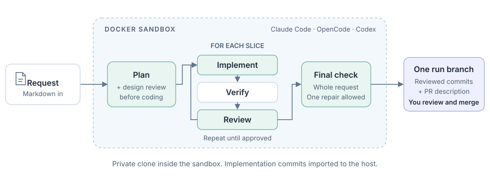

# jig

jig turns a markdown request into a plan, reviewed commits, and a pull request description.
It runs Claude Code, OpenCode, or Codex inside a Docker sandbox, stacks the work on one
branch, and waits for you to merge. Automatic merging is optional.



## Install

Requires Node **20.17 or newer**, Git **2.38 or newer**, and a running Docker daemon.
Run jig from the target repository's root. Set your Git `user.name` and `user.email`
for automatic merges.

Install from a checkout:

```bash
git clone https://github.com/ygrishajev/jig.git
cd jig
npm ci
npm run install:local
jig --help
```

Tagged releases publish as `@ygrishajev/jig` to **GitHub Packages**. See
[package installation](docs/installation.md) for registry setup and authentication.
For development setup and checks, see [Contributing](CONTRIBUTING.md).

## Quickstart

### 1. Initialize your repository

From the repository you want jig to work on:

```bash
jig init
```

Choose agents and provide their credentials when prompted. jig proposes a Dockerfile
and setup and verification commands, then checks them inside the sandbox. Review the
generated files and commit them:

```bash
git add .sandcastle/Dockerfile .sandcastle/.gitignore jig.config.json
git commit -m "chore: set up jig"
```

### 2. Describe the change

Create a Markdown request with the change you need, why it matters, relevant context,
constraints, and verifiable acceptance criteria. Linked conversations are not part
of the agent's input. Save the file outside the target repository, for example as
`../request.md`, or commit it before running jig.

To review the plan before implementation, set `"designGate": "checkpoint"` in
`jig.config.json` and commit the change before starting.

### 3. Run and inspect

```bash
jig run ../request.md --id first-run
jig status first-run
```

jig plans the work, reviews the design, and implements and reviews each slice.
At a design checkpoint, read the generated documents and continue with
`jig run --id first-run`.

### 4. Review and merge

By default, jig waits for you to merge `jig/run/first-run`. Read
`.jig/first-run/state/PR_DESCRIPTION.md`, inspect the branch, and merge through your
normal workflow. jig generates the description but does not open a pull request.
After merging, run `jig run --id first-run` to record completion.

If a run stops early, use [outcomes and recovery](docs/commands.md#outcomes-and-recovery)
to choose the next action.

## Documentation

Start with the [documentation index](docs/README.md), or go directly to a task:

| I want to…                              | Guide                                      |
| --------------------------------------- | ------------------------------------------ |
| Install jig                             | [Installation](docs/installation.md)       |
| Start, inspect, or resume a run         | [Commands and lifecycle](docs/commands.md) |
| Set up agent access                     | [Authentication](docs/authentication.md)   |
| Choose agents and models                | [Agent presets](docs/presets.md)           |
| Look up settings and defaults           | [Configuration](docs/configuration.md)     |
| Understand container and merge behavior | [Sandbox boundaries](docs/sandbox.md)      |
| Automate runs or inspect artifacts      | [Operations](docs/operations.md)           |
| Develop jig                             | [Contributing](CONTRIBUTING.md)            |

## Sandbox boundaries

Agents run unattended inside a [sandcastle](https://github.com/mattpocock/sandcastle)
Docker container. They see a private clone with no remote or host repository mounts.
Only implementation commits are imported back to the host. Credentials enter through
environment variables, with a private login-cache mount for Codex.

Agent review does not replace your review. Automatic merging (`"mergeMode": "auto"`)
lands agent code without a human checkpoint. Agent commits are unsigned by default;
`"commitSigning": "repo"` re-signs the run branch during an automatic merge and requires
a signing setup that works without prompts. See [sandbox boundaries](docs/sandbox.md#merging-and-signing) for details.
