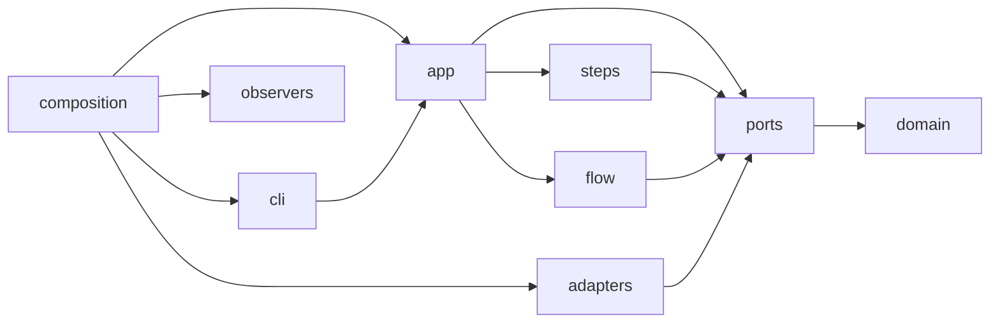

# Application boundaries and dependency ownership

Date: 2026-11-21

Status: Finalized for implementation planning after specification review. This document specifies
the target architecture; it does not describe the currently implemented layout. The construction
mechanism remains deferred to spike #49. Its recorded outcome gates container-specific planning,
not the architectural boundaries or unrelated ownership work.

## Intent

Make the code structure teach agents where behavior belongs. Command handling, application
behavior, external operations, and executable wiring have distinct owners and enforceable
dependency boundaries. A new contribution should follow an obvious existing pattern without
needing an explanation of exceptions in a conversation.

The architecture should support growth while remaining as simple as the current responsibilities
allow. A separate module is justified by a distinct responsibility and useful enforcement, not by
matching a diagram. Existing rules can change when they obstruct a clearer design.

REST is a useful thought experiment for testing the boundary, not a requested feature. A caller
that does not use the CLI must be able to invoke application operations without reproducing
configuration preparation, repository prerequisites, locking, or cleanup.

This design incorporates the GitHub redistribution in issue #47 and the subsequent discussion of
CLI/application/composition boundaries. It records default and error ownership principles relevant
to #48. The implementation plan must reconcile those existing issues rather than create competing
requests for the same work.

## Architectural basis

The established principles used here are a transport-independent application, ports for external
capabilities, inward dependencies, and a composition root near executable startup. They follow
[ports and adapters](https://alistair.cockburn.us/hexagonal-architecture/), the
[composition-root pattern](https://blog.ploeh.dk/2011/07/28/CompositionRoot/), and the
[dependency rule](https://blog.cleancoder.com/uncle-bob/2012/08/13/the-clean-architecture.html).
Separating construction from use does not require a container; see
[dependency injection](https://martinfowler.com/articles/injection.html).

The exact folders, the separate composition owner, and the owner allowlist below are jig-specific
design choices. They are not requirements imposed by those architecture patterns. Their purpose
is to express actual responsibilities and prevent regressions in this codebase.

## Goals and limits

- Remove the top-level `integrations` owner and distribute GitHub functionality by responsibility.
- Give every existing command a container-free application boundary.
- Separate executable composition from application use cases and CLI translation.
- Keep business decisions independent of concrete infrastructure, transport, and configuration I/O.
- Distinguish domain rules from configurable defaults and technical failure handling.
- Enforce import directions with Dependency Cruiser and ownership decisions through review guidance.
- Preserve commands, configuration precedence, error behavior, execution safety, and recovery.

Do not build a server, plugin framework, universal application facade, generic dependency registry,
or replacement workflow engine. Do not add interfaces around functions merely for symmetry.
Generic flow extraction remains a separate spike. Adding operator retry overrides remains follow-up
behavior work tracked in #48; moving default ownership does not itself expose new settings.

An outcome that merely moves files while handlers still receive a container, or hides concrete
adapters behind a barrel of re-exports, does not satisfy this design.

## Current implementation

The baseline inspected for this design is commit `27a525b`.

| Area                                                                      | Current responsibility that crosses the proposed boundary                                               |
| ------------------------------------------------------------------------- | ------------------------------------------------------------------------------------------------------- |
| `src/integrations/github/cli.ts`                                          | Composes commands and starts the executable                                                             |
| `src/integrations/github/command.ts`                                      | Parses inputs, creates the GitHub adapter, invokes orchestration, and prints results                    |
| `src/integrations/github/implement-issue.ts`                              | Coordinates accepted requests, runs, and publication using concrete Git/store helpers                   |
| `src/integrations/github/orchestration-store.ts`                          | Persists publication receipts but imports `app/report-cleanup.ts`                                       |
| `src/cli/with-app.ts`                                                     | Repository checks, credentials, configuration/preset resolution, container creation, and disposal       |
| `src/cli/app-action.ts` and command handlers                              | Expose `AwilixContainer<AppCradle>` and cradle access to CLI code                                       |
| `src/app/container.ts`                                                    | Mixes adapter construction, scopes, lifecycle policy, and execution preparation                         |
| `src/app/run-jig.ts`, `init-sandbox.ts`, `run-status.ts`, `run-stores.ts` | Mix use cases with concrete adapter calls, I/O, and container access                                    |
| `src/config`                                                              | Mixes schemas/defaults/preset resolution with file reads, writes, and directory discovery               |
| `src/domain/errors.ts`, `retry.ts`                                        | Combine business failures with infrastructure failures, recognition, panic helpers, and retry execution |

`flow` currently depends on jig state, settings, slices, events, and ports. It is a specialized
executor, despite current documentation calling it generic. This design does not require removing
those dependencies.

## Approaches considered

### Retain composition inside app

Use an enforced `app/composition` subtree and let CLI startup import it. This preserves the current
top-level graph and accommodates the existing app-only Awilix rule. It uses fewer top-level owners
and is a valid architecture when the subtree boundary is enforced. A collapsed app graph hides the
distinction between wiring and use cases; detailed graphs and subtree rules can still show it.
Keeping the existing Awilix restriction is not itself a reason to choose this layout.

### Dedicated composition owner — selected design

Introduce `src/composition`, move executable startup and concrete wiring there, and let CLI handlers
depend on the application API. Revise the existing Awilix restriction and allow composition alone to
import CLI. This makes the wiring visible in the same graph as every other responsibility and gives
the application one consistent role.

This deliberately revises the earlier proposal that nothing imports CLI. Composition must import
the transport it starts; application and infrastructure modules must not. This is an architectural
role with a rule, not an exemption for a leftover import.

### Feature-owned integrations

Keep a GitHub feature owning CLI, orchestration, ports, and adapters internally. This could be coherent
if the whole repository adopted feature boundaries. Doing so would broaden the refactor and preserve
two different organizing schemes in the meantime. It does not meet the agreed goal for this work.

The selected design uses a dedicated composition owner to make construction and application use
separate, visible responsibilities. Further layers require an actual responsibility or
a reduction in caller complexity. Simplicity and correct boundaries are both acceptance criteria.

### Simplicity constraints

- Measure complexity by how much a caller must understand to use a component correctly, including
  its dependency, ordering and lifecycle requirements. Interface, file and layer counts are not
  proxies for that measure.
- Use narrow interfaces to expose required capabilities, hide implementation details and support
  substitution in tests. Prefer direct typed functions, explicit factories and ordinary objects
  where they provide an equally clear contract; neither form is inherently simpler.
- Keep dependencies narrow. Replacing a container with an application-wide dependency bag still
  hides what each operation requires and does not meet the goal.
- Use delegation layers to centralize preparation, lifecycle or error handling, or present a stable
  operation contract. A small forwarding implementation can be valuable when it shields callers
  from internal changes. A layer that only repeats an existing contract without hiding details or
  owning behavior adds navigation without reducing what callers must understand.
- Preserve real resource lifetimes and deferred construction where needed, without introducing
  generalized scope management for hypothetical future transports.
- Do not treat dependency injection as synonymous with a dependency injection container. The
  construction mechanism is evaluated separately from the architectural boundaries in spike #49.
- Each new abstraction should make actual dependencies, policy or lifecycle behavior easier to
  understand. Reducing file or line counts alone is not sufficient evidence of lower complexity.

## Target responsibilities

| Owner         | Purpose                                                                                                | Allowed other production source owners                         |
| ------------- | ------------------------------------------------------------------------------------------------------ | -------------------------------------------------------------- |
| `domain`      | Run/slice concepts, business rules and transitions, genuine business failures                          | None                                                           |
| `failures`    | Failure presentation, unwrapping and retry execution                                                   | None                                                           |
| `ports`       | External capability contracts, their portable data, and capability failures                            | domain                                                         |
| `config`      | Configuration/environment schemas, provider/default policy, presets and pure resolution                | domain, ports                                                  |
| `flow`        | Existing jig execution mechanics and its step contracts                                                | domain, ports, failures                                        |
| `prompts`     | Agent request construction                                                                             | domain                                                         |
| `steps`       | Individual workflow operations through ports                                                           | domain, ports, flow, prompts, failures                         |
| `observers`   | Event subscriptions, derived metrics, and reporting behavior                                           | domain, ports, failures                                        |
| `adapters`    | Git, GitHub, files, containers, terminal, logging and telemetry implementations                        | domain, ports, config, observers, failures                     |
| `app`         | Application API, prerequisites, use cases, resource-lifetime policy and concrete jig workflow assembly | domain, ports, config, flow, steps, prompts, failures          |
| `cli`         | Command declarations, transport validation, input translation, presentation and exit-code decisions    | app public API, domain, ports, failures                        |
| `composition` | Executable startup, construction, dependency registration and concrete observer/adapter wiring         | app, cli, adapters, config, observers, ports, domain, failures |

Same-owner imports are allowed, subject to cycle rules and the application API boundary below.
This table is the initial project-source allowlist, not permission to import arbitrary third-party
packages. Existing restrictions on external calls still apply. A justified change to peripheral
ownership is possible, but must update the spec, rules, fixtures and diagrams together; no silent
exceptions. The core prohibitions against infrastructure/transport/container dependencies in
application behavior remain in force.

`failures` is the one shared technical owner. It holds how jig presents a failure (`messageOf`),
unwraps a panic to its original cause (`rootCause`) and retries an operation that returns a
`Result` (`retryResult` and its `RetryPolicy`). These helpers are pure or need only a timer, and
their consumers span flow, steps, observers, adapters, app, CLI and composition. No existing owner
is importable by all of them: flow cannot import adapters, adapters cannot import flow, and domain
is reserved for business rules. So `failures` sits beneath every consumer, imports no project
source, and depends only on better-result and Node. Callers import its functions directly; they are
not ports, have no adapter implementation, and are not injected. Domain stays independent and does
not import `failures`.

`failures` holds no error classes and no classification. Each class lives with the condition it
describes (see below), carries its literal `kind`, and the owner of a decision says which kinds it
retries. Any further shared technical owner must name its cohesive responsibility and specific
consumers, explain why existing libraries/owners do not fit, and propose its allowed dependency
edges before the corresponding issue is implemented. Do not grant every module access in
anticipation of need.

The main dependency paths are:



The diagram highlights boundaries; the table specifies the initial source-owner policy. App calling a
supplied port at runtime does not require app to import an adapter implementation.

### CLI and the incoming application API

Declare a public application surface, such as `src/app/api.ts` or `src/app/api/`, containing
caller-facing operations, their types and any boundary schemas needed by callers. Choose its exact
shape during planning and encode that path in lint. A typed function is a valid incoming port.
An interface is appropriate when a collection of operations is injected into a caller; it must not
become a container-shaped service locator.

This is an encapsulation boundary, not a requirement for parallel contract, facade, service and
implementation layers. The public entry may export actual use-case functions directly. Introduce
a delegating facade when it hides meaningful preparation, lifecycle or implementation variation.
Split declaration-only contracts from implementations only where a consumer needs that distinction.

Every existing operation is reachable through this surface: start/resume a run, inspect status,
initialize a repository, build its sandbox image, list presets, and implement a GitHub issue.
Use cases need not all share identical preparation or a single interface.

Inputs and outputs expose no Awilix types, cradles, concrete stores, Pino logger, OpenTelemetry tracer,
Commander command, Node process/environment object, or terminal-adapter implementation. Public
contracts may name domain and portable port types. Do not infer exported API types from concrete
factories when doing so leaks their implementation types.

CLI declares commands, parses transport input once, translates file/stdin input through supplied
input capabilities, calls an application operation, formats results, and sets exit codes. It may
implement terminal formatting and use a supplied terminal output capability. It cannot construct
adapters, load configuration, probe Git, manage application scopes, or access the container.
Help/version handling stays lightweight and starts no application resources.

CLI may import app only through the declared public entry. Composition binds dependencies and
CLI receives the resulting operations. No application code imports composition or adapters.
The public surface may depend on application implementations; exported contracts must remain free
of concrete infrastructure and container types. Re-exporting a use-case operation is legitimate;
re-exporting a container or arbitrary internal helpers does not create an application boundary.

### Application preparation and resource lifetime

Separate shared behavior from `with-app` by responsibility rather than moving the whole helper:

| Responsibility                                                                                                  | Owner                                   |
| --------------------------------------------------------------------------------------------------------------- | --------------------------------------- |
| Capture process arguments, working directory and environment sources; select terminal/logging implementations   | composition and its adapters            |
| Parse CLI-specific syntax and translate file/stdin input                                                        | cli through supplied input capabilities |
| Validate configuration/environment values, apply defaults and resolve preset policy                             | config                                  |
| Read/write files, discover preset directories, inspect Git and load credentials                                 | adapters behind capabilities            |
| Decide repository prerequisites, credential-source policy, required stores and preparation order                | app                                     |
| Decide when a preset/agent/credential choice is needed, and whether an operation may proceed after cancellation | app                                     |
| Render prompts and collect the answer or consent                                                                | terminal adapter                        |
| Configure concrete logging/telemetry and connect observers                                                      | composition                             |

Application operations receive explicit typed context and values or obtain them through supplied
capabilities whose inputs are parsed at the owning edge. They do not read process globals. App owns
which configuration is required for an operation and when to obtain it; composition supplies its
source and implementations. Composition does not select required stores or credential-save policy.
An operation's repository preconditions remain inside the application even if startup has already
captured the working directory. Do not require callers to remember those checks.

Capturing a source does not mean eagerly reading, validating or opening everything at startup.
Help/version must work without configuration, credentials, repository checks or a sandbox. Preserve
the existing operation-specific preparation order, especially input refusal before resource opening.
Status and ended-run queries preserve existing environment and saved-credential loading, including
their failures. They do not prompt for agent credentials, require usable agent credentials, or start
a sandbox. Removing saved-credential loading from status is separate improvement work.
Do not impose identical preparation on all commands.

Use lifecycle wrappers that acquire, invoke, and release together. Concrete acquisition and release
are supplied capabilities; business sequencing belongs to app. Preserve existing cleanup semantics:
a cleanup failure replaces success, while an existing work failure wins and the cleanup failure is
reported. Attempt all required releases in the defined order. If multiple expected cleanup failures
occur, keep the work failure when one exists; otherwise return the first cleanup failure. Report
additional cleanup failures. Cleanup panics remain bugs. Preserve sandbox closure before scope
disposal and telemetry/output flushing order.
Release resources already acquired when a later acquisition fails. Run cleanup after a work panic
and preserve its original cause for reporting; do not convert the panic into an expected failure.

Interactive operations use narrowly defined operator-interaction ports. App determines when a choice
is needed; terminal adapters render and collect it. Model cancellation explicitly using existing
outcomes. Preserve `init`'s agent selection and credential-save consent, and preset cancellation.
Do not invent a noninteractive server protocol.

App may request logs/events through ports. Concrete observers are attached by composition. Move
plain metrics/report data needed by application responses to appropriate portable contracts so app
does not import observer implementations just to expose a result.
Preserve observer failure isolation: report an ordinary observer exception and continue notifying
other observers. A panic still propagates as a bug.

### Composition

Move the executable to `src/composition/main.ts`. Composition constructs concrete dependencies,
binds application operations, builds the CLI, invokes parsing when executed, and performs process
shutdown after application cleanup. Importing builders or the executable module must not start a
command; preserve the existing realpath check for installed symlinks.

Composition is not a second application layer. It chooses implementations, constructs dependencies,
connects reporting and starts the executable. It may supply lazy factories or scope capabilities
for resources whose lifetime is controlled by app. It does not implement resume, retry, locking,
required-store, credential-consent or publication decisions. Those remain with their owning
application, domain or capability policy even when composition installs the implementation.

The construction mechanism is unresolved pending spike #49, which compares current Awilix usage,
Awilix confined to composition, and explicit factories/lifecycle wrappers on equivalent behavior.
Explicit wiring is a working hypothesis to evaluate, not a condition for accepting the architecture.
Both alternatives must be compared on equivalent boundaries and actual resource lifetimes.
Do not remove or retain the dependency solely to satisfy this specification.
If retained, restrict it to composition, replacing the app-only rule. If removed, do not build a
replacement registry or resolver. In either case, application wrappers own lifecycle policy through
supplied capabilities; domain, steps, flow, and use cases do not receive a container or learn
registration keys, resolution or scope APIs.

Spike #49 does not block finalizing this spec or planning mechanism-independent work. Complete the
spike before planning container-specific implementation details or removing/rewriting container
management. Record its decision and rationale in the affected implementation issue. If its evidence
conflicts with an architectural requirement, propose a focused spec revision instead of silently
changing the boundary. Apply equivalent release-order requirements when there is no container scope.

Update package `bin.jig`, `main`, `scripts.dev`, built-executable references, and path-sensitive tests.
Keep custom run-store module loading supported: adapter code validates the module and its returned
values; app selects the required stores by policy; composition supplies the implementations/factory.

### Redistribute GitHub functionality

| Current responsibility                                                          | Destination                                               |
| ------------------------------------------------------------------------------- | --------------------------------------------------------- |
| Executable startup in `integrations/github/cli.ts`                              | composition                                               |
| Command registration, schemas and terminal descriptions in `command.ts`         | cli                                                       |
| `implementIssue`, accepted-request and publication coordination                 | app                                                       |
| `GithubPort` and external publication/store capabilities actually needed by app | ports                                                     |
| Octokit API implementation                                                      | adapters/github                                           |
| Repository identity discovery, remote refs, push and ancestry operations        | appropriate Git adapters                                  |
| Publication receipts and lease persistence                                      | appropriate persistence adapter                           |
| Pure acceptance, receipt, lease and refusal state transitions                   | domain                                                    |
| Request/comment/PR content construction                                         | owning application/presentation policy, using domain data |

Split mixed files rather than moving their dependencies unchanged. Domain code must not import the
GitHub API port to obtain a basic repository identity type. Place shared business identity in domain
where appropriate; keep request/response details specific to the capability in ports.

Lease renewal, recovery markers, default-branch checks, deferred publication, required stores,
protected-path refusal, ready/draft PR selection and idempotent reconciliation remain unchanged.
GitHub issue implementation delegates run execution to the same application implementation used
by the run command. It supplies the accepted request, run identity, required stores and publication
choice; it does not duplicate start/resume, locking, sandbox preparation or run cleanup policy.
The receipts adapter must not depend on app's cleanup helper; app owns publication lifetime through
a narrow capability or the adapter owns its own self-contained technical lifecycle.

Remove `src/integrations` completely. Do not retain compatibility forwarding modules there.

### Configuration and defaults

Split config's current I/O from parsing and resolution. Config retains schemas, default values,
provider/model policy, preset-name validation, precedence and selection rules. File reading/writing,
directory discovery and environment capture belong at their respective external boundaries.
Preserve schema-driven parsing once per input edge and never copy a schema into callers.

Move `MAX_STEP_RETRIES = 2` and `RETRY_DELAY_MS = 5000` to config-owned defaults. Domain keeps resolved
`RunSettings` and rules such as comparing review cycles with the resolved cap. No value changes and
no new operator override are required by this architecture refactor. #48's proposed retry keys,
zero semantics and documentation changes remain separate behavior work after ownership is settled.
Agent presets currently override role configurations only; this refactor must not broaden presets
to arbitrary run settings.

Keep genuine safety/stopping rules in domain. Do not mechanically turn all caps into settings or
move policy just because it contains a numeric constant.

### Error ownership and technical failure handling

Use the following ownership decisions to avoid recreating a global domain error registry:

- Domain owns failures expressing business conditions, such as unresolved design or plan coverage.
- Ports own failures forming external capability contracts, including storage, Git and sandbox
  failures. Keep raw library details out of those contracts. Define each class once.
- Config owns failures specific to configuration validation. A failure shared as a portable
  capability contract may belong with that contract instead; decide from what it means to callers.
  Inspect `ConfigInvalid` carefully: it currently appears in `RunStoreFailure`, so moving it into
  config without changing the contract would make ports depend on config. Inventory its actual
  meanings before assigning ownership. If the same failure genuinely spans capability contracts,
  define its portable contract once below its consumers. Do not use a historically broad error
  name as evidence that unrelated failure conditions belong together.
- CLI owns transport-specific input failures. App owns failures specific to application use cases.
- Adapters translate raw third-party exceptions to the declared capability failures.

Preserve error tags, important fields, messages, retry/block/fatal classifications and CLI behavior.
Use narrow unions where decisions are exhaustive. Aggregate unions may live at the application
boundary that actually needs them; domain and flow cannot import such an app-wide union.

Before moving error helpers or retry code, inventory their consumers and separate error meaning,
classification policy, presentation/unwrapping and retry execution. Sharing a connection to errors
does not by itself make those responsibilities cohesive. Prefer better-result facilities over
rebuilding them. Keep a thin wrapper only when it preserves a required behavior the library does
not supply directly, and explain that behavior.

Presentation, unwrapping and retry execution live in `failures` (see Target responsibilities).
better-result's retry runs only inside `Result.tryPromise`, which retries a rejected promise; jig
operations return `Result` values and never throw, and callers need a callback on every failed
attempt, the last one included. `retryResult` is the thin wrapper that keeps that behavior: the first
attempt runs at once, delays grow exponentially, and the final `Err` is returned. Never throw an
`Err` to reach a library retry loop. `failures` must not become a miscellaneous utilities module,
an app-wide class registry, or a route for domain to import outer layers. Remove unused registry
machinery rather than moving it wholesale.

Flow's failure contract comes from the steps and persistence capabilities it actually invokes,
including portable failures representing invalid saved state where those already occur. It does
not depend on the application-wide union merely to recognize failures, or import CLI error classes.
Keep domain classes self-contained. Use narrow unions or an explicit structural protocol where
appropriate, and supported library recognition or explicit validation at untrusted boundaries.

The error-ownership implementation issue must enumerate the old-to-new error ownership and show
how each existing tag/field and retry/block/fatal classification is preserved at its consumer. If
that requires changes to a boundary contract, include them in the same planned slice. Relocating
classes alone is not sufficient, and a new outward import is not an acceptable compatibility fix.

## Enforcement

### Dependency lint

Express the owner allowlist in the existing Dependency Cruiser pipeline. Scan every production file,
including disconnected files. Keep module-level acyclicity including erased edges, runtime file
cycles, resolution/package checks, production-to-spec rejection and unowned-file detection.
Add composition as an explicit owner and remove integrations. Register `failures` as an owner that
imports no project source, and allow only the owners whose table row lists it to import it.
Register any subsequently justified technical owner only with its concrete allowed edges and
regression fixtures.

Only composition may import CLI across owners. Only CLI and composition may import app across
owners, with CLI restricted to the declared public app entry. No other source owner may import
composition. App cannot import adapters, observers or CLI. Adapters cannot import app, flow, steps,
CLI or composition.

Enforce public app access by path: CLI may import operations/types/schemas from that entry, while
other app paths remain private to app and composition. Public entries may export the real operation
implementations; do not force a declaration-only API or a parallel forwarding layer. Exported types
and schemas must still avoid concrete infrastructure and container details. Check external-package
restrictions as well as source paths: if Awilix is retained it belongs only in composition;
Pino/OpenTelemetry belong in concrete reporting/wiring areas; application and workflow code use
ports. Keep terminal process interaction in CLI/adapters/startup.

Restrictions include type imports, re-exports and resolvable literal dynamic imports. Apply normalized
path matching and test nested paths. Production owner rules do not prohibit specs from importing
their subjects; production cannot depend on specs. Repository tooling under scripts may reuse CLI
parsing helpers without becoming a production source owner; do not silently extend the source-only
rule to break `scripts/validate.ts`.

Remove obsolete `github-is-isolated` checks and the custom scanner in `src/boundary.spec.ts`.
Reconcile overlapping ESLint flat-config entries. Keep policy in the existing dependency configuration
and package restrictions; do not build another dependency analyzer.

### House rules and review

Update the existing applicable rules, including the composition and error rules. Use concrete
examples: CLI does not receive a cradle; defaults are not domain rules; capability failures do not
belong in domain merely because multiple modules return them; composition only wires.

Require PRs changing ownership to state the owner, why the concept belongs there, and whether the
change introduces a reusable pattern agents should copy. Incorporate that requirement into the
existing PR/review procedure rather than adding a parallel general guide. Structural checks are
automatic; semantic ownership remains a reviewer judgment. Do not enforce it through names such
as `DEFAULT_*` or prose presence tests.

## Acceptance evidence

1. Dependency fixtures accept legitimate paths and reject forbidden paths under the named rule,
   including type-only, re-export, literal dynamic, nested and disconnected examples. Reintroduced
   integrations fail ownership. An app/CLI leak must fail even without an incidental cycle.
2. Each operation can be exercised through the application API with supplied ports and without
   importing CLI, constructing Awilix, or reaching an adapter implementation. Existing behavior
   tests continue to exercise real domain/step logic through fakes; Git tests use temporary repos.
3. Exercise preparation failure before sandbox start, preset cancellation, invalid file/stdin input,
   init cancellation/save consent, run-lock refusal, work failure with cleanup failure, successful
   work with cleanup failure, partial acquisition failure, work panic cleanup and original-cause
   reporting, and observer failure isolation with panic propagation. Preserve the current order where it
   affects behavior; do not enforce a new common setup path that starts unnecessary resources.
4. Preserve status as non-mutating, ended-run queries without a sandbox, start/resume identity,
   custom stores, publication recovery, metrics and original-cause reporting.
5. Built executable `--help` and `github implement --help` work, imported builders have no startup
   effects, symlink execution works, and shutdown flushes output after resources close.
6. Review transitive exported types as well as imports: a facade that still exposes concrete
   infrastructure types is not a clean API. Include compile-time API coverage where it verifies a real
   boundary; do not write tests that merely mirror static exports.
7. Demonstrate the boundary using representative changes: terminal presentation does not require
   changes to run lifecycle policy; a store implementation can be substituted without changing
   application-operation signatures; a new operation requires only layers with distinct work to do.
   Assess these through existing behavior tests and review examples rather than speculative
   frameworks, source-text assertions or creating unused implementations.
8. The container decision may remain deferred while the architecture is approved. Before any
   container-specific implementation slice is planned, #49 has a recorded decision grounded in
   the same boundaries and lifecycle guarantees. Test those guarantees independently of the choice.

From the repository root with the pinned Node runtime, implementation slices run the relevant
behavior tests and required validation. The final integrated change passes:

```sh
npm run lint:dependencies
npm run lint
npm run typecheck
npm test
npm run build
npm run format:check
npm run validate
```

Routine validation already covers the listed checks plus coverage, duplication and secret scanning;
the commands above specify required evidence, not a demand to repeat unchanged checks unnecessarily.
Live E2E and mutation testing remain opt-in and are reported separately. No verification should
launch agents on the host or publish test results/PRs to GitHub as part of application testing.

## Documentation and delivery

Update existing architecture descriptions, `docs/architecture.html`, CONTRIBUTING's code map,
installation/development examples, executable paths and relevant ownership references in the slices
that change them. Describe supported behavior in present tense. Historical design records remain
history; do not rewrite them as current guides. Add no user guide solely for this refactor.

Preserve the sandbox-only unattended-agent rule, credential secrecy and refresh behavior,
owner-only ignored credential persistence after explicit init consent, target-tree isolation,
dirty-tree merge protection, and existing init write exceptions. No release tags or version bumps.

After design approval, use the planning workflow to divide work into reviewable issues. Each issue
must contain its own context, acceptance checks, verification commands and safety constraints.
Sequence shared-file changes explicitly; do not run competing issues over the same container,
error registry or dependency configuration. Reconcile #47 and #48 with the plan and identify which
parts are superseded, retained or deferred. Do not close either issue merely because the spec exists.
Keep #49 as the construction-mechanism spike. Its outcome gates container-specific implementation
planning, not approval of this architecture or unrelated ownership work. Review the error/helper
inventory during planning before prescribing a new shared module or distributing error refactors
across issues with conflicting contracts.

Exact operation method names, port granularity and implementation file names below the chosen owners
are left to the builder. The owner policy, container-free API, observable behavior and safety
constraints are not. Generic flow extraction and new retry overrides do not block this architecture.

## Out of scope

- **Construction mechanism:** Spike #49 decides whether composition uses Awilix or explicit
  factories. Both must meet the boundaries and lifecycle guarantees in this spec. Its recorded
  outcome gates container-specific implementation planning, not architecture review or unrelated
  ownership work.
- **New retry settings:** Operator overrides tracked in #48 remain separate behavior work.
  This refactor moves default ownership and preserves existing values and retry behavior.
- **Generic flow extraction:** Flow remains jig-specific. This refactor does not remove its
  existing domain, settings, event or port dependencies.
- **Additional transports and extension frameworks:** REST is a boundary check only. No server,
  plugin framework, universal application facade or replacement dependency registry is required.
- **Further technical owners:** `failures` is the only shared helper owner this spec approves. Any
  other needs its responsibility, consumers and allowed edges reviewed before its implementation
  issue proceeds, and it cannot weaken the core inward boundaries.
- **Credential-independent status:** [Issue #50](https://github.com/ygrishajev/jig/issues/50) removes
  saved agent-credential loading from status separately. This refactor preserves the existing
  preparation failures.
- **Cleanup warnings after successful work:** [Issue #51](https://github.com/ygrishajev/jig/issues/51)
  allows successful work and publication to continue after expected cleanup failures separately.
  This refactor keeps the current rule that cleanup failure replaces success.
- **Cleanup recovery for completed runs:** [Spike #52](https://github.com/ygrishajev/jig/issues/52)
  investigates remaining resources and current recovery
  before choosing persistent cleanup tracking, retry-on-resume behavior or a cleanup command.
  This refactor does not add those mechanisms.

## Cleanup summary

- Made shared run execution explicit. GitHub orchestration reuses the run application's lifecycle,
  as the current implementation and callee-ownership rule require.
- Clarified lifecycle failure coverage. Release partially acquired resources, clean up after work
  panics and preserve original-cause reporting. Added these cases to acceptance evidence.
- Clarified observer isolation. Ordinary observer exceptions are reported without stopping other
  observers; panics propagate. This preserves the current observer contract.
- Collected existing deferrals with their scope boundaries and implementation gates.
- Checked issues #47–#49. The spec already requires reconciliation of #47's CLI/composition and
  container rules and #48's retry-setting scope. #49 confirms the separate construction decision.
  No issue changes were needed during this review.
- Resolved status credential wording. Existing saved-credential reads and failures remain; agent
  credential requirements and sandbox startup remain unnecessary for status and ended-run queries.
- Defined precedence for multiple expected cleanup failures and kept the proposed warning behavior
  outside this refactor.
- Checked distributed publication leases and partial-store recovery against existing code and tests.
  Both already exist. Preserve them; no new protocol, formal model or behavior change is required
  to complete this specification.
