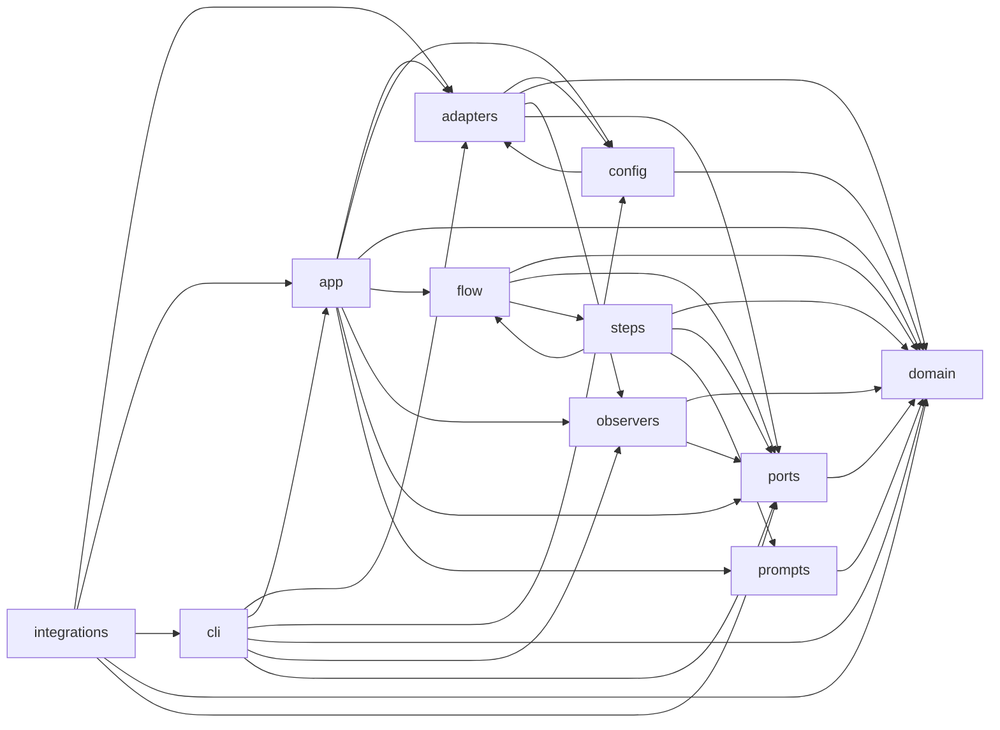
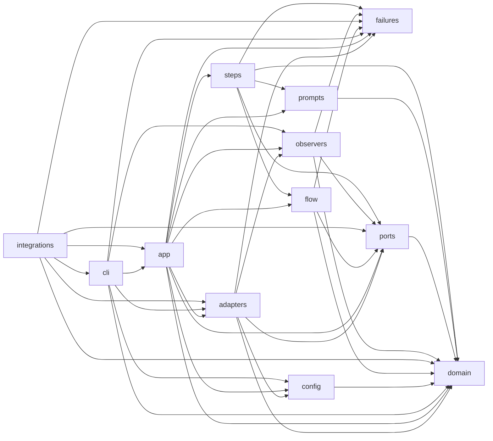

# Workflow ownership and dependency baseline

`src/app/run-flow.ts` owns concrete workflow assembly: step selection, ordered guards,
transitions, halts, resume points, and terminal outcomes. `src/app/run-jig.ts` supplies
that workflow to the engine. `src/flow/define-flow.ts` owns generic flow contracts;
`src/flow/engine.ts` interprets supplied flows. Production `flow` imports neither
`app` nor `steps`. Steps implement the contracts in `flow`; they do not select the
whole workflow. The behavioral workflow spec lives beside the assembly in `app`.

The [interactive map](architecture.html) depicts execution sequence, including an engine
calling supplied steps. Such a runtime call is not a source dependency from `flow` to
`steps`. The source direction after this move is `app → steps → flow`, with `app → flow`
as well. Configuration ownership is unchanged in this slice.

## Prerequisite

Invocation status already belongs to `src/domain/invocation-status.ts`, including
`INVOCATION_STATUSES`, `InvocationStatus`, and `outcomeIsComplete`. The engine imports
the domain type; local-store run artifacts and GitHub orchestration also import this
module directly. They need no engine or app import to classify completion. Both
`done` and `completed` count as complete; `stuck`, `halted`, and `blocked` do not.

## Before the assembly move

This baseline was captured before moving any source files, at commit `8f7c1a142d14644817c6ccf73cbb9b9baa452f8a`.
It deliberately retains the observed cycles rather than presenting the intended
architecture as though it were already enforced.

From the repository root, dependency-cruiser 18.7.2 was run with:

```sh
npx depcruise src --no-config --ts-config tsconfig.json --ts-pre-compilation-deps --include-only '^src/' --exclude '\.spec\.ts$' --output-type json
```

The explicit pre-compilation option includes type imports. The inventory below
contains every production `src/` file (125 files), grouped by top-level owner;
specs are excluded. Each file lists all its resolved internal source dependencies,
including same-owner imports. External packages and Node built-ins are omitted.
Repeated imports of the same file are collapsed. This adjacency list captures the
file graph; the following diagram collapses it by owner.



### Observed cycles and other ownership concerns

- `flow ↔ steps`: `flow/run-flow.ts` imports six concrete step modules, which import
  the contracts in `flow/define-flow.ts`. This slice removes the six `flow → steps`
  edges by moving assembly to `app`. It preserves the reverse contract dependencies.
- `config ↔ adapters`: `config/load-config.ts → adapters/sandcastle/agents.ts` and
  `config/presets.ts → adapters/local-store/run-paths.ts`. Reverse dependencies come
  from `adapters/sandcastle/open-session.ts` (environment and load-config),
  `adapters/telemetry/open-telemetry.ts` (environment), and
  `adapters/terminal/ask-for-preset.ts` (presets). These remain for the configuration slice.
- `adapters → observers`: both `adapters/local-store/metrics-log.ts` and
  `adapters/local-store/run-artefacts.ts` import `observers/metrics.ts`. These are
  additional inward ownership concerns, including type dependencies, for final enforcement.
- `cli → adapters`, `cli → config`, and `cli → observers` bypass application wiring.
  The complete file edges below retain these additional boundary concerns for review;
  this slice does not silently grant exemptions or change enforcement settings.
- Configuration also performs filesystem I/O in `load-config.ts`, `presets.ts`, and
  `write-config.ts`; owner-only source graphs do not show Node built-in dependencies.
  Domain has no imports of other source owners. Ports depend only on domain;
  prompts depend only on domain; no core owner imports `integrations`.

## Production file inventory and baseline graph

Paths below are relative to `src/`. An empty dependency list means no internal source imports.
The inventory intentionally uses the pre-move paths; only `flow/run-flow.ts` moves to
`app/run-flow.ts` in this slice. The production file count stays the same.

### adapters (37 files)

- `adapters/find-symlink.ts` → `domain/errors.ts`
- `adapters/git/branch.ts` → `adapters/git/repository.ts`, `domain/errors.ts`
- `adapters/git/git-workspace.ts` → `adapters/git/merge.ts`, `adapters/git/repository.ts`, `domain/errors.ts`, `domain/protected-paths.ts`, `domain/run-id.ts`, `domain/run-state.ts`, `domain/usage.ts`, `domain/work-facts.ts`, `ports/sandbox-git.ts`, `ports/workspace.ts`
- `adapters/git/merge.ts` → `adapters/git/branch.ts`, `adapters/git/repository.ts`, `domain/errors.ts`
- `adapters/git/remote-ref.ts` → `domain/errors.ts`, `domain/retry.ts`
- `adapters/git/repository.ts` → `domain/errors.ts`
- `adapters/git/run-code.ts` → `adapters/git/remote-ref.ts`, `adapters/git/repository.ts`, `adapters/git/run-history.ts`, `domain/errors.ts`, `domain/run-id.ts`, `domain/run-state.ts`, `ports/run-code.ts`
- `adapters/git/run-history.ts` → `domain/errors.ts`
- `adapters/git/throwaway-branch.ts` → `adapters/git/branch.ts`, `adapters/git/repository.ts`, `domain/errors.ts`
- `adapters/local-store/credentials-file.ts` → `adapters/find-symlink.ts`, `adapters/local-store/local-state.ts`, `adapters/local-store/run-paths.ts`, `domain/errors.ts`
- `adapters/local-store/local-run-store.ts` → `adapters/local-store/local-state.ts`, `adapters/local-store/run-paths.ts`, `domain/errors.ts`, `domain/run-id.ts`, `domain/run-state.ts`, `ports/run-store.ts`
- `adapters/local-store/local-state.ts` → `domain/errors.ts`
- `adapters/local-store/metrics-log.ts` → `adapters/local-store/run-paths.ts`, `domain/agent-role.ts`, `domain/errors.ts`, `domain/events.ts`, `domain/outcome.ts`, `domain/run-id.ts`, `observers/metrics.ts`
- `adapters/local-store/run-artefacts.ts` → `adapters/local-store/local-state.ts`, `adapters/local-store/run-paths.ts`, `domain/design-review-report.ts`, `domain/errors.ts`, `domain/invocation-status.ts`, `domain/run-id.ts`, `domain/run-state.ts`, `observers/metrics.ts`
- `adapters/local-store/run-lock.ts` → `adapters/local-store/local-state.ts`, `adapters/local-store/run-paths.ts`, `domain/errors.ts`, `domain/run-id.ts`
- `adapters/local-store/run-paths.ts` → `adapters/find-symlink.ts`, `domain/run-id.ts`
- `adapters/logging/create-logger.ts` → none
- `adapters/run-store/composite-run-store.ts` → `domain/errors.ts`, `domain/run-id.ts`, `domain/run-state.ts`, `ports/run-code.ts`, `ports/run-store.ts`
- `adapters/run-store/git-remote-run-store.ts` → `adapters/git/remote-ref.ts`, `adapters/git/repository.ts`, `domain/errors.ts`, `domain/run-id.ts`, `domain/run-state.ts`, `ports/run-store.ts`
- `adapters/sandbox-image/docker-images.ts` → `domain/errors.ts`, `ports/sandbox-images.ts`
- `adapters/sandbox-image/image-recipe.ts` → `domain/errors.ts`
- `adapters/sandbox-image/latest-agent-versions.ts` → none
- `adapters/sandcastle/agents.ts` → `adapters/local-store/credentials-file.ts`, `adapters/sandcastle/codex-auth.ts`, `domain/errors.ts`
- `adapters/sandcastle/codex-auth.ts` → `domain/errors.ts`
- `adapters/sandcastle/git-hooks.ts` → none
- `adapters/sandcastle/open-session.ts` → `adapters/local-store/run-paths.ts`, `adapters/sandcastle/agents.ts`, `adapters/sandcastle/sandcastle-env.ts`, `adapters/sandcastle/sandcastle-session.ts`, `adapters/telemetry/open-telemetry.ts`, `config/environment.ts`, `config/load-config.ts`, `domain/agent-role.ts`, `domain/errors.ts`, `domain/run-state.ts`, `ports/observability.ts`
- `adapters/sandcastle/private-clone-docker.ts` → `adapters/git/repository.ts`, `domain/errors.ts`
- `adapters/sandcastle/sandcastle-env.ts` → none
- `adapters/sandcastle/sandcastle-session.ts` → `adapters/find-symlink.ts`, `adapters/sandcastle/codex-auth.ts`, `adapters/sandcastle/git-hooks.ts`, `adapters/sandcastle/private-clone-docker.ts`, `adapters/sandcastle/structured-output.ts`, `adapters/sandcastle/usage.ts`, `domain/errors.ts`, `domain/run-id.ts`, `domain/run-state.ts`, `ports/agent-session.ts`, `ports/observability.ts`, `ports/sandbox-git.ts`
- `adapters/sandcastle/structured-output.ts` → `domain/errors.ts`
- `adapters/sandcastle/usage.ts` → `domain/usage.ts`
- `adapters/telemetry/open-telemetry.ts` → `config/environment.ts`
- `adapters/terminal/ask-for-agents.ts` → `adapters/sandcastle/agents.ts`, `adapters/terminal/terminal.ts`, `domain/agent-role.ts`
- `adapters/terminal/ask-for-credential.ts` → `adapters/local-store/credentials-file.ts`, `adapters/sandcastle/agents.ts`, `adapters/terminal/terminal.ts`
- `adapters/terminal/ask-for-preset.ts` → `adapters/terminal/terminal.ts`, `config/presets.ts`
- `adapters/terminal/standard-input.ts` → none
- `adapters/terminal/terminal.ts` → `domain/errors.ts`

### app (9 files)

- `app/container.ts` → `adapters/git/git-workspace.ts`, `adapters/local-store/metrics-log.ts`, `adapters/local-store/run-artefacts.ts`, `adapters/local-store/run-paths.ts`, `adapters/logging/create-logger.ts`, `adapters/sandbox-image/docker-images.ts`, `adapters/sandbox-image/latest-agent-versions.ts`, `adapters/sandcastle/agents.ts`, `adapters/sandcastle/open-session.ts`, `adapters/sandcastle/sandcastle-session.ts`, `adapters/terminal/ask-for-agents.ts`, `adapters/terminal/ask-for-credential.ts`, `app/observed-events.ts`, `app/report-cleanup.ts`, `app/sandbox-image.ts`, `config/environment.ts`, `config/load-config.ts`, `domain/agent-role.ts`, `domain/retry.ts`, `domain/run-state.ts`, `domain/settings.ts`, `flow/engine.ts`, `observers/logging-observer.ts`, `observers/metrics.ts`, `observers/run-events.ts`, `observers/tracing-observer.ts`, `ports/agent-session.ts`, `ports/observability.ts`, `ports/run-store.ts`, `ports/sandbox-git.ts`, `ports/sandbox-images.ts`, `ports/workspace.ts`
- `app/init-sandbox.ts` → `adapters/find-symlink.ts`, `adapters/local-store/credentials-file.ts`, `adapters/sandbox-image/image-recipe.ts`, `adapters/sandcastle/agents.ts`, `adapters/sandcastle/sandcastle-session.ts`, `app/container.ts`, `app/sandbox-image.ts`, `app/throwaway-sandbox.ts`, `config/environment.ts`, `config/load-config.ts`, `config/write-config.ts`, `domain/errors.ts`, `prompts/toolchain.ts`
- `app/observed-events.ts` → `domain/events.ts`, `observers/run-events.ts`
- `app/report-cleanup.ts` → none
- `app/run-jig.ts` → `adapters/git/branch.ts`, `adapters/git/run-history.ts`, `adapters/local-store/metrics-log.ts`, `adapters/local-store/run-lock.ts`, `adapters/sandcastle/open-session.ts`, `adapters/telemetry/open-telemetry.ts`, `app/container.ts`, `app/run-stores.ts`, `app/sandbox-image.ts`, `config/load-config.ts`, `domain/errors.ts`, `domain/run-id.ts`, `domain/run-state.ts`, `flow/define-flow.ts`, `flow/engine.ts`, `flow/run-flow.ts`, `ports/run-store.ts`
- `app/run-status.ts` → `adapters/local-store/metrics-log.ts`, `adapters/local-store/run-artefacts.ts`, `app/container.ts`, `app/run-stores.ts`, `domain/errors.ts`, `domain/run-id.ts`, `domain/run-state.ts`, `observers/metrics.ts`
- `app/run-stores.ts` → `adapters/git/run-code.ts`, `adapters/local-store/local-run-store.ts`, `adapters/run-store/composite-run-store.ts`, `adapters/run-store/git-remote-run-store.ts`, `app/container.ts`, `domain/errors.ts`, `domain/run-id.ts`, `domain/run-state.ts`, `ports/run-store.ts`
- `app/sandbox-image.ts` → `adapters/sandbox-image/image-recipe.ts`, `adapters/sandcastle/agents.ts`, `config/load-config.ts`, `domain/errors.ts`, `ports/sandbox-images.ts`
- `app/throwaway-sandbox.ts` → `adapters/git/branch.ts`, `adapters/git/throwaway-branch.ts`, `adapters/sandcastle/sandcastle-session.ts`, `app/container.ts`, `app/observed-events.ts`, `app/report-cleanup.ts`, `domain/errors.ts`, `domain/run-id.ts`, `domain/run-state.ts`, `observers/logging-observer.ts`

### cli (13 files)

- `cli/app-action.ts` → `app/container.ts`, `cli/with-app.ts`, `cli/with-error-handling.ts`, `cli/with-input.ts`, `domain/errors.ts`
- `cli/commands/presets.ts` → `adapters/logging/create-logger.ts`, `cli/with-app.ts`, `cli/with-error-handling.ts`, `config/presets.ts`
- `cli/commands/run.ts` → `app/run-jig.ts`, `cli/app-action.ts`, `cli/config-option.ts`, `cli/log-format-option.ts`, `cli/read-request.ts`, `cli/with-app.ts`, `domain/errors.ts`, `domain/run-id.ts`, `domain/run-state.ts`
- `cli/commands/sandbox.ts` → `app/init-sandbox.ts`, `app/sandbox-image.ts`, `cli/app-action.ts`, `cli/config-option.ts`, `cli/log-format-option.ts`
- `cli/commands/status.ts` → `adapters/logging/create-logger.ts`, `app/run-status.ts`, `cli/config-option.ts`, `cli/with-app.ts`, `cli/with-error-handling.ts`, `cli/with-input.ts`, `domain/run-id.ts`, `domain/run-state.ts`, `domain/slice.ts`, `observers/metrics.ts`
- `cli/config-option.ts` → `config/presets.ts`
- `cli/exit-when-done.ts` → none
- `cli/log-format-option.ts` → `adapters/logging/create-logger.ts`
- `cli/main.ts` → `cli/commands/presets.ts`, `cli/commands/run.ts`, `cli/commands/sandbox.ts`, `cli/commands/status.ts`
- `cli/read-request.ts` → `adapters/terminal/standard-input.ts`, `app/run-jig.ts`, `domain/errors.ts`
- `cli/with-app.ts` → `adapters/git/repository.ts`, `adapters/local-store/credentials-file.ts`, `adapters/logging/create-logger.ts`, `adapters/terminal/ask-for-preset.ts`, `adapters/terminal/standard-input.ts`, `app/container.ts`, `cli/config-option.ts`, `config/environment.ts`, `config/load-config.ts`, `config/presets.ts`, `domain/errors.ts`
- `cli/with-error-handling.ts` → `domain/errors.ts`
- `cli/with-input.ts` → `config/describe-issues.ts`, `domain/errors.ts`

### config (5 files)

- `config/describe-issues.ts` → none
- `config/environment.ts` → `config/describe-issues.ts`, `domain/errors.ts`
- `config/load-config.ts` → `adapters/sandcastle/agents.ts`, `config/describe-issues.ts`, `domain/agent-role.ts`, `domain/errors.ts`, `domain/settings.ts`
- `config/presets.ts` → `adapters/local-store/run-paths.ts`, `config/describe-issues.ts`, `config/environment.ts`, `config/load-config.ts`, `domain/agent-role.ts`, `domain/errors.ts`
- `config/write-config.ts` → `config/load-config.ts`, `domain/errors.ts`

### domain (22 files)

- `domain/agent-role.ts` → none
- `domain/apply-outcome.ts` → `domain/completion-reuse.ts`, `domain/design-review.ts`, `domain/diagnostics.ts`, `domain/final-check.ts`, `domain/outcome.ts`, `domain/run-state.ts`, `domain/slice.ts`
- `domain/completion-reuse.ts` → `domain/final-check.ts`, `domain/run-state.ts`, `domain/settings.ts`, `domain/slice.ts`, `domain/work-facts.ts`
- `domain/design-docs.ts` → none
- `domain/design-review-report.ts` → `domain/design-review.ts`, `domain/run-state.ts`
- `domain/design-review.ts` → `domain/design-docs.ts`, `domain/errors.ts`, `domain/run-state.ts`
- `domain/diagnostics.ts` → none
- `domain/errors.ts` → none
- `domain/events.ts` → `domain/agent-role.ts`, `domain/outcome.ts`, `domain/run-id.ts`, `domain/run-state.ts`, `domain/slice.ts`, `domain/usage.ts`
- `domain/final-check.ts` → `domain/diagnostics.ts`, `domain/outcome.ts`, `domain/run-state.ts`, `domain/slice.ts`
- `domain/invocation-status.ts` → none
- `domain/outcome.ts` → `domain/completion-reuse.ts`, `domain/design-docs.ts`, `domain/design-review.ts`, `domain/run-state.ts`, `domain/slice.ts`, `domain/usage.ts`, `domain/work-facts.ts`
- `domain/plan-coverage.ts` → `domain/errors.ts`, `domain/slice.ts`
- `domain/protected-paths.ts` → none
- `domain/retry.ts` → `domain/errors.ts`, `domain/settings.ts`
- `domain/run-diagnostics.ts` → `domain/diagnostics.ts`, `domain/run-state.ts`, `domain/slice.ts`
- `domain/run-id.ts` → none
- `domain/run-state.ts` → `domain/completion-reuse.ts`, `domain/design-docs.ts`, `domain/design-review.ts`, `domain/diagnostics.ts`, `domain/final-check.ts`, `domain/run-id.ts`, `domain/settings.ts`, `domain/slice.ts`
- `domain/settings.ts` → `domain/slice.ts`
- `domain/slice.ts` → `domain/diagnostics.ts`, `domain/work-facts.ts`
- `domain/usage.ts` → none
- `domain/work-facts.ts` → none

### flow (3 files)

- `flow/define-flow.ts` → `domain/errors.ts`, `domain/outcome.ts`, `domain/run-state.ts`, `domain/settings.ts`, `domain/slice.ts`, `ports/agent-session.ts`, `ports/workspace.ts`
- `flow/engine.ts` → `domain/apply-outcome.ts`, `domain/errors.ts`, `domain/events.ts`, `domain/invocation-status.ts`, `domain/outcome.ts`, `domain/retry.ts`, `domain/run-id.ts`, `domain/run-state.ts`, `domain/settings.ts`, `flow/define-flow.ts`, `ports/observability.ts`, `ports/run-store.ts`
- `flow/run-flow.ts` → `domain/design-review.ts`, `domain/final-check.ts`, `domain/run-state.ts`, `domain/settings.ts`, `flow/define-flow.ts`, `steps/completion-reuse.ts`, `steps/design-review.ts`, `steps/final-check.ts`, `steps/finishing.ts`, `steps/planning.ts`, `steps/slice.ts`

### integrations (12 files)

- `integrations/github/cli.ts` → `cli/app-action.ts`, `cli/exit-when-done.ts`, `cli/main.ts`, `integrations/github/command.ts`, `integrations/github/github-port.ts`
- `integrations/github/command.ts` → `cli/app-action.ts`, `cli/config-option.ts`, `cli/log-format-option.ts`, `cli/with-app.ts`, `integrations/github/errors.ts`, `integrations/github/github-port.ts`, `integrations/github/implement-issue.ts`, `integrations/github/octokit-github.ts`, `integrations/github/repository-identity.ts`
- `integrations/github/errors.ts` → none
- `integrations/github/findings-comment.ts` → `domain/diagnostics.ts`, `domain/run-diagnostics.ts`, `domain/run-state.ts`
- `integrations/github/github-port.ts` → `integrations/github/errors.ts`
- `integrations/github/implement-issue.ts` → `adapters/git/branch.ts`, `adapters/git/run-history.ts`, `app/container.ts`, `app/run-jig.ts`, `app/run-stores.ts`, `domain/errors.ts`, `domain/invocation-status.ts`, `domain/run-id.ts`, `domain/run-state.ts`, `integrations/github/errors.ts`, `integrations/github/findings-comment.ts`, `integrations/github/github-port.ts`, `integrations/github/orchestration-state.ts`, `integrations/github/orchestration-store.ts`, `integrations/github/request-snapshot.ts`, `integrations/github/run-branch-publication.ts`, `ports/run-store.ts`
- `integrations/github/octokit-github.ts` → `domain/retry.ts`, `integrations/github/errors.ts`, `integrations/github/github-port.ts`
- `integrations/github/orchestration-state.ts` → `domain/invocation-status.ts`, `domain/run-id.ts`, `integrations/github/github-port.ts`
- `integrations/github/orchestration-store.ts` → `adapters/git/remote-ref.ts`, `app/report-cleanup.ts`, `domain/errors.ts`, `domain/retry.ts`, `integrations/github/errors.ts`, `integrations/github/orchestration-state.ts`
- `integrations/github/repository-identity.ts` → `adapters/git/repository.ts`, `integrations/github/errors.ts`, `integrations/github/github-port.ts`
- `integrations/github/request-snapshot.ts` → `integrations/github/github-port.ts`
- `integrations/github/run-branch-publication.ts` → `adapters/git/remote-ref.ts`, `adapters/git/repository.ts`, `adapters/git/run-history.ts`, `domain/errors.ts`, `domain/run-id.ts`, `domain/run-state.ts`, `integrations/github/errors.ts`

### observers (4 files)

- `observers/logging-observer.ts` → `domain/events.ts`
- `observers/metrics.ts` → `domain/agent-role.ts`, `domain/events.ts`, `domain/outcome.ts`, `domain/run-id.ts`, `domain/usage.ts`, `ports/observability.ts`
- `observers/run-events.ts` → `domain/errors.ts`, `domain/events.ts`, `ports/observability.ts`
- `observers/tracing-observer.ts` → `domain/events.ts`

### ports (7 files)

- `ports/agent-session.ts` → `domain/agent-role.ts`, `domain/errors.ts`
- `ports/observability.ts` → `domain/events.ts`
- `ports/run-code.ts` → `domain/errors.ts`, `domain/run-id.ts`
- `ports/run-store.ts` → `domain/errors.ts`, `domain/run-id.ts`, `domain/run-state.ts`
- `ports/sandbox-git.ts` → `domain/errors.ts`, `ports/agent-session.ts`
- `ports/sandbox-images.ts` → `domain/errors.ts`
- `ports/workspace.ts` → `domain/errors.ts`, `domain/protected-paths.ts`, `domain/usage.ts`, `domain/work-facts.ts`

### prompts (6 files)

- `prompts/design-review.ts` → `domain/design-docs.ts`, `domain/design-review.ts`, `domain/run-state.ts`
- `prompts/final-check.ts` → `domain/final-check.ts`
- `prompts/planning.ts` → `domain/run-state.ts`
- `prompts/pull-request.ts` → `domain/completion-reuse.ts`, `domain/final-check.ts`, `domain/run-state.ts`, `domain/slice.ts`
- `prompts/slice.ts` → `domain/protected-paths.ts`, `domain/slice.ts`
- `prompts/toolchain.ts` → none

### steps (7 files)

- `steps/completion-reuse.ts` → `domain/completion-reuse.ts`, `domain/errors.ts`, `domain/outcome.ts`, `flow/define-flow.ts`
- `steps/design-review.ts` → `domain/design-review.ts`, `domain/run-state.ts`, `flow/define-flow.ts`, `prompts/design-review.ts`
- `steps/final-check.ts` → `domain/final-check.ts`, `domain/outcome.ts`, `flow/define-flow.ts`, `ports/agent-session.ts`, `prompts/final-check.ts`
- `steps/finishing.ts` → `domain/completion-reuse.ts`, `domain/outcome.ts`, `domain/run-state.ts`, `domain/slice.ts`, `flow/define-flow.ts`, `prompts/pull-request.ts`, `steps/completion-reuse.ts`, `steps/pull-request-description.ts`
- `steps/planning.ts` → `domain/design-docs.ts`, `domain/errors.ts`, `domain/outcome.ts`, `domain/plan-coverage.ts`, `domain/retry.ts`, `domain/run-state.ts`, `domain/slice.ts`, `flow/define-flow.ts`, `prompts/planning.ts`
- `steps/pull-request-description.ts` → `domain/completion-reuse.ts`, `domain/final-check.ts`, `domain/run-state.ts`, `domain/settings.ts`, `domain/slice.ts`
- `steps/slice.ts` → `domain/completion-reuse.ts`, `domain/errors.ts`, `domain/final-check.ts`, `domain/outcome.ts`, `domain/protected-paths.ts`, `domain/run-state.ts`, `domain/slice.ts`, `flow/define-flow.ts`, `prompts/slice.ts`

## Current ownership graph

The complete production graph was recomputed with the dependency-cruiser command above,
including type imports: 139 source files. The aggregate graph is acyclic.
Configuration imports only domain; adapters consume configuration policy.
Provider construction, credential checks, authentication and filesystem operations
remain with their existing owners.

Dependency-first topological order: `domain`, `failures`, `ports`, `config`, `observers`, `adapters`, `flow`, `prompts`, `steps`, `app`, `cli`, `integrations`.



### Shared failure helpers

`src/failures/messages.ts` owns `messageOf` and `rootCause`, and `src/failures/retry.ts` owns
`retryResult` and `RetryPolicy`. Callers import them directly from those modules; they are not
ports and are not injected, and no other module declares or re-exports them. Domain keeps its
business failures, `FailureKind` and `isTransient` in `src/domain/errors.ts`; `isTransient` accepts
any `{ kind: FailureKind }`. Every other failure class lives with its owner, listed under
[Failure classes](#failure-classes). Flow owns assembling the step retry policy:
`transientRetryPolicy` in `src/flow/retry-policy.ts` returns `RetryPolicy<{ kind: FailureKind }>`
from the resolved `maxStepRetries` and `retryDelayMs` and `isTransient`, leaving
`onFailedAttempt` to each caller. `flow/engine.ts` and `app/container.ts` import it directly; it
is not a port or an injected dependency. The engine still decides what a failure's kind means for
the run.

The baseline inventory above is the snapshot from before the assembly move. Since then, these
production imports replace the baseline's `domain/errors.ts` and `domain/retry.ts` references for
the shared helpers and the retry policy:

- `failures/messages.ts` ← every adapter that reports a thrown cause (`filesystem/config-source.ts`,
  `filesystem/preset-source.ts`, `find-symlink.ts`, `git/git-workspace.ts`, `git/merge.ts`,
  `git/repository.ts`, `git/run-history.ts`, `local-store/credentials-file.ts`,
  `local-store/local-run-store.ts`, `local-store/local-state.ts`, `local-store/run-lock.ts`,
  `run-store/git-remote-run-store.ts`, `sandbox-image/docker-images.ts`,
  `sandcastle/codex-auth.ts`, `sandcastle/private-clone-docker.ts`,
  `sandcastle/sandcastle-session.ts`, `sandcastle/structured-output.ts`, `terminal/terminal.ts`),
  `app/init-sandbox.ts`, `app/run-stores.ts`, `app/sandbox-image.ts`, `cli/read-request.ts`,
  `cli/with-error-handling.ts`, `flow/engine.ts`, `integrations/github/orchestration-store.ts` and
  `observers/run-events.ts`.
- `failures/retry.ts` ← `adapters/git/remote-ref.ts`, `app/container.ts`, `flow/engine.ts`,
  `flow/retry-policy.ts`, `integrations/github/octokit-github.ts`,
  `integrations/github/orchestration-store.ts` and `steps/planning.ts`.
- `flow/retry-policy.ts` → `domain/errors.ts`, `domain/settings.ts`, `failures/retry.ts`; it
  replaces `domain/retry.ts`, which no longer exists. `app/container.ts` and `flow/engine.ts`
  import it.

Dependency-cruiser's `failures-imports-only-better-result-and-node` rule allows production
`failures` to import only itself, `better-result` and Node built-ins, and
`failures-is-imported-only-by-listed-owners` lets only adapters, app, cli, flow, integrations,
observers and steps import it; domain, ports, config and prompts cannot. `integrations` stands in
for the planned composition owner until that slice moves executable wiring out of it.

`failures` is a one-off owner, not a home for shared utilities. A new helper belongs with the rule
it expresses: a business rule in domain, a capability contract in its port, a configuration policy
in config. Moving composition out of `app` and `integrations` and separating the GitHub
integration are separate slices.

## Failure ownership audit

This audit records where each failure class moved and the evidence for its owner. Locations are as
of the ownership move. Every class keeps its literal `kind`, its fields and every message text;
`_tag` equals the class name for every class. `JigError`, `isJigError` and the `jigErrorClasses`
registry are gone; nothing replaces them with another union of every class.

### Retry policy ownership

| Responsibility                            | Old location                                                       | New location                                                                                  |
| ----------------------------------------- | ------------------------------------------------------------------ | --------------------------------------------------------------------------------------------- |
| Default count and first delay             | `config/load-config.ts:147`, `:150`                                | unchanged                                                                                     |
| Resolved `maxStepRetries`, `retryDelayMs` | `domain/settings.ts`, from `config/load-config.ts:138-139`         | unchanged                                                                                     |
| Retryable kind (`isTransient`)            | `domain/errors.ts:33`, over `JigError`                             | `domain/errors.ts:10`, over `{ kind: FailureKind }`                                           |
| Step policy assembly                      | `domain/retry.ts` (`transientRetryPolicy`, `TransientRetryPolicy`) | `flow/retry-policy.ts` (`transientRetryPolicy`, returns `RetryPolicy<{ kind: FailureKind }>`) |
| Policy shape and retry loop               | `failures/retry.ts` (`RetryPolicy`, `retryResult`)                 | unchanged                                                                                     |
| Step retry decision and events            | `flow/engine.ts:214-229`                                           | `flow/engine.ts:214-235`, over `StepFailure`                                                  |
| Sandbox start retry                       | `app/container.ts:252-256`                                         | unchanged, imports `flow/retry-policy.ts`                                                     |

Local policies that do not use the step settings stay with their callers: `adapters/git/remote-ref.ts:58`
(`RemoteUnavailable`), `steps/planning.ts:56-62` (one `PlanNotCovered` correction),
`integrations/github/octokit-github.ts:62` (`GithubUnavailable`) and
`integrations/github/orchestration-store.ts:134` (`RunStateConflict`).

### Failure classes

Old definitions are lines of `src/domain/errors.ts` before the move. Constructors are every
`new <Class>(` in production files under `src/`. A capability failure that several port contracts
return lives once in a shared port module: `ports/git-failures.ts` (Git), `ports/run-state-failures.ts`
(saved runs, their code, lock and metrics log) and `ports/local-state.ts` (jig's own files on this
machine). Each module defines its own classes and re-exports nothing; there are no barrels.

| Class                  | Old definition         | New owner and definition                                   | Kind  | Fields beyond `message` | Constructed at                                                                                                                                                                                                                     | Read through                                                                                                                                             |
| ---------------------- | ---------------------- | ---------------------------------------------------------- | ----- | ----------------------- | ---------------------------------------------------------------------------------------------------------------------------------------------------------------------------------------------------------------------------------- | -------------------------------------------------------------------------------------------------------------------------------------------------------- |
| `AgentRunFailed`       | `domain/errors.ts:41`  | agent session port (`ports/agent-session.ts:32`)           | retry |                         | `adapters/sandcastle/sandcastle-session.ts:180`                                                                                                                                                                                    | `AgentSession.run`, `runForOutput`; engine retry                                                                                                         |
| `AgentOutputInvalid`   | `domain/errors.ts:46`  | agent session port (`ports/agent-session.ts:37`)           | retry |                         | `adapters/sandcastle/structured-output.ts:37`, `steps/planning.ts:65`, `:98`                                                                                                                                                       | `AgentSession.runForOutput`; `AgentOutputInvalid.is` at `steps/slice.ts:82`; engine retry                                                                |
| `PlanNotCovered`       | `domain/errors.ts:54`  | domain (`domain/errors.ts:18`)                             | retry |                         | `domain/plan-coverage.ts:24`                                                                                                                                                                                                       | `instanceof` at `steps/planning.ts:59`, `:61`, re-raised as `AgentOutputInvalid` at `:65`                                                                |
| `DesignUnresolved`     | `domain/errors.ts:62`  | domain (`domain/errors.ts:26`)                             | block | `findingIds`            | `domain/design-review.ts:240`                                                                                                                                                                                                      | `StepFailure`; engine block                                                                                                                              |
| `RemoteUnavailable`    | `domain/errors.ts:70`  | shared Git module (`ports/git-failures.ts:4`)              | retry |                         | `adapters/git/merge.ts:85`, `adapters/git/remote-ref.ts:50`                                                                                                                                                                        | `_tag` at `adapters/git/remote-ref.ts:58`; `Workspace.isRunBranchMerged`, `RunStoreFailure`, `RunCodeRestoreFailure`                                     |
| `SandboxUnavailable`   | `domain/errors.ts:78`  | agent session port (`ports/agent-session.ts:45`)           | retry |                         | `adapters/sandcastle/sandcastle-session.ts:320`, `:377`, `:419`, `:476`                                                                                                                                                            | `AgentSession.exec`, `SandboxGit.execGit`, `SaveWorkFailure`, `SessionOpenFailure`, `SessionCloseFailure`; sandbox start retry at `app/container.ts:253` |
| `SetupCommandFailed`   | `domain/errors.ts:87`  | agent session port (`ports/agent-session.ts:54`)           | retry | `output`                | `adapters/sandcastle/sandcastle-session.ts:397`, `:404`                                                                                                                                                                            | `SessionOpenFailure`; `instanceof` at `app/init-sandbox.ts:228`                                                                                          |
| `RunStateConflict`     | `domain/errors.ts:95`  | shared run-state module (`ports/run-state-failures.ts:4`)  | block |                         | `adapters/git/remote-ref.ts:47`, `adapters/git/run-code.ts:37`, `adapters/run-store/composite-run-store.ts:104`, `adapters/run-store/git-remote-run-store.ts:98`                                                                   | `_tag` at `integrations/github/orchestration-store.ts:134`, `:137`; `RunStoreFailure`, `RunCodeRestoreFailure`                                           |
| `RunCodeUnavailable`   | `domain/errors.ts:103` | shared run-state module (`ports/run-state-failures.ts:12`) | block |                         | `adapters/git/run-code.ts:59`, `adapters/run-store/composite-run-store.ts:137`                                                                                                                                                     | `RunStoreFailure`, `RunCodeRestoreFailure`                                                                                                               |
| `MergeFailed`          | `domain/errors.ts:107` | workspace port (`ports/workspace.ts:50`)                   | block |                         | `adapters/git/git-workspace.ts:280`, `:297`, `:301`, `:310`, `:318`, `adapters/git/merge.ts:108`, `:115`, `:122`, `:136`                                                                                                           | `Workspace.mergeRunBranch`; `adapters/git/merge.ts:136` turns a `RepositoryInvalid` from `getCurrentBranch` into `MergeFailed` with its message          |
| `GitCommandFailed`     | `domain/errors.ts:115` | shared Git module (`ports/git-failures.ts:12`)             | block | `command`, `output`     | `adapters/git/git-workspace.ts:91`, `adapters/git/merge.ts:63`, `adapters/git/remote-ref.ts:87`, `adapters/git/repository.ts:34`, `:71`, `adapters/git/run-history.ts:29`, `adapters/sandcastle/private-clone-docker.ts:293`       | `GitCommandFailed.is` at `adapters/git/merge.ts:136`; workspace, sandbox Git, run store and run code contracts                                           |
| `CommitImportRefused`  | `domain/errors.ts:124` | workspace port (`ports/workspace.ts:55`)                   | block |                         | `adapters/git/git-workspace.ts:111`, `:118`                                                                                                                                                                                        | `SaveWorkFailure`                                                                                                                                        |
| `CommitRejected`       | `domain/errors.ts:129` | workspace port (`ports/workspace.ts:60`)                   | block | `output`                | `adapters/git/git-workspace.ts:75`                                                                                                                                                                                                 | `SaveWorkFailure`; `CommitRejected.is` at `steps/slice.ts:53`                                                                                            |
| `ConfigInvalid`        | `domain/errors.ts:136` | config (`config/errors.ts:4`)                              | fatal |                         | `adapters/sandcastle/agents.ts:76`, `:87`, `cli/with-app.ts:136`, `config/environment.ts:40`, `config/load-config.ts:29`, `:43`, `:52`, `:103`, `config/presets.ts:47`, `:102`, `:146`, `config/update-config.ts:19`, `:29`, `:43` | `loadConfig`, `discoverPresets`, `loadPreset`, `updateConfig`, `configuredSteps`, agent model choice; `SessionOpenFailure`, `AppOpenFailure`             |
| `RunRequestInvalid`    | `domain/errors.ts:140` | app use cases (`app/errors.ts:4`)                          | fatal |                         | `app/run-jig.ts:140`, `:146`, `app/run-status.ts:37`, `cli/read-request.ts:30`, `:42`, `:51`, `:60`                                                                                                                                | `RunJigFailure`, `RunStatusFailure`; the CLI request reads                                                                                               |
| `RunInProgress`        | `domain/errors.ts:145` | shared run-state module (`ports/run-state-failures.ts:22`) | fatal |                         | `adapters/local-store/run-lock.ts:45`                                                                                                                                                                                              | `lockRun`; `RunJigFailure`                                                                                                                               |
| `MetricsLogCorrupt`    | `domain/errors.ts:150` | shared run-state module (`ports/run-state-failures.ts:27`) | fatal |                         | `adapters/local-store/metrics-log.ts:70`                                                                                                                                                                                           | `MetricsLog.summary`; `RunJigFailure`, `RunStatusFailure`                                                                                                |
| `LocalStateUnwritable` | `domain/errors.ts:158` | shared local-state module (`ports/local-state.ts:7`)       | fatal | `path`                  | `adapters/git/git-workspace.ts:332`, `adapters/local-store/local-state.ts:14`, `adapters/local-store/run-lock.ts:27`, `:48`                                                                                                        | `SaveWorkFailure`, `RunStoreFailure`, `lockRun`; the one fatal `StepFailure`                                                                             |
| `CodexLoginNotSaved`   | `domain/errors.ts:169` | agent session port (`ports/agent-session.ts:82`)           | fatal |                         | `adapters/sandcastle/codex-auth.ts:150`, `:167`, `:173`, `:209`, `:224`, `:229`, `:237`                                                                                                                                            | `SessionCloseFailure`                                                                                                                                    |
| `ImageBuildFailed`     | `domain/errors.ts:174` | sandbox images port (`ports/sandbox-images.ts:20`)         | fatal | `output`                | `adapters/sandbox-image/docker-images.ts:58`, `:71`, `:85`, `:94`                                                                                                                                                                  | `SandboxImages.labels`, `build`; `ensureSandboxImage`                                                                                                    |
| `CommandInputInvalid`  | `domain/errors.ts:182` | CLI (`cli/with-input.ts:35`)                               | fatal |                         | `cli/with-input.ts:20`                                                                                                                                                                                                             | `withInput`                                                                                                                                              |

`isTransient` (`domain/errors.ts:10`) and `FailureKind` (`:7`) stay in domain; the removed
`isJigError` had no production caller. The GitHub integration's classes in
`integrations/github/errors.ts` stay where they are and carry no `kind`.

#### `ConfigInvalid` split by meaning

`ConfigInvalid` carried seven meanings. Only configuration validation keeps the class and the
`ConfigInvalid` tag, now in `config/errors.ts`; its constructors are listed above. Each other
meaning is its own class, `_tag` equal to the class name, kind `fatal` and the same message text, so
the engine (`flow/engine.ts:233`), the sandbox start retry (`app/container.ts:253`, through
`isTransient`) and the CLI (`cli/with-error-handling.ts`, message only, exit 1) decide and print
exactly as before. Saved run state did not move to config, because `RunStoreFailure` would then
make ports depend on config; `ports/run-store.ts` now names `RunStateInvalid` and
`RunStoreOperationFailed` instead.

| New class and tag           | Meaning                                                                                                                        | Constructed at                                                                                                                                                                                         | Reaches callers through                                                                                                                                                          |
| --------------------------- | ------------------------------------------------------------------------------------------------------------------------------ | ------------------------------------------------------------------------------------------------------------------------------------------------------------------------------------------------------ | -------------------------------------------------------------------------------------------------------------------------------------------------------------------------------- |
| `RunStateInvalid`           | saved run state does not parse                                                                                                 | `adapters/local-store/local-run-store.ts:50`, `adapters/run-store/git-remote-run-store.ts:188`, `app/run-stores.ts:127` (a module store returned a malformed run; was `:120`)                          | `RunStoreFailure` (`ports/run-store.ts:22`)                                                                                                                                      |
| `RunStoreOperationFailed`   | a custom store module threw during `load`, `peek` or `save`                                                                    | `app/run-stores.ts:137` (`ModuleRunStore.call`; was `:87` through `:129`)                                                                                                                              | `RunStoreFailure`                                                                                                                                                                |
| `RunStoreSetupInvalid`      | a configured store module will not load or is not a store                                                                      | `app/run-stores.ts:61`, `:67`, `:74`, `:79` (was `:65`, `:77` and `:87` through `storeNamed`)                                                                                                          | `openRunStore` (`app/run-stores.ts:39`); `RunJigFailure`, `RunStatusFailure`, `codeCheckpointOf` in `integrations/github/implement-issue.ts`                                     |
| `RepositoryInvalid`         | a repository precondition is unmet                                                                                             | `adapters/git/branch.ts:13`, `adapters/git/repository.ts:57`                                                                                                                                           | `getCurrentBranch`, `ensureRepositoryRoot`; `AppOpenFailure`, `RunJigFailure`, `withThrowawaySandbox`, `SandboxCheckFailure`; `merge.ts:136` still re-raises it as `MergeFailed` |
| `SandboxCredentialsInvalid` | agent credentials or the Codex login are missing or unusable                                                                   | `adapters/sandcastle/agents.ts:112`, `:128`, `adapters/sandcastle/codex-auth.ts:39`, `:45`, `:68`, `:77`, `:106`, `:126`                                                                               | `collectCredentials`, `openCodexAuthCache`; `SessionOpenFailure`, `RunJigFailure`, init credential checks                                                                        |
| `SandboxPreparationInvalid` | the sandbox cannot be prepared: repository path, `.sandcastle/.gitignore`, a sandcastle `CwdError`, or the Dockerfile recipe   | `adapters/sandcastle/sandcastle-session.ts:108`, `:287`, `:319` (the provider translation of sandcastle's `CwdError`), `adapters/sandbox-image/image-recipe.ts:67`, `app/sandbox-image.ts:111`, `:119` | `SessionOpenFailure`, `withToolchain`, `readSandboxDockerfile`, `ensureSandboxImage`; `RunJigFailure`                                                                            |
| `LocalPreparationFailed`    | a local file jig prepares with cannot be used: `.jig/.env` read, parse or save refusal, a symbolic link, or a `jig init` write | `adapters/local-store/credentials-file.ts:27`, `:39`, `:70`, `adapters/find-symlink.ts:11`, `:18`, `app/init-sandbox.ts:148`                                                                           | `readCredentialsFile` (`AppOpenFailure`), `saveCredential`, `refuseSymlinks` (also inside `ignoreSandcastleDirectory`, so `SessionOpenFailure`), init writes                     |

### Failure signatures

| Contract                                                   | Location                                                                 | Failures                                                                                                                                                                                                                                                                                                                                                                                                                                                 |
| ---------------------------------------------------------- | ------------------------------------------------------------------------ | -------------------------------------------------------------------------------------------------------------------------------------------------------------------------------------------------------------------------------------------------------------------------------------------------------------------------------------------------------------------------------------------------------------------------------------------------------- |
| `AgentSession.run`, `runForOutput`, `exec`                 | `ports/agent-session.ts:11`, `:12-14`, `:16`                             | `AgentRunFailed`; `AgentRunFailed \| AgentOutputInvalid`; `SandboxUnavailable`                                                                                                                                                                                                                                                                                                                                                                           |
| `AgentSessionFailure`                                      | `ports/agent-session.ts:30`                                              | `AgentRunFailed \| AgentOutputInvalid \| SandboxUnavailable`                                                                                                                                                                                                                                                                                                                                                                                             |
| `SandboxGit.execGit`, `copyOut`                            | `ports/sandbox-git.ts:9`, `:11`                                          | `SandboxUnavailable`; `GitCommandFailed`                                                                                                                                                                                                                                                                                                                                                                                                                 |
| `Workspace` methods                                        | `ports/workspace.ts:16-35`                                               | `SaveWorkFailure`; `GitCommandFailed`; `GitCommandFailed \| SandboxUnavailable`; `MergeFailed`; `GitCommandFailed \| RemoteUnavailable`                                                                                                                                                                                                                                                                                                                  |
| `SaveWorkFailure`, `WorkspaceFailure`                      | `ports/workspace.ts:39`, `:47`                                           | `GitCommandFailed \| CommitImportRefused \| CommitRejected \| SandboxUnavailable \| LocalStateUnwritable`; that plus `MergeFailed \| RemoteUnavailable`                                                                                                                                                                                                                                                                                                  |
| `RunStore.load`, `peek`, `save` → `RunStoreFailure`        | `ports/run-store.ts:16`, `:18`, `:19`, `:22`                             | `RunStateConflict \| RemoteUnavailable \| RunStateInvalid \| RunStoreOperationFailed \| GitCommandFailed \| LocalStateUnwritable \| RunCodeUnavailable`                                                                                                                                                                                                                                                                                                  |
| `RunCode.checkpoint`, `restore` → `RunCodeRestoreFailure`  | `ports/run-code.ts:10`, `:15`, `:18`                                     | `GitCommandFailed`; `GitCommandFailed \| RemoteUnavailable \| RunStateConflict \| RunCodeUnavailable`                                                                                                                                                                                                                                                                                                                                                    |
| `SandboxImages.labels`, `build`                            | `ports/sandbox-images.ts:6`, `:7`                                        | `ImageBuildFailed`                                                                                                                                                                                                                                                                                                                                                                                                                                       |
| `SessionOpenFailure`, `SessionCloseFailure`                | `adapters/sandcastle/sandcastle-session.ts:49`, `:58`                    | `ConfigInvalid \| SandboxCredentialsInvalid \| SandboxPreparationInvalid \| LocalPreparationFailed \| SandboxUnavailable \| SetupCommandFailed`; `SandboxUnavailable \| CodexLoginNotSaved`                                                                                                                                                                                                                                                              |
| `RunSession` open and close                                | `app/container.ts:76`, `:86`, `:189`, `:251`                             | `SessionOpenFailure`; `SessionCloseFailure`                                                                                                                                                                                                                                                                                                                                                                                                              |
| flow step contracts: `StepFailure`, `RunStep`, `SliceStep` | `flow/define-flow.ts:15`, `:44`, `:81`                                   | `AgentSessionFailure \| WorkspaceFailure \| PlanNotCovered \| DesignUnresolved`                                                                                                                                                                                                                                                                                                                                                                          |
| `FatalStepFailure`                                         | `flow/define-flow.ts:12`                                                 | the `fatal` members of `StepFailure`: `LocalStateUnwritable`                                                                                                                                                                                                                                                                                                                                                                                             |
| engine: `runEngine` → `EngineFailure`                      | `flow/engine.ts:46`, `:63`                                               | `FatalStepFailure \| RunStoreFailure`; every `retry` and `block` step failure is consumed as a retry or a block, never returned                                                                                                                                                                                                                                                                                                                          |
| step-local unions                                          | `steps/planning.ts:20`, `steps/completion-reuse.ts:13`, `steps/slice.ts` | the agent, Git and sandbox classes they name                                                                                                                                                                                                                                                                                                                                                                                                             |
| app use cases: `RunJigFailure`, `RunStatusFailure`         | `app/run-jig.ts:54`, `app/run-status.ts:22`                              | lock (`RunInProgress \| LocalStateUnwritable`), `RunStoreSetupInvalid`, start (`RunStoreFailure \| RunRequestInvalid \| RepositoryInvalid \| GitCommandFailed`), advance (`ConfigInvalid \| SandboxCredentialsInvalid \| SandboxPreparationInvalid \| ImageBuildFailed \| SessionOpenFailure \| SessionCloseFailure \| EngineFailure`), `MetricsLogCorrupt`; status: `RunStoreSetupInvalid \| RunStoreFailure \| RunRequestInvalid \| MetricsLogCorrupt` |
| `InitFailure`, `SandboxCheckFailure`                       | `app/init-sandbox.ts:55`, `:59`                                          | `SandboxCheckFailure \| AgentRunFailed \| AgentOutputInvalid \| LocalStateUnwritable`; `LocalPreparationFailed \| ImageBuildFailed \| SessionOpenFailure \| SessionCloseFailure \| GitCommandFailed \| RepositoryInvalid`                                                                                                                                                                                                                                |
| `withThrowawaySandbox`                                     | `app/throwaway-sandbox.ts`                                               | `SessionOpenFailure \| SessionCloseFailure \| GitCommandFailed \| RepositoryInvalid` plus the work's own                                                                                                                                                                                                                                                                                                                                                 |
| CLI: `AppOpenFailure`, `withApp`, `appAction`, `withInput` | `cli/with-app.ts:56`, `cli/app-action.ts`, `cli/with-input.ts`           | `RepositoryInvalid \| ConfigInvalid \| LocalPreparationFailed`; the command's own `E` plus that; `CommandInputInvalid`                                                                                                                                                                                                                                                                                                                                   |
| GitHub integration: `IssueFailure`                         | `integrations/github/implement-issue.ts:63`                              | `RunJigFailure` plus GitHub failures other than `GithubSetupInvalid`; the orchestration store and publication unions name Git, remote and run-state classes                                                                                                                                                                                                                                                                                              |

The assembled workflow is checked in app: `defineRunFlow` and `defineSliceFlow` in
`app/run-flow.ts` type every step against `RunStep` and `SliceStep`, so a step that could return a
failure outside `StepFailure` does not compile. `flow/engine.spec.ts` pins `FatalStepFailure` and
`EngineFailure` as types.

### Where failures are read, shown and stored

| Use   | Location                                                                                                                                                                                                                                                             | What it relies on                                                                                                                 |
| ----- | -------------------------------------------------------------------------------------------------------------------------------------------------------------------------------------------------------------------------------------------------------------------- | --------------------------------------------------------------------------------------------------------------------------------- |
| read  | `flow/engine.ts:222`, `flow/retry-policy.ts`                                                                                                                                                                                                                         | `kind` through `isTransient`                                                                                                      |
| read  | `flow/engine.ts:233-234`                                                                                                                                                                                                                                             | `kind === 'fatal'` returns the error as a `FatalStepFailure`, anything else blocks with its `message`                             |
| read  | `app/container.ts:253`                                                                                                                                                                                                                                               | `kind` of `SessionOpenFailure` through `transientRetryPolicy`                                                                     |
| read  | `adapters/git/remote-ref.ts:58`                                                                                                                                                                                                                                      | `_tag === 'RemoteUnavailable'`                                                                                                    |
| read  | `integrations/github/orchestration-store.ts:134`, `:137`                                                                                                                                                                                                             | `_tag === 'RunStateConflict'`                                                                                                     |
| read  | `steps/planning.ts:59`, `:61`, `:65`                                                                                                                                                                                                                                 | `instanceof PlanNotCovered`, re-raised as `AgentOutputInvalid` with the same message                                              |
| read  | `steps/slice.ts:53`, `:82`                                                                                                                                                                                                                                           | `CommitRejected.is`, `AgentOutputInvalid.is`                                                                                      |
| read  | `adapters/git/merge.ts:136`                                                                                                                                                                                                                                          | `GitCommandFailed.is`; a `RepositoryInvalid` from `getCurrentBranch` becomes `MergeFailed` with its message                       |
| read  | `app/init-sandbox.ts:228`                                                                                                                                                                                                                                            | `instanceof SetupCommandFailed`, its message becomes the check's output                                                           |
| read  | `adapters/sandcastle/sandcastle-session.ts:316-325`                                                                                                                                                                                                                  | sandcastle's own Effect failure `_tag`: `CwdError` becomes `SandboxPreparationInvalid`, the rest `SandboxUnavailable`             |
| show  | `cli/with-error-handling.ts`                                                                                                                                                                                                                                         | `message` only, exit 1                                                                                                            |
| show  | `flow/engine.ts` `stepRetried`, `stepFailed`, `runFailed` → `observers/logging-observer.ts:23`, `:28`, `:63`, `observers/tracing-observer.ts:31`, `:36`                                                                                                              | the failure's `message` as `reason`; no tag or kind                                                                               |
| show  | console `{ err }` fields at `app/report-cleanup.ts:12` (from `app/container.ts:181`, `app/throwaway-sandbox.ts:70`, `integrations/github/orchestration-store.ts:77`), `app/throwaway-sandbox.ts:65`, `adapters/sandcastle/sandcastle-session.ts:264`, `:354`, `:382` | the console logger built by `createConsoleLogger` (`app/container.ts:129`), whose `err` serializer is `serializeError`            |
| show  | `cli/commands/status.ts:42`                                                                                                                                                                                                                                          | the stored `blockedReason` text                                                                                                   |
| store | `run.log`: `{ err }` at `app/container.ts:255` (sandbox start failures) and `app/observed-events.ts:13` (observer failures), through `createRunLogger` (`app/container.ts:196`) into `.jig/<id>/state/run.log`                                                       | `serializeError` writes `type`, `message`, `stack` and own enumerable fields — `_tag`, `name`, `kind` and fields such as `output` |
| store | `run.log`: `stepRetried`, `stepFailed`, `runBlocked` and `runFailed` lines from `observers/logging-observer.ts`                                                                                                                                                      | the failure's `message` as `reason`; no tag or kind                                                                               |
| store | `blockedReason` in run state, written at `flow/engine.ts:321`                                                                                                                                                                                                        | the failure's `message`                                                                                                           |
| store | `adapters/local-store/run-artefacts.ts:26`                                                                                                                                                                                                                           | `blockedReason` in the run's result file                                                                                          |
| store | `observers/metrics.ts:27`, `:86`                                                                                                                                                                                                                                     | a `retry` record in `metrics.jsonl` with the `message` as `reason`                                                                |

Run state, run artefacts and metrics store only the message, so the split changes nothing there.
The logged `err` field is the one surface that shows or stores a tag, class name and kind. Its sole
translation boundary is `serializeError` in `adapters/logging/error-serializer.ts`, installed as
pino's `err` serializer by both `createConsoleLogger` and `createRunLogger`
(`adapters/logging/create-logger.ts`). For a serialized error whose `type` and `_tag` are one of the
seven split tags above it writes `type`, `_tag` and `name` as `ConfigInvalid` and replaces the
class name that heads the stack, keeping the message, kind, other fields and stack frames. It
works on pino's serialized copy, so the runtime error keeps its own tag; it matches tag strings and
imports no class; every other error, `ConfigInvalid` itself included, is serialized by pino
unchanged. `adapters/logging/create-logger.spec.ts` checks both destinations.

### Spec assertions on classes and tags

Every `toBeInstanceOf(<Class>)` and literal `_tag` assertion in `src/**/*.spec.ts` and `tests/`, by
class. A split class's assertions point at the new class; configuration ones stay on
`ConfigInvalid`.

| Class                       | Assertions                                                                                                                                                                                                                                                                                                                                                                                                                                                                                                                                                                                                        |
| --------------------------- | ----------------------------------------------------------------------------------------------------------------------------------------------------------------------------------------------------------------------------------------------------------------------------------------------------------------------------------------------------------------------------------------------------------------------------------------------------------------------------------------------------------------------------------------------------------------------------------------------------------------- |
| `AgentRunFailed`            | `adapters/sandcastle/sandcastle-session.spec.ts:94`                                                                                                                                                                                                                                                                                                                                                                                                                                                                                                                                                               |
| `AgentOutputInvalid`        | `adapters/sandcastle/sandcastle-session.spec.ts:80`, `adapters/sandcastle/structured-output.spec.ts:72`, `steps/design-review.spec.ts:71`, `:72`, `:107`, `steps/final-check.spec.ts:126`, `steps/planning.spec.ts:113`, `:132`, `:156`, `:157`, `:197`, `:216`                                                                                                                                                                                                                                                                                                                                                   |
| `PlanNotCovered`            | `domain/errors.spec.ts:21` (`_tag`), `domain/plan-coverage.spec.ts:67`, `:88`, `:98`, `:108`, `:118`, `:128`, `:193`, `:203`, `:219`, `:229`, `:240`                                                                                                                                                                                                                                                                                                                                                                                                                                                              |
| `DesignUnresolved`          | `domain/design-review.spec.ts:200`, `domain/errors.spec.ts:30` (`_tag`), `steps/design-review.spec.ts:131`                                                                                                                                                                                                                                                                                                                                                                                                                                                                                                        |
| `RemoteUnavailable`         | `adapters/git/merge.spec.ts:175`, `adapters/run-store/git-remote-run-store.spec.ts:192`                                                                                                                                                                                                                                                                                                                                                                                                                                                                                                                           |
| `SandboxUnavailable`        | `adapters/sandcastle/sandcastle-session.spec.ts:173`, `:184`, `:215`, `:225`, `:234`, `:315`, `app/container.spec.ts:36`                                                                                                                                                                                                                                                                                                                                                                                                                                                                                          |
| `SetupCommandFailed`        | `adapters/sandcastle/sandcastle-session.spec.ts:278`, `:293`, `:305`, `:326`, `ports/agent-session.spec.ts:34` (`_tag`)                                                                                                                                                                                                                                                                                                                                                                                                                                                                                           |
| `RunStateConflict`          | `adapters/git/remote-ref.spec.ts:54`, `adapters/git/run-code.spec.ts:81` (`_tag`), `adapters/run-store/composite-run-store.spec.ts:180` (`_tag`), `:199` (`_tag`), `:200` (`_tag`), `:218` (`_tag`), `:219` (`_tag`), `:230` (`_tag`), `adapters/run-store/git-remote-run-store.spec.ts:156`, `:208`                                                                                                                                                                                                                                                                                                              |
| `RunCodeUnavailable`        | `adapters/git/run-code.spec.ts:53` (`_tag`), `adapters/run-store/composite-run-store.spec.ts:275`, `:276`, `:353`, `app/run-stores.spec.ts:256` (`_tag`), `integrations/github/implement-issue.spec.ts:639` (`_tag`)                                                                                                                                                                                                                                                                                                                                                                                              |
| `MergeFailed`               | `adapters/git/git-workspace.spec.ts:281`, `:345`, `:433`, `adapters/git/merge.spec.ts:47`, `:58`, `:71`, `:84`, `steps/finishing.spec.ts:45`, `:78`                                                                                                                                                                                                                                                                                                                                                                                                                                                               |
| `GitCommandFailed`          | `adapters/git/branch.spec.ts:23`, `adapters/git/git-workspace.spec.ts:238`, `:366`, `adapters/git/merge.spec.ts:31`, `:183`, `adapters/git/repository.spec.ts:29`, `:41`, `adapters/git/run-code.spec.ts:119` (`_tag`), `adapters/git/run-history.spec.ts:112` (`_tag`), `:113` (`_tag`), `adapters/run-store/git-remote-run-store.spec.ts:173`, `adapters/sandcastle/private-clone-docker.spec.ts:225`, `:238`, `:248`, `app/run-jig.spec.ts:79`, `app/throwaway-sandbox.spec.ts:34`                                                                                                                             |
| `CommitImportRefused`       | `adapters/git/git-workspace.spec.ts:199`, `:222`                                                                                                                                                                                                                                                                                                                                                                                                                                                                                                                                                                  |
| `CommitRejected`            | `adapters/git/git-workspace.spec.ts:158`, `ports/workspace.spec.ts:22` (`_tag`)                                                                                                                                                                                                                                                                                                                                                                                                                                                                                                                                   |
| `ConfigInvalid`             | `adapters/filesystem/config-source.spec.ts:254`, `adapters/filesystem/preset-source.spec.ts:345`, `adapters/logging/create-logger.spec.ts:84` (`_tag`), `adapters/sandcastle/agents.spec.ts:40`, `:96`, `app/init-sandbox.spec.ts:323`, `app/sandbox-image.spec.ts:60`, `cli/with-app.spec.ts:81`, `:92`, `:103`, `:173`, `:261`, `:276`, `config/environment.spec.ts:139`, `config/errors.spec.ts:10` (`_tag`), `config/load-config.spec.ts:42`, `:121`, `:152`, `config/presets.spec.ts:102`, `:114`, `:145`, `:210`, `:223`, `:243`, `:259`, `:274`, `:290`, `:303`, `:357`, `config/update-config.spec.ts:66` |
| `RunStateInvalid`           | `adapters/local-store/local-run-store.spec.ts:140`, `:174`, `app/run-stores.spec.ts:141`                                                                                                                                                                                                                                                                                                                                                                                                                                                                                                                          |
| `RunStoreOperationFailed`   | `app/run-stores.spec.ts:158`, `:179`, `ports/run-store.spec.ts:10` (`_tag`)                                                                                                                                                                                                                                                                                                                                                                                                                                                                                                                                       |
| `RunStoreSetupInvalid`      | `app/run-stores.spec.ts:197`, `:214`, `:227`                                                                                                                                                                                                                                                                                                                                                                                                                                                                                                                                                                      |
| `RepositoryInvalid`         | `adapters/git/branch.spec.ts:39`, `adapters/git/repository.spec.ts:70`, `cli/with-app.spec.ts:287`                                                                                                                                                                                                                                                                                                                                                                                                                                                                                                                |
| `SandboxCredentialsInvalid` | `adapters/sandcastle/agents.spec.ts:32`, `:87`, `adapters/sandcastle/codex-auth.spec.ts:35`, `:100`, `app/init-sandbox.spec.ts:125`                                                                                                                                                                                                                                                                                                                                                                                                                                                                               |
| `SandboxPreparationInvalid` | `adapters/sandbox-image/image-recipe.spec.ts:48`, `adapters/sandcastle/sandcastle-session.spec.ts:205`, `app/run-jig.spec.ts:246`, `app/sandbox-image.spec.ts:144`                                                                                                                                                                                                                                                                                                                                                                                                                                                |
| `LocalPreparationFailed`    | `adapters/local-store/credentials-file.spec.ts:35`, `:72`, `:86`, `:87`, `adapters/sandcastle/sandcastle-session.spec.ts:197`, `app/init-sandbox.spec.ts:192`, `:207`, `:218`, `:358`, `ports/local-state.spec.ts:18` (`_tag`)                                                                                                                                                                                                                                                                                                                                                                                    |
| `RunRequestInvalid`         | `app/errors.spec.ts:10` (`_tag`), `app/run-jig.spec.ts:258`, `:266`, `:275`, `app/run-status.spec.ts:85`, `cli/read-request.spec.ts:37`, `:46`, `:54`, `:62`, `:75`                                                                                                                                                                                                                                                                                                                                                                                                                                               |
| `RunInProgress`             | `adapters/local-store/run-lock.spec.ts:40`, `app/run-jig.spec.ts:209`                                                                                                                                                                                                                                                                                                                                                                                                                                                                                                                                             |
| `MetricsLogCorrupt`         | `adapters/local-store/metrics-log.spec.ts:86`                                                                                                                                                                                                                                                                                                                                                                                                                                                                                                                                                                     |
| `LocalStateUnwritable`      | `adapters/local-store/run-lock.spec.ts:28`, `app/run-jig.spec.ts:151`, `flow/engine.spec.ts:348`, `ports/local-state.spec.ts:12` (`_tag`)                                                                                                                                                                                                                                                                                                                                                                                                                                                                         |
| `CodexLoginNotSaved`        | `adapters/sandcastle/codex-auth.spec.ts:59`, `:72`, `:88`                                                                                                                                                                                                                                                                                                                                                                                                                                                                                                                                                         |
| `ImageBuildFailed`          | `adapters/sandbox-image/docker-images.spec.ts:31`, `:43`, `app/run-jig.spec.ts:346`, `ports/sandbox-images.spec.ts:12` (`_tag`)                                                                                                                                                                                                                                                                                                                                                                                                                                                                                   |
| `CommandInputInvalid`       | `cli/config-option.spec.ts:40`, `cli/log-format-option.spec.ts:25`, `cli/with-input.spec.ts:36`                                                                                                                                                                                                                                                                                                                                                                                                                                                                                                                   |

Across owners: `integrations/github/failure-ownership.spec.ts` checks that every failure class of
every owner, the GitHub integration's included, has `_tag` equal to its name and that no two share a
name; it lives in the integrations owner because only that owner may import the GitHub classes.
Owner-local specs cover each class's kind and fields: `domain/errors.spec.ts` (`isTransient` on
`retry`, `block` and `fatal`, and the two business failures), `ports/agent-session.spec.ts`,
`ports/git-failures.spec.ts`, `ports/run-state-failures.spec.ts`, `ports/local-state.spec.ts`,
`ports/workspace.spec.ts`, `ports/sandbox-images.spec.ts`, `ports/run-store.spec.ts`,
`config/errors.spec.ts`, `app/errors.spec.ts`, and `app/run-stores.spec.ts` for
`RunStoreSetupInvalid`. Retry and blocking are covered by `failures/retry.spec.ts` (attempts, last
failure, every failed-attempt callback, exponential delays), `flow/retry-policy.spec.ts` and
`flow/engine.spec.ts` (retry budget, immediate blocking, fatal and persistence propagation, with
`LocalStateUnwritable` as the fatal step failure). The `_tag` assertions in
`integrations/github/*.spec.ts` on GitHub classes, `adapters/sandcastle/sandcastle-session.spec.ts`
on sandcastle's own Effect tags and the `kind` reads on metrics records are not about these classes.

## Configuration I/O and defaults

Adapters read and write the settings file and find and read presets, and the process edge captures
the environment. `src/config` does none of these: it owns the contracts and the policy over them.

Presets cross the `PresetSource` contract in `src/config/preset-source.ts`. A source names the
places it looks in, highest precedence first; for one name it yields the present candidates in
that order, looking at each place only when reached; and it lists every present candidate, each
place's in name order. A candidate carries the name its place gives it, an opaque label (source,
location and whether it is a shipped starter) and a `read` that decodes its JSON only when called.
The source fails narrowly as not findable, unlistable, unreadable or not JSON.
`src/config/presets.ts` owns the selection rule: it skips candidates whose names are not valid
preset names without reading them, lets the first candidate of a name win and shadow the rest
unread, refuses a broken winner instead of falling back, validates the strict preset schema,
replaces whole roles, and turns source failures into `ConfigInvalid` messages that name the
location. A named lookup reads only its winner and lists nothing; only a missing name lists the
places to say which presets exist. `src/adapters/filesystem/preset-source.ts` owns the ordering:
the repository's `.jig/presets`, the home directory's `.jig/presets`, the XDG config home's
`jig/presets` (`~/.config` unless `XDG_CONFIG_HOME` is absolute) and the packaged starters, a
directory two sources share looked in once. It maps a name to its `.json` file, counts any entry
`lstat` finds as present, a dangling link included, and reads and parses the file.

Settings cross one boundary, the `ConfigSource` contract in `src/config/config-source.ts`. A
source reports its destination's name, whether the operator chose it with `--config`, and either
the raw JSON it holds or that nothing is there, with the native reason; it fails narrowly as
unreadable, not JSON or unwritable, and writes whole settings. `loadConfig` in
`src/config/load-config.ts` decides that only the repository's own settings may be absent,
applies the strict schema and its defaults, and so refuses the retry defaults as keys.
`updateConfig` in `src/config/update-config.ts` merges new keys over the current object, creates
absent settings and refuses anything that is not an object. Both turn source failures into
`ConfigInvalid` messages. `src/adapters/filesystem/config-source.ts` resolves the destination
(`jig.config.json` in the repository root, or a `--config` path resolved against it), reads and
parses its JSON and writes it atomically. `jig init` takes that concrete destination separately to
write the starter file and to refuse symbolic links at both starter destinations before writing
either.
`src/cli/with-app.ts` captures `process.env`, the working directory and the fallback home
directory at the process edge and passes them to `parseEnvironment`. Config keeps the schemas,
defaults, provider and model policy, preset-name validation, first-winner selection and the
preset schema.

The step retry count (2) and first retry delay (5000 ms) are private defaults in
`src/config/load-config.ts`, which `runSettingsFrom` resolves into `RunSettings`. They are not
configuration keys, and presets still override agent roles only. `src/domain/settings.ts` keeps
`RunSettings`, `reviewCapReached`, `sliceNeedsVerification` and the stopping caps
(`HOOK_FAILURE_CAP`, `VERIFICATION_FAILURE_CAP`, `EMPTY_ATTEMPT_CAP`, `RULE_FIX_CAP`).
`retryResult` in `src/failures/retry.ts` reads the resolved count and delay unchanged.

Dependency-cruiser's `config-imports-only-approved-dependencies` rule allows production config to
import only `src/config`, `src/domain`, `better-result` and `zod`. Anything else fails, including
adapters, ports, `node:fs`, `node:os`, `node:path`, `node:child_process`, `execa` and
`write-file-atomic`. Config specs and the test packages they use are exempt. Adapters may import
config's contracts, and ports still depend only on domain. CLI commands still receive the container through
`src/cli/with-app.ts` and `src/cli/app-action.ts`, which also prepares the invocation, and
`src/app/container.ts` remains the composition root; moving preparation into application
operations and composition out of `app` are separate slices.
