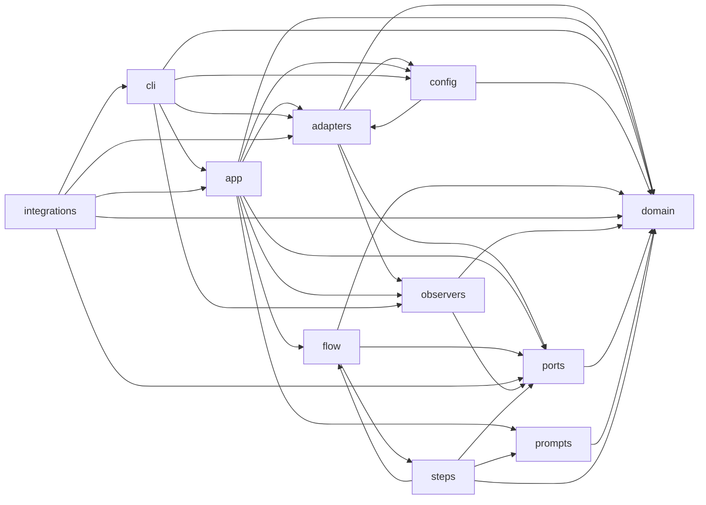
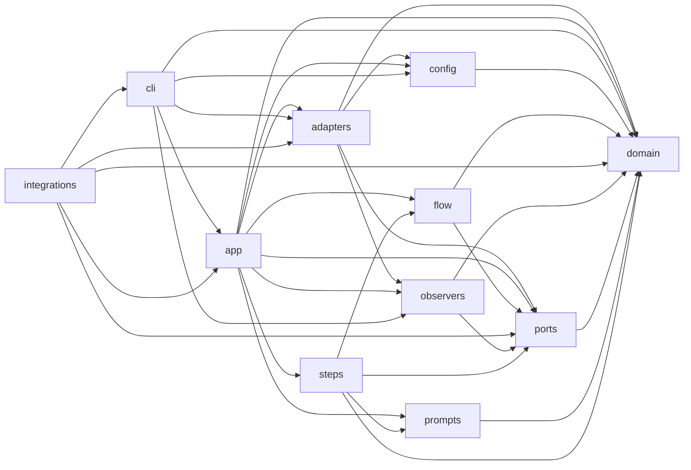

# Workflow ownership and dependency baseline

`src/app/run-flow.ts` owns concrete workflow assembly: step selection, ordered guards,
transitions, halts, resume points, and terminal outcomes. `src/app/run-jig.ts` supplies
that workflow to the engine. `src/flow/define-flow.ts` owns generic flow contracts;
`src/flow/engine.ts` interprets supplied flows. Production `flow` imports neither
`app` nor `steps`. Steps implement the contracts in `flow`; they do not select the
whole workflow. The behavioral workflow spec lives beside the assembly in `app`.

The [interactive map](architecture.html) depicts execution sequence, including an engine
calling supplied steps. Such a runtime call is not a source dependency from `flow` to
`steps`. The source direction after this move is `app → steps → flow`, with `app → flow`
as well. Configuration ownership is unchanged in this slice.

## Prerequisite

Invocation status already belongs to `src/domain/invocation-status.ts`, including
`INVOCATION_STATUSES`, `InvocationStatus`, and `outcomeIsComplete`. The engine imports
the domain type; local-store run artifacts and GitHub orchestration also import this
module directly. They need no engine or app import to classify completion. Both
`done` and `completed` count as complete; `stuck`, `halted`, and `blocked` do not.

## Before the assembly move

This baseline was captured before moving any source files, at commit `8f7c1a142d14644817c6ccf73cbb9b9baa452f8a`.
It deliberately retains the observed cycles rather than presenting the intended
architecture as though it were already enforced.

From the repository root, dependency-cruiser 18.7.2 was run with:

```sh
npx depcruise src --no-config --ts-config tsconfig.json --ts-pre-compilation-deps --include-only '^src/' --exclude '\.spec\.ts$' --output-type json
```

The explicit pre-compilation option includes type imports. The inventory below
contains every production `src/` file (125 files), grouped by top-level owner;
specs are excluded. Each file lists all its resolved internal source dependencies,
including same-owner imports. External packages and Node built-ins are omitted.
Repeated imports of the same file are collapsed. This adjacency list captures the
file graph; the following diagram collapses it by owner.



### Observed cycles and other ownership concerns

- `flow ↔ steps`: `flow/run-flow.ts` imports six concrete step modules, which import
  the contracts in `flow/define-flow.ts`. This slice removes the six `flow → steps`
  edges by moving assembly to `app`. It preserves the reverse contract dependencies.
- `config ↔ adapters`: `config/load-config.ts → adapters/sandcastle/agents.ts` and
  `config/presets.ts → adapters/local-store/run-paths.ts`. Reverse dependencies come
  from `adapters/sandcastle/open-session.ts` (environment and load-config),
  `adapters/telemetry/open-telemetry.ts` (environment), and
  `adapters/terminal/ask-for-preset.ts` (presets). These remain for the configuration slice.
- `adapters → observers`: both `adapters/local-store/metrics-log.ts` and
  `adapters/local-store/run-artefacts.ts` import `observers/metrics.ts`. These are
  additional inward ownership concerns, including type dependencies, for final enforcement.
- `cli → adapters`, `cli → config`, and `cli → observers` bypass application wiring.
  The complete file edges below retain these additional boundary concerns for review;
  this slice does not silently grant exemptions or change enforcement settings.
- Configuration also performs filesystem I/O in `load-config.ts`, `presets.ts`, and
  `write-config.ts`; owner-only source graphs do not show Node built-in dependencies.
  Domain has no imports of other source owners. Ports depend only on domain;
  prompts depend only on domain; no core owner imports `integrations`.

## Production file inventory and baseline graph

Paths below are relative to `src/`. An empty dependency list means no internal source imports.
The inventory intentionally uses the pre-move paths; only `flow/run-flow.ts` moves to
`app/run-flow.ts` in this slice. The production file count stays the same.

### adapters (37 files)

- `adapters/find-symlink.ts` → `domain/errors.ts`
- `adapters/git/branch.ts` → `adapters/git/repository.ts`, `domain/errors.ts`
- `adapters/git/git-workspace.ts` → `adapters/git/merge.ts`, `adapters/git/repository.ts`, `domain/errors.ts`, `domain/protected-paths.ts`, `domain/run-id.ts`, `domain/run-state.ts`, `domain/usage.ts`, `domain/work-facts.ts`, `ports/sandbox-git.ts`, `ports/workspace.ts`
- `adapters/git/merge.ts` → `adapters/git/branch.ts`, `adapters/git/repository.ts`, `domain/errors.ts`
- `adapters/git/remote-ref.ts` → `domain/errors.ts`, `domain/retry.ts`
- `adapters/git/repository.ts` → `domain/errors.ts`
- `adapters/git/run-code.ts` → `adapters/git/remote-ref.ts`, `adapters/git/repository.ts`, `adapters/git/run-history.ts`, `domain/errors.ts`, `domain/run-id.ts`, `domain/run-state.ts`, `ports/run-code.ts`
- `adapters/git/run-history.ts` → `domain/errors.ts`
- `adapters/git/throwaway-branch.ts` → `adapters/git/branch.ts`, `adapters/git/repository.ts`, `domain/errors.ts`
- `adapters/local-store/credentials-file.ts` → `adapters/find-symlink.ts`, `adapters/local-store/local-state.ts`, `adapters/local-store/run-paths.ts`, `domain/errors.ts`
- `adapters/local-store/local-run-store.ts` → `adapters/local-store/local-state.ts`, `adapters/local-store/run-paths.ts`, `domain/errors.ts`, `domain/run-id.ts`, `domain/run-state.ts`, `ports/run-store.ts`
- `adapters/local-store/local-state.ts` → `domain/errors.ts`
- `adapters/local-store/metrics-log.ts` → `adapters/local-store/run-paths.ts`, `domain/agent-role.ts`, `domain/errors.ts`, `domain/events.ts`, `domain/outcome.ts`, `domain/run-id.ts`, `observers/metrics.ts`
- `adapters/local-store/run-artefacts.ts` → `adapters/local-store/local-state.ts`, `adapters/local-store/run-paths.ts`, `domain/design-review-report.ts`, `domain/errors.ts`, `domain/invocation-status.ts`, `domain/run-id.ts`, `domain/run-state.ts`, `observers/metrics.ts`
- `adapters/local-store/run-lock.ts` → `adapters/local-store/local-state.ts`, `adapters/local-store/run-paths.ts`, `domain/errors.ts`, `domain/run-id.ts`
- `adapters/local-store/run-paths.ts` → `adapters/find-symlink.ts`, `domain/run-id.ts`
- `adapters/logging/create-logger.ts` → none
- `adapters/run-store/composite-run-store.ts` → `domain/errors.ts`, `domain/run-id.ts`, `domain/run-state.ts`, `ports/run-code.ts`, `ports/run-store.ts`
- `adapters/run-store/git-remote-run-store.ts` → `adapters/git/remote-ref.ts`, `adapters/git/repository.ts`, `domain/errors.ts`, `domain/run-id.ts`, `domain/run-state.ts`, `ports/run-store.ts`
- `adapters/sandbox-image/docker-images.ts` → `domain/errors.ts`, `ports/sandbox-images.ts`
- `adapters/sandbox-image/image-recipe.ts` → `domain/errors.ts`
- `adapters/sandbox-image/latest-agent-versions.ts` → none
- `adapters/sandcastle/agents.ts` → `adapters/local-store/credentials-file.ts`, `adapters/sandcastle/codex-auth.ts`, `domain/errors.ts`
- `adapters/sandcastle/codex-auth.ts` → `domain/errors.ts`
- `adapters/sandcastle/git-hooks.ts` → none
- `adapters/sandcastle/open-session.ts` → `adapters/local-store/run-paths.ts`, `adapters/sandcastle/agents.ts`, `adapters/sandcastle/sandcastle-env.ts`, `adapters/sandcastle/sandcastle-session.ts`, `adapters/telemetry/open-telemetry.ts`, `config/environment.ts`, `config/load-config.ts`, `domain/agent-role.ts`, `domain/errors.ts`, `domain/run-state.ts`, `ports/observability.ts`
- `adapters/sandcastle/private-clone-docker.ts` → `adapters/git/repository.ts`, `domain/errors.ts`
- `adapters/sandcastle/sandcastle-env.ts` → none
- `adapters/sandcastle/sandcastle-session.ts` → `adapters/find-symlink.ts`, `adapters/sandcastle/codex-auth.ts`, `adapters/sandcastle/git-hooks.ts`, `adapters/sandcastle/private-clone-docker.ts`, `adapters/sandcastle/structured-output.ts`, `adapters/sandcastle/usage.ts`, `domain/errors.ts`, `domain/run-id.ts`, `domain/run-state.ts`, `ports/agent-session.ts`, `ports/observability.ts`, `ports/sandbox-git.ts`
- `adapters/sandcastle/structured-output.ts` → `domain/errors.ts`
- `adapters/sandcastle/usage.ts` → `domain/usage.ts`
- `adapters/telemetry/open-telemetry.ts` → `config/environment.ts`
- `adapters/terminal/ask-for-agents.ts` → `adapters/sandcastle/agents.ts`, `adapters/terminal/terminal.ts`, `domain/agent-role.ts`
- `adapters/terminal/ask-for-credential.ts` → `adapters/local-store/credentials-file.ts`, `adapters/sandcastle/agents.ts`, `adapters/terminal/terminal.ts`
- `adapters/terminal/ask-for-preset.ts` → `adapters/terminal/terminal.ts`, `config/presets.ts`
- `adapters/terminal/standard-input.ts` → none
- `adapters/terminal/terminal.ts` → `domain/errors.ts`

### app (9 files)

- `app/container.ts` → `adapters/git/git-workspace.ts`, `adapters/local-store/metrics-log.ts`, `adapters/local-store/run-artefacts.ts`, `adapters/local-store/run-paths.ts`, `adapters/logging/create-logger.ts`, `adapters/sandbox-image/docker-images.ts`, `adapters/sandbox-image/latest-agent-versions.ts`, `adapters/sandcastle/agents.ts`, `adapters/sandcastle/open-session.ts`, `adapters/sandcastle/sandcastle-session.ts`, `adapters/terminal/ask-for-agents.ts`, `adapters/terminal/ask-for-credential.ts`, `app/observed-events.ts`, `app/report-cleanup.ts`, `app/sandbox-image.ts`, `config/environment.ts`, `config/load-config.ts`, `domain/agent-role.ts`, `domain/retry.ts`, `domain/run-state.ts`, `domain/settings.ts`, `flow/engine.ts`, `observers/logging-observer.ts`, `observers/metrics.ts`, `observers/run-events.ts`, `observers/tracing-observer.ts`, `ports/agent-session.ts`, `ports/observability.ts`, `ports/run-store.ts`, `ports/sandbox-git.ts`, `ports/sandbox-images.ts`, `ports/workspace.ts`
- `app/init-sandbox.ts` → `adapters/find-symlink.ts`, `adapters/local-store/credentials-file.ts`, `adapters/sandbox-image/image-recipe.ts`, `adapters/sandcastle/agents.ts`, `adapters/sandcastle/sandcastle-session.ts`, `app/container.ts`, `app/sandbox-image.ts`, `app/throwaway-sandbox.ts`, `config/environment.ts`, `config/load-config.ts`, `config/write-config.ts`, `domain/errors.ts`, `prompts/toolchain.ts`
- `app/observed-events.ts` → `domain/events.ts`, `observers/run-events.ts`
- `app/report-cleanup.ts` → none
- `app/run-jig.ts` → `adapters/git/branch.ts`, `adapters/git/run-history.ts`, `adapters/local-store/metrics-log.ts`, `adapters/local-store/run-lock.ts`, `adapters/sandcastle/open-session.ts`, `adapters/telemetry/open-telemetry.ts`, `app/container.ts`, `app/run-stores.ts`, `app/sandbox-image.ts`, `config/load-config.ts`, `domain/errors.ts`, `domain/run-id.ts`, `domain/run-state.ts`, `flow/define-flow.ts`, `flow/engine.ts`, `flow/run-flow.ts`, `ports/run-store.ts`
- `app/run-status.ts` → `adapters/local-store/metrics-log.ts`, `adapters/local-store/run-artefacts.ts`, `app/container.ts`, `app/run-stores.ts`, `domain/errors.ts`, `domain/run-id.ts`, `domain/run-state.ts`, `observers/metrics.ts`
- `app/run-stores.ts` → `adapters/git/run-code.ts`, `adapters/local-store/local-run-store.ts`, `adapters/run-store/composite-run-store.ts`, `adapters/run-store/git-remote-run-store.ts`, `app/container.ts`, `domain/errors.ts`, `domain/run-id.ts`, `domain/run-state.ts`, `ports/run-store.ts`
- `app/sandbox-image.ts` → `adapters/sandbox-image/image-recipe.ts`, `adapters/sandcastle/agents.ts`, `config/load-config.ts`, `domain/errors.ts`, `ports/sandbox-images.ts`
- `app/throwaway-sandbox.ts` → `adapters/git/branch.ts`, `adapters/git/throwaway-branch.ts`, `adapters/sandcastle/sandcastle-session.ts`, `app/container.ts`, `app/observed-events.ts`, `app/report-cleanup.ts`, `domain/errors.ts`, `domain/run-id.ts`, `domain/run-state.ts`, `observers/logging-observer.ts`

### cli (13 files)

- `cli/app-action.ts` → `app/container.ts`, `cli/with-app.ts`, `cli/with-error-handling.ts`, `cli/with-input.ts`, `domain/errors.ts`
- `cli/commands/presets.ts` → `adapters/logging/create-logger.ts`, `cli/with-app.ts`, `cli/with-error-handling.ts`, `config/presets.ts`
- `cli/commands/run.ts` → `app/run-jig.ts`, `cli/app-action.ts`, `cli/config-option.ts`, `cli/log-format-option.ts`, `cli/read-request.ts`, `cli/with-app.ts`, `domain/errors.ts`, `domain/run-id.ts`, `domain/run-state.ts`
- `cli/commands/sandbox.ts` → `app/init-sandbox.ts`, `app/sandbox-image.ts`, `cli/app-action.ts`, `cli/config-option.ts`, `cli/log-format-option.ts`
- `cli/commands/status.ts` → `adapters/logging/create-logger.ts`, `app/run-status.ts`, `cli/config-option.ts`, `cli/with-app.ts`, `cli/with-error-handling.ts`, `cli/with-input.ts`, `domain/run-id.ts`, `domain/run-state.ts`, `domain/slice.ts`, `observers/metrics.ts`
- `cli/config-option.ts` → `config/presets.ts`
- `cli/exit-when-done.ts` → none
- `cli/log-format-option.ts` → `adapters/logging/create-logger.ts`
- `cli/main.ts` → `cli/commands/presets.ts`, `cli/commands/run.ts`, `cli/commands/sandbox.ts`, `cli/commands/status.ts`
- `cli/read-request.ts` → `adapters/terminal/standard-input.ts`, `app/run-jig.ts`, `domain/errors.ts`
- `cli/with-app.ts` → `adapters/git/repository.ts`, `adapters/local-store/credentials-file.ts`, `adapters/logging/create-logger.ts`, `adapters/terminal/ask-for-preset.ts`, `adapters/terminal/standard-input.ts`, `app/container.ts`, `cli/config-option.ts`, `config/environment.ts`, `config/load-config.ts`, `config/presets.ts`, `domain/errors.ts`
- `cli/with-error-handling.ts` → `domain/errors.ts`
- `cli/with-input.ts` → `config/describe-issues.ts`, `domain/errors.ts`

### config (5 files)

- `config/describe-issues.ts` → none
- `config/environment.ts` → `config/describe-issues.ts`, `domain/errors.ts`
- `config/load-config.ts` → `adapters/sandcastle/agents.ts`, `config/describe-issues.ts`, `domain/agent-role.ts`, `domain/errors.ts`, `domain/settings.ts`
- `config/presets.ts` → `adapters/local-store/run-paths.ts`, `config/describe-issues.ts`, `config/environment.ts`, `config/load-config.ts`, `domain/agent-role.ts`, `domain/errors.ts`
- `config/write-config.ts` → `config/load-config.ts`, `domain/errors.ts`

### domain (22 files)

- `domain/agent-role.ts` → none
- `domain/apply-outcome.ts` → `domain/completion-reuse.ts`, `domain/design-review.ts`, `domain/diagnostics.ts`, `domain/final-check.ts`, `domain/outcome.ts`, `domain/run-state.ts`, `domain/slice.ts`
- `domain/completion-reuse.ts` → `domain/final-check.ts`, `domain/run-state.ts`, `domain/settings.ts`, `domain/slice.ts`, `domain/work-facts.ts`
- `domain/design-docs.ts` → none
- `domain/design-review-report.ts` → `domain/design-review.ts`, `domain/run-state.ts`
- `domain/design-review.ts` → `domain/design-docs.ts`, `domain/errors.ts`, `domain/run-state.ts`
- `domain/diagnostics.ts` → none
- `domain/errors.ts` → none
- `domain/events.ts` → `domain/agent-role.ts`, `domain/outcome.ts`, `domain/run-id.ts`, `domain/run-state.ts`, `domain/slice.ts`, `domain/usage.ts`
- `domain/final-check.ts` → `domain/diagnostics.ts`, `domain/outcome.ts`, `domain/run-state.ts`, `domain/slice.ts`
- `domain/invocation-status.ts` → none
- `domain/outcome.ts` → `domain/completion-reuse.ts`, `domain/design-docs.ts`, `domain/design-review.ts`, `domain/run-state.ts`, `domain/slice.ts`, `domain/usage.ts`, `domain/work-facts.ts`
- `domain/plan-coverage.ts` → `domain/errors.ts`, `domain/slice.ts`
- `domain/protected-paths.ts` → none
- `domain/retry.ts` → `domain/errors.ts`, `domain/settings.ts`
- `domain/run-diagnostics.ts` → `domain/diagnostics.ts`, `domain/run-state.ts`, `domain/slice.ts`
- `domain/run-id.ts` → none
- `domain/run-state.ts` → `domain/completion-reuse.ts`, `domain/design-docs.ts`, `domain/design-review.ts`, `domain/diagnostics.ts`, `domain/final-check.ts`, `domain/run-id.ts`, `domain/settings.ts`, `domain/slice.ts`
- `domain/settings.ts` → `domain/slice.ts`
- `domain/slice.ts` → `domain/diagnostics.ts`, `domain/work-facts.ts`
- `domain/usage.ts` → none
- `domain/work-facts.ts` → none

### flow (3 files)

- `flow/define-flow.ts` → `domain/errors.ts`, `domain/outcome.ts`, `domain/run-state.ts`, `domain/settings.ts`, `domain/slice.ts`, `ports/agent-session.ts`, `ports/workspace.ts`
- `flow/engine.ts` → `domain/apply-outcome.ts`, `domain/errors.ts`, `domain/events.ts`, `domain/invocation-status.ts`, `domain/outcome.ts`, `domain/retry.ts`, `domain/run-id.ts`, `domain/run-state.ts`, `domain/settings.ts`, `flow/define-flow.ts`, `ports/observability.ts`, `ports/run-store.ts`
- `flow/run-flow.ts` → `domain/design-review.ts`, `domain/final-check.ts`, `domain/run-state.ts`, `domain/settings.ts`, `flow/define-flow.ts`, `steps/completion-reuse.ts`, `steps/design-review.ts`, `steps/final-check.ts`, `steps/finishing.ts`, `steps/planning.ts`, `steps/slice.ts`

### integrations (12 files)

- `integrations/github/cli.ts` → `cli/app-action.ts`, `cli/exit-when-done.ts`, `cli/main.ts`, `integrations/github/command.ts`, `integrations/github/github-port.ts`
- `integrations/github/command.ts` → `cli/app-action.ts`, `cli/config-option.ts`, `cli/log-format-option.ts`, `cli/with-app.ts`, `integrations/github/errors.ts`, `integrations/github/github-port.ts`, `integrations/github/implement-issue.ts`, `integrations/github/octokit-github.ts`, `integrations/github/repository-identity.ts`
- `integrations/github/errors.ts` → none
- `integrations/github/findings-comment.ts` → `domain/diagnostics.ts`, `domain/run-diagnostics.ts`, `domain/run-state.ts`
- `integrations/github/github-port.ts` → `integrations/github/errors.ts`
- `integrations/github/implement-issue.ts` → `adapters/git/branch.ts`, `adapters/git/run-history.ts`, `app/container.ts`, `app/run-jig.ts`, `app/run-stores.ts`, `domain/errors.ts`, `domain/invocation-status.ts`, `domain/run-id.ts`, `domain/run-state.ts`, `integrations/github/errors.ts`, `integrations/github/findings-comment.ts`, `integrations/github/github-port.ts`, `integrations/github/orchestration-state.ts`, `integrations/github/orchestration-store.ts`, `integrations/github/request-snapshot.ts`, `integrations/github/run-branch-publication.ts`, `ports/run-store.ts`
- `integrations/github/octokit-github.ts` → `domain/retry.ts`, `integrations/github/errors.ts`, `integrations/github/github-port.ts`
- `integrations/github/orchestration-state.ts` → `domain/invocation-status.ts`, `domain/run-id.ts`, `integrations/github/github-port.ts`
- `integrations/github/orchestration-store.ts` → `adapters/git/remote-ref.ts`, `app/report-cleanup.ts`, `domain/errors.ts`, `domain/retry.ts`, `integrations/github/errors.ts`, `integrations/github/orchestration-state.ts`
- `integrations/github/repository-identity.ts` → `adapters/git/repository.ts`, `integrations/github/errors.ts`, `integrations/github/github-port.ts`
- `integrations/github/request-snapshot.ts` → `integrations/github/github-port.ts`
- `integrations/github/run-branch-publication.ts` → `adapters/git/remote-ref.ts`, `adapters/git/repository.ts`, `adapters/git/run-history.ts`, `domain/errors.ts`, `domain/run-id.ts`, `domain/run-state.ts`, `integrations/github/errors.ts`

### observers (4 files)

- `observers/logging-observer.ts` → `domain/events.ts`
- `observers/metrics.ts` → `domain/agent-role.ts`, `domain/events.ts`, `domain/outcome.ts`, `domain/run-id.ts`, `domain/usage.ts`, `ports/observability.ts`
- `observers/run-events.ts` → `domain/errors.ts`, `domain/events.ts`, `ports/observability.ts`
- `observers/tracing-observer.ts` → `domain/events.ts`

### ports (7 files)

- `ports/agent-session.ts` → `domain/agent-role.ts`, `domain/errors.ts`
- `ports/observability.ts` → `domain/events.ts`
- `ports/run-code.ts` → `domain/errors.ts`, `domain/run-id.ts`
- `ports/run-store.ts` → `domain/errors.ts`, `domain/run-id.ts`, `domain/run-state.ts`
- `ports/sandbox-git.ts` → `domain/errors.ts`, `ports/agent-session.ts`
- `ports/sandbox-images.ts` → `domain/errors.ts`
- `ports/workspace.ts` → `domain/errors.ts`, `domain/protected-paths.ts`, `domain/usage.ts`, `domain/work-facts.ts`

### prompts (6 files)

- `prompts/design-review.ts` → `domain/design-docs.ts`, `domain/design-review.ts`, `domain/run-state.ts`
- `prompts/final-check.ts` → `domain/final-check.ts`
- `prompts/planning.ts` → `domain/run-state.ts`
- `prompts/pull-request.ts` → `domain/completion-reuse.ts`, `domain/final-check.ts`, `domain/run-state.ts`, `domain/slice.ts`
- `prompts/slice.ts` → `domain/protected-paths.ts`, `domain/slice.ts`
- `prompts/toolchain.ts` → none

### steps (7 files)

- `steps/completion-reuse.ts` → `domain/completion-reuse.ts`, `domain/errors.ts`, `domain/outcome.ts`, `flow/define-flow.ts`
- `steps/design-review.ts` → `domain/design-review.ts`, `domain/run-state.ts`, `flow/define-flow.ts`, `prompts/design-review.ts`
- `steps/final-check.ts` → `domain/final-check.ts`, `domain/outcome.ts`, `flow/define-flow.ts`, `ports/agent-session.ts`, `prompts/final-check.ts`
- `steps/finishing.ts` → `domain/completion-reuse.ts`, `domain/outcome.ts`, `domain/run-state.ts`, `domain/slice.ts`, `flow/define-flow.ts`, `prompts/pull-request.ts`, `steps/completion-reuse.ts`, `steps/pull-request-description.ts`
- `steps/planning.ts` → `domain/design-docs.ts`, `domain/errors.ts`, `domain/outcome.ts`, `domain/plan-coverage.ts`, `domain/retry.ts`, `domain/run-state.ts`, `domain/slice.ts`, `flow/define-flow.ts`, `prompts/planning.ts`
- `steps/pull-request-description.ts` → `domain/completion-reuse.ts`, `domain/final-check.ts`, `domain/run-state.ts`, `domain/settings.ts`, `domain/slice.ts`
- `steps/slice.ts` → `domain/completion-reuse.ts`, `domain/errors.ts`, `domain/final-check.ts`, `domain/outcome.ts`, `domain/protected-paths.ts`, `domain/run-state.ts`, `domain/slice.ts`, `flow/define-flow.ts`, `prompts/slice.ts`

## After configuration ownership

The complete production graph was recomputed with the dependency-cruiser command above,
including type imports: 127 source files. The aggregate graph is acyclic.
Configuration imports only domain; adapters consume configuration policy.
Provider construction, credential checks, authentication and filesystem operations
remain with their existing owners. No enforcement settings changed.

Dependency-first topological order: `domain`, `ports`, `config`, `observers`, `adapters`, `flow`, `prompts`, `steps`, `app`, `cli`, `integrations`.



## Configuration I/O and defaults

Adapters read and write the settings file and find and read presets, and the process edge captures
the environment. `src/config` does none of these: it owns the contracts and the policy over them.

Presets cross the `PresetSource` contract in `src/config/preset-source.ts`. A source names the
places it looks in, highest precedence first; for one name it yields the present candidates in
that order, looking at each place only when reached; and it lists every present candidate, each
place's in name order. A candidate carries the name its place gives it, an opaque label (source,
location and whether it is a shipped starter) and a `read` that decodes its JSON only when called.
The source fails narrowly as not findable, unlistable, unreadable or not JSON.
`src/config/presets.ts` owns the selection rule: it skips candidates whose names are not valid
preset names without reading them, lets the first candidate of a name win and shadow the rest
unread, refuses a broken winner instead of falling back, validates the strict preset schema,
replaces whole roles, and turns source failures into `ConfigInvalid` messages that name the
location. A named lookup reads only its winner and lists nothing; only a missing name lists the
places to say which presets exist. `src/adapters/filesystem/preset-source.ts` owns the ordering:
the repository's `.jig/presets`, the home directory's `.jig/presets`, the XDG config home's
`jig/presets` (`~/.config` unless `XDG_CONFIG_HOME` is absolute) and the packaged starters, a
directory two sources share looked in once. It maps a name to its `.json` file, counts any entry
`lstat` finds as present, a dangling link included, and reads and parses the file.

Settings cross one boundary, the `ConfigSource` contract in `src/config/config-source.ts`. A
source reports its destination's name, whether the operator chose it with `--config`, and either
the raw JSON it holds or that nothing is there, with the native reason; it fails narrowly as
unreadable, not JSON or unwritable, and writes whole settings. `loadConfig` in
`src/config/load-config.ts` decides that only the repository's own settings may be absent,
applies the strict schema and its defaults, and so refuses the retry defaults as keys.
`updateConfig` in `src/config/update-config.ts` merges new keys over the current object, creates
absent settings and refuses anything that is not an object. Both turn source failures into
`ConfigInvalid` messages. `src/adapters/filesystem/config-source.ts` resolves the destination
(`jig.config.json` in the repository root, or a `--config` path resolved against it), reads and
parses its JSON and writes it atomically. `jig init` takes that concrete destination separately to
write the starter file and to refuse symbolic links at both starter destinations before writing
either.
`src/cli/with-app.ts` captures `process.env`, the working directory and the fallback home
directory at the process edge and passes them to `parseEnvironment`. Config keeps the schemas,
defaults, provider and model policy, preset-name validation, first-winner selection and the
preset schema.

The step retry count (2) and first retry delay (5000 ms) are private defaults in
`src/config/load-config.ts`, which `runSettingsFrom` resolves into `RunSettings`. They are not
configuration keys, and presets still override agent roles only. `src/domain/settings.ts` keeps
`RunSettings`, `reviewCapReached`, `sliceNeedsVerification` and the stopping caps
(`HOOK_FAILURE_CAP`, `VERIFICATION_FAILURE_CAP`, `EMPTY_ATTEMPT_CAP`, `RULE_FIX_CAP`).
`transientRetryPolicy` reads the resolved count and delay unchanged.

Dependency-cruiser's `config-imports-only-approved-dependencies` rule allows production config to
import only `src/config`, `src/domain`, `better-result` and `zod`. Anything else fails, including
adapters, ports, `node:fs`, `node:os`, `node:path`, `node:child_process`, `execa` and
`write-file-atomic`. Config specs and the test packages they use are exempt. Adapters may import
config's contracts, and ports still depend only on domain. CLI commands still receive the container through
`src/cli/with-app.ts` and `src/cli/app-action.ts`, which also prepares the invocation, and
`src/app/container.ts` remains the composition root; moving preparation into application
operations and composition out of `app` are separate slices.

## Retry execution and exception details

Retry execution and the reading of thrown values are supplied capabilities. Their contracts are
declaration-only ports; their implementations are adapters:

| Contract                                               | Implementation                                                                      |
| ------------------------------------------------------ | ----------------------------------------------------------------------------------- |
| `RetryResult`, `RetryPolicy` in `src/ports/retry.ts`   | `retryResult` in `src/adapters/retry.ts`                                            |
| `ExceptionDetails` in `src/ports/exception-details.ts` | `exceptionDetails`, `messageOf`, `rootCause` in `src/adapters/exception-details.ts` |

better-result 3.0.1 retries only a `Result.tryPromise` whose `try` throws, so it cannot retry an
operation that already returns its failure as an `Err` without turning that `Err` back into a
rejection. `retryResult` keeps that behaviour thin: it calls the operation, reports each failed
attempt with the retries left, stops on success, exhaustion or a failure the policy refuses, waits
`delayMs × 2^(attempt − 1)` with `node:timers/promises`, and lets a throw through. better-result
supplies `Panic`, `isPanic` and `panic`, but nothing that unwraps a chain of panics; `rootCause`
follows `Panic.cause` until it reaches a non-`Panic` or a `Panic` without a cause, and never
follows an ordinary `Error`'s cause. `messageOf` reads an `Error`'s message and turns anything
else into text with `String`. A broad catch that already knows it holds a `Panic` uses its
`message` directly.

Each consumer receives the capability through its existing construction path:

| Consumer                                             | How it receives the capability                                              |
| ---------------------------------------------------- | --------------------------------------------------------------------------- |
| `src/flow/engine.ts` step retries                    | `EngineDependencies.ports.retryResult`, under `transientRetryPolicy`        |
| `src/flow/engine.ts` bug reports                     | `EngineDependencies.exceptionDetails`                                       |
| `src/steps/planning.ts` slicing correction           | `StepPorts.retryResult`                                                     |
| `src/app/container.ts` sandbox start                 | the `retryResult` the container registers, under `transientRetryPolicy`     |
| `src/cli/with-error-handling.ts`                     | an `ExceptionDetails` argument from the command that registers it           |
| `src/cli/read-request.ts`                            | `RequestReads.messageOf`, from `CommandIo.exceptionDetails`                 |
| `src/cli/main.ts` and every CLI command              | `buildCli(exceptionDetails)` and `CommandIo.exceptionDetails`               |
| `src/observers/run-events.ts`                        | none: a `Panic` is rethrown with its own `message`                          |
| `src/integrations/github/cli.ts`                     | imports the adapter implementation and supplies it to `buildCli` and GitHub |
| GitHub API and orchestration store                   | import the adapter implementations at their third-party boundary            |
| adapters and app modules wrapping a third-party call | import `messageOf` from the adapter                                         |

`src/app/container.ts` registers `retryResult` and `exceptionDetails` as values and builds the
engine's dependencies from them. Domain keeps the failure classes, `isTransient` and
`transientRetryPolicy`; `TransientRetryPolicy` matches `RetryPolicy<JigError>` by shape without
importing the port. The `retry-and-exception-details-are-supplied` dependency rule rejects
production imports of either implementation from flow, steps, CLI and observers, including type
imports, re-exports, literal dynamic imports and nested paths.

## Failure class inventory

This is the preservation baseline for the error-contract slice. Every class lives in
`src/domain/errors.ts`, extends better-result's `TaggedError` with its class name as `_tag`,
carries `message`, and declares a constant `kind`. Moving a class keeps its `_tag`, fields,
`kind`, message templates and every recognition site below.

### Exported contracts

| Export                 | Where                     | Contract                                                                                                                                                                               | Consumers outside specs                                                      |
| ---------------------- | ------------------------- | -------------------------------------------------------------------------------------------------------------------------------------------------------------------------------------- | ---------------------------------------------------------------------------- |
| `FailureKind`          | `src/domain/errors.ts:7`  | `'retry' \| 'block' \| 'fatal'`; each class's `kind` is one of these as a literal                                                                                                      | none import the name; every class's `kind` and the engine's switch follow it |
| `JigError`             | `src/domain/errors.ts:9`  | the union of the 21 classes                                                                                                                                                            | engine, steps, app and CLI signatures                                        |
| `isTransient`          | `src/domain/errors.ts:33` | `error.kind === 'retry'`                                                                                                                                                               | `src/domain/retry.ts:18`, `src/flow/engine.ts:217`                           |
| `isJigError`           | `src/domain/errors.ts:37` | `instanceof` one of the 21 classes in `jigErrorClasses`                                                                                                                                | none; specs only                                                             |
| the 21 classes         | `src/domain/errors.ts:40` | constructor `{ message, …fields }`, static `is`, `_tag`, `kind`                                                                                                                        | the sites below                                                              |
| `TransientRetryPolicy` | `src/domain/retry.ts:8`   | `{ retries, delayMs, shouldRetry(error: JigError) }`, `RetryPolicy<JigError>` by shape                                                                                                 | `src/flow/engine.ts:214`, `src/app/container.ts:270`                         |
| `transientRetryPolicy` | `src/domain/retry.ts:14`  | `maxStepRetries` and `retryDelayMs` from `RunSettings`, `shouldRetry: isTransient`                                                                                                     | `src/flow/engine.ts:215`, `src/app/container.ts:270`                         |
| aggregate unions       | adapters, ports, app      | `SessionOpenFailure`, `SessionCloseFailure`, `RunStoreFailure`, `RunCodeRestoreFailure`, `SaveWorkFailure`, `InitFailure`, `SandboxCheckFailure`, `StoreFailure`, `PublicationFailure` | the signatures that name them                                                |

### Semantic ownership and classification

Classification is decided in one place per concern, and nothing else branches on `kind`:

- `kind` is declared on each class; `isTransient` reads it, and `transientRetryPolicy` turns it into
  the engine's and the sandbox start's retry policy.
- `src/flow/engine.ts:209-230` (`attempt`) is the only reader of all three kinds: `retry` is retried
  under `transientRetryPolicy` and blocks the run once exhausted, `block` blocks it
  (`blockedReason` is the `message`), `fatal` is returned as the `Err`. `stepRetried` is published
  only for a transient failure with retries left. An `Err` from `store.save` (`engine.ts:107`,
  `:119`, `:321`) is returned as it is, outside `attempt`.
- `src/app/container.ts:261-273` (`openSessionRetrying`) retries a session open under the same
  policy, so only `SandboxUnavailable` and `SetupCommandFailed` are retried there; `ConfigInvalid`
  is returned at once. `src/app/throwaway-sandbox.ts:49` opens without retry.
- `src/cli/with-error-handling.ts:23` prints any `Err` as its `message` and sets exit code 1.
- `src/app/report-cleanup.ts:5` returns a cleanup failure only when the work succeeded and logs it
  otherwise; it does not look at the class.

Technical helper consumers apply a capability without deciding what a class means:
`retryResult` with a local policy (`src/adapters/git/remote-ref.ts:57`,
`src/integrations/github/orchestration-store.ts:137`, `src/steps/planning.ts:54`), and `messageOf`
inside the constructions that quote a thrown cause (marked `messageOf(cause)` below).

### Classes

| Class                  | `kind` | Fields beyond `message` | Constructed at                                                                                                                                                                                                                                       | Recognised or handled by class                                                                                                                                                                   |
| ---------------------- | ------ | ----------------------- | ---------------------------------------------------------------------------------------------------------------------------------------------------------------------------------------------------------------------------------------------------- | ------------------------------------------------------------------------------------------------------------------------------------------------------------------------------------------------ |
| `AgentRunFailed`       | retry  | —                       | `src/adapters/sandcastle/sandcastle-session.ts:170`                                                                                                                                                                                                  | none; `src/steps/slice.ts:83` passes it through where it recovers `AgentOutputInvalid`                                                                                                           |
| `AgentOutputInvalid`   | retry  | —                       | `src/adapters/sandcastle/structured-output.ts:37`, `src/steps/planning.ts:63` (from `PlanNotCovered`), `src/steps/planning.ts:96` (repeated slice ids)                                                                                               | `src/steps/slice.ts:83` `AgentOutputInvalid.is`: the slice title stands in for an unreadable commit message                                                                                      |
| `PlanNotCovered`       | retry  | —                       | `src/domain/plan-coverage.ts:24`                                                                                                                                                                                                                     | `src/steps/planning.ts:57` `instanceof` retries slicing once; `:59` keeps its message as the correction; `:63` maps a second one to `AgentOutputInvalid`                                         |
| `DesignUnresolved`     | block  | `findingIds`            | `src/domain/design-review.ts:240`, returned by `src/steps/design-review.ts:56`                                                                                                                                                                       | none by class; `findingIds` is set and not read outside specs                                                                                                                                    |
| `RemoteUnavailable`    | retry  | —                       | `src/adapters/git/merge.ts:85`, `src/adapters/git/remote-ref.ts:49`                                                                                                                                                                                  | `src/adapters/git/remote-ref.ts:57` `_tag` retries the Git remote call                                                                                                                           |
| `SandboxUnavailable`   | retry  | —                       | `src/adapters/sandcastle/sandcastle-session.ts:308` (start failure not caused by configuration), `:365`, `:407`, `:464`                                                                                                                              | none by class                                                                                                                                                                                    |
| `SetupCommandFailed`   | retry  | `output`                | `src/adapters/sandcastle/sandcastle-session.ts:385`, `:392`                                                                                                                                                                                          | `src/app/init-sandbox.ts:210` `instanceof`: its `message` becomes the failure handed back to the planner                                                                                         |
| `RunStateConflict`     | block  | —                       | `src/adapters/git/remote-ref.ts:46`, `src/adapters/git/run-code.ts:40`, `src/adapters/run-store/composite-run-store.ts:107`, `src/adapters/run-store/git-remote-run-store.ts:102`                                                                    | `src/integrations/github/orchestration-store.ts:137` `_tag` retries the update; `:140` maps the last one to `OrchestrationStateInvalid`                                                          |
| `RunCodeUnavailable`   | block  | —                       | `src/adapters/git/run-code.ts:62`, `src/adapters/run-store/composite-run-store.ts:140`                                                                                                                                                               | none by class                                                                                                                                                                                    |
| `MergeFailed`          | block  | —                       | `src/adapters/git/merge.ts:108`, `:115`, `:122`, `:134` (from `ConfigInvalid`); `src/adapters/git/git-workspace.ts:280`, `:297`, `:301`, `:310`, `:318`                                                                                              | none by class                                                                                                                                                                                    |
| `GitCommandFailed`     | block  | `command`, `output`     | `src/adapters/git/repository.ts:34`, `:71`; `src/adapters/git/merge.ts:63`; `src/adapters/git/run-history.ts:29`; `src/adapters/git/git-workspace.ts:91`; `src/adapters/git/remote-ref.ts:86`; `src/adapters/sandcastle/private-clone-docker.ts:293` | `src/adapters/git/merge.ts:134` `GitCommandFailed.is` keeps it while mapping `ConfigInvalid` to `MergeFailed`; `src/adapters/sandcastle/private-clone-docker.ts:330` reads `output` for `EEXIST` |
| `CommitImportRefused`  | block  | —                       | `src/adapters/git/git-workspace.ts:111`, `:118`                                                                                                                                                                                                      | none by class                                                                                                                                                                                    |
| `CommitRejected`       | block  | `output`                | `src/adapters/git/git-workspace.ts:75`                                                                                                                                                                                                               | `src/steps/slice.ts:54` `CommitRejected.is`: becomes a `hookRejected` outcome whose feedback quotes `output`                                                                                     |
| `ConfigInvalid`        | fatal  | —                       | 47 constructions, listed below                                                                                                                                                                                                                       | none by class; `src/adapters/git/merge.ts:134` maps the no-branch one to `MergeFailed`, `src/app/init-sandbox.ts:77` and `src/adapters/terminal/ask-for-agents.ts:69` reuse a `message`          |
| `RunRequestInvalid`    | fatal  | —                       | `src/cli/read-request.ts:30`, `:43`, `:52`, `:61`; `src/app/run-jig.ts:112`, `:118`; `src/app/run-status.ts:31`                                                                                                                                      | none by class                                                                                                                                                                                    |
| `RunInProgress`        | fatal  | —                       | `src/adapters/local-store/run-lock.ts:44`                                                                                                                                                                                                            | none by class                                                                                                                                                                                    |
| `MetricsLogCorrupt`    | fatal  | —                       | `src/adapters/local-store/metrics-log.ts:70`                                                                                                                                                                                                         | none by class                                                                                                                                                                                    |
| `LocalStateUnwritable` | fatal  | `path`                  | `src/adapters/local-store/local-state.ts:14`, `src/adapters/local-store/run-lock.ts:26`, `:47`, `src/adapters/git/git-workspace.ts:332`                                                                                                              | none by class; `path` is not read outside specs                                                                                                                                                  |
| `CodexLoginNotSaved`   | fatal  | —                       | `src/adapters/sandcastle/codex-auth.ts:144`, `:161`, `:167`, `:203`, `:218`, `:223`, `:231`                                                                                                                                                          | none by class; as a `SessionCloseFailure` it goes through `reportCleanup` (`src/app/container.ts:188`, `src/app/throwaway-sandbox.ts:66`)                                                        |
| `ImageBuildFailed`     | fatal  | `output`                | `src/adapters/sandbox-image/docker-images.ts:55`, `:68`, `:82`, `:91`                                                                                                                                                                                | none by class                                                                                                                                                                                    |
| `CommandInputInvalid`  | fatal  | —                       | `src/cli/with-input.ts:21`                                                                                                                                                                                                                           | none by class                                                                                                                                                                                    |

A class marked "none by class" reaches the generic consumers above only: the engine by `kind`, the
session-open retry, `reportCleanup` and the CLI's printing.

### ConfigInvalid constructions

Every construction has `_tag` `ConfigInvalid`, `kind` `fatal` and no field beyond `message`. No
caller tells two of them apart by class; unless a row says otherwise, the `Err` propagates to the
CLI, which prints the message and exits 1. `${messageOf(cause)}` is the thrown cause's message.

| #   | Meaning                                             | Site                                                 | Message template                                                                                                                                                                   | Caller handling                                                                                                                                                                                                                                     |
| --- | --------------------------------------------------- | ---------------------------------------------------- | ---------------------------------------------------------------------------------------------------------------------------------------------------------------------------------- | --------------------------------------------------------------------------------------------------------------------------------------------------------------------------------------------------------------------------------------------------- |
| 1   | Config file is not JSON                             | `src/config/load-config.ts:32`                       | `${source.name} is not valid JSON: ${failure.detail}`                                                                                                                              | `loadConfig` callers: `src/cli/with-app.ts:100`, `src/app/init-sandbox.ts:75`, `:143`, `:235`                                                                                                                                                       |
| 2   | Config file unreadable                              | `src/config/load-config.ts:33`                       | `Cannot read ${source.name}: ${failure.detail}`                                                                                                                                    | as 1                                                                                                                                                                                                                                                |
| 3   | `--config` file absent                              | `src/config/load-config.ts:43`                       | `Cannot read ${source.name}: ${contents.detail}`                                                                                                                                   | as 1; an absent repository config is `{}` instead                                                                                                                                                                                                   |
| 4   | Config fails the schema                             | `src/config/load-config.ts:53`                       | `${source.name} is not valid — ${describeIssues(parsed.error)}`                                                                                                                    | as 1                                                                                                                                                                                                                                                |
| 5   | A step has no agent                                 | `src/config/load-config.ts:104`                      | `No agent set for ${steps} — set each in the config to { "provider": "claude \| opencode \| codex", "model": "..." }.`                                                             | `src/app/init-sandbox.ts:77` turns it into an `Ok` `needs-agents` result carrying the message; `src/adapters/sandcastle/open-session.ts:64`, `:97` fail the session open; `src/app/sandbox-image.ts:68` fails the image                             |
| 6   | Config cannot be written                            | `src/config/update-config.ts:19`                     | `Cannot read or write ${location}: ${detail}`                                                                                                                                      | `src/app/init-sandbox.ts:92`, `:148`                                                                                                                                                                                                                |
| 7   | Config cannot be read for an update                 | `src/config/update-config.ts:29`                     | `Cannot read or write ${location}: ${detail}`                                                                                                                                      | as 6                                                                                                                                                                                                                                                |
| 8   | Config is not a JSON object to update               | `src/config/update-config.ts:43`                     | `${source.name} must hold a JSON object to add settings to.`                                                                                                                       | as 6; built for a non-JSON read and for a non-object value                                                                                                                                                                                          |
| 9   | Environment fails its schema                        | `src/config/environment.ts:40`                       | `The environment is not valid — ${describeIssues(parsed.error)}`                                                                                                                   | `src/cli/with-app.ts:95`                                                                                                                                                                                                                            |
| 10  | Preset place cannot be looked for                   | `src/config/presets.ts:47` (`PresetNotFindable`)     | `Cannot look for ${failure.location}: ${failure.detail}`                                                                                                                           | `discoverPresets` (`src/cli/with-app.ts:127`, `src/cli/commands/presets.ts:17`) and `loadPreset` (`src/cli/with-app.ts:103`)                                                                                                                        |
| 11  | Preset directory cannot be listed                   | `src/config/presets.ts:47` (`PresetsUnlistable`)     | `Cannot list presets in ${failure.location}: ${failure.detail}`                                                                                                                    | as 10                                                                                                                                                                                                                                               |
| 12  | Preset file unreadable                              | `src/config/presets.ts:47` (`PresetUnreadable`)      | `Cannot read ${failure.location}: ${failure.detail}`                                                                                                                               | as 10                                                                                                                                                                                                                                               |
| 13  | Preset file is not JSON                             | `src/config/presets.ts:47` (`PresetNotJson`)         | `${failure.location} is not valid JSON: ${failure.detail}`                                                                                                                         | as 10                                                                                                                                                                                                                                               |
| 14  | Preset fails the schema                             | `src/config/presets.ts:102`                          | `${label.location} is not valid — ${describeIssues(parsed.error)}`                                                                                                                 | as 10                                                                                                                                                                                                                                               |
| 15  | Named preset does not exist                         | `src/config/presets.ts:146`                          | `No preset named ${name} — looked in ${places}; available: ${names}.` or `…; there are none.`                                                                                      | `src/cli/with-app.ts:103`                                                                                                                                                                                                                           |
| 16  | `--preset` asked and none picked                    | `src/cli/with-app.ts:131`                            | `No preset was picked — pass --preset <name>; jig presets lists them.`                                                                                                             | `src/cli/with-app.ts:102`                                                                                                                                                                                                                           |
| 17  | codex step without a model                          | `src/adapters/sandcastle/agents.ts:75`               | `codex needs an explicit model — set "model" on the step.`                                                                                                                         | `src/adapters/sandcastle/open-session.ts:106-109` fail the open; `modelProblem` (`agents.ts:37`) hands the message to `src/adapters/terminal/ask-for-agents.ts:69` as prompt validation                                                             |
| 18  | opencode step without a `provider/model`            | `src/adapters/sandcastle/agents.ts:86`               | `opencode needs a model as "provider/model" (e.g. "openrouter/<model>") — set "model" on the step.`                                                                                | as 17, and through `credentialKeys` (`agents.ts:57`) to `missingCredentials` and `collectCredentials`                                                                                                                                               |
| 19  | Agent credentials missing                           | `src/adapters/sandcastle/agents.ts:111`              | `Agent credentials are missing — set ${provider}: ${keys}; … in the environment or in .jig/.env.`                                                                                  | `src/adapters/sandcastle/open-session.ts:98` fails the open; `src/app/init-sandbox.ts:187` fails init after prompting                                                                                                                               |
| 20  | Agent credential unusable                           | `src/adapters/sandcastle/agents.ts:126`              | `${key}: ${problem}`, `problem` from `codexLoginProblem` (`codex-auth.ts:22`: ``No Codex login at ${file}: expected the auth.json of `codex login`.``, or the message of 31 or 32) | as 19                                                                                                                                                                                                                                               |
| 21  | `.jig/.env` unreadable                              | `src/adapters/local-store/credentials-file.ts:27`    | `Cannot read .jig/.env: ${messageOf(cause)}`                                                                                                                                       | `src/cli/with-app.ts:96`                                                                                                                                                                                                                            |
| 22  | `.jig/.env` not a dotenv file of strings            | `src/adapters/local-store/credentials-file.ts:37`    | `Cannot parse .jig/.env as a dotenv file.`                                                                                                                                         | as 21; built when `parseEnv` throws and when the schema fails, never quoting the file                                                                                                                                                               |
| 23  | `.jig/.env` not ignored by git                      | `src/adapters/local-store/credentials-file.ts:68`    | `Not saving a credential to .jig/.env: git tracks that file or does not ignore it.`                                                                                                | `saveCredential` caller `src/app/init-sandbox.ts:182`                                                                                                                                                                                               |
| 24  | Symbolic link cannot be checked                     | `src/adapters/find-symlink.ts:11`                    | `Cannot check ${paths}: ${messageOf(cause)}`                                                                                                                                       | `refuseSymlinks` callers: `src/adapters/local-store/credentials-file.ts:21`, `:59`; `src/adapters/sandcastle/sandcastle-session.ts:268`; `src/app/init-sandbox.ts:120`                                                                              |
| 25  | Write through a symbolic link refused               | `src/adapters/find-symlink.ts:16`                    | `Refusing to write through the symbolic link ${link}.`                                                                                                                             | as 24                                                                                                                                                                                                                                               |
| 26  | Not started at the repository root                  | `src/adapters/git/repository.ts:57`                  | `Run jig from the repository's root, ${root} — not from ${cwd}.`                                                                                                                   | `src/cli/with-app.ts:94`                                                                                                                                                                                                                            |
| 27  | No branch checked out                               | `src/adapters/git/branch.ts:13`                      | `${cwd} has no branch checked out — check out the branch the run should start from.`                                                                                               | `src/app/run-jig.ts:131`, `src/app/throwaway-sandbox.ts:30`, `src/integrations/github/implement-issue.ts:98`; `src/adapters/git/merge.ts:104` maps it to `MergeFailed` with the same message (`merge.ts:134`)                                       |
| 28  | Repository path cannot be resolved for the sandbox  | `src/adapters/sandcastle/sandcastle-session.ts:98`   | `Cannot resolve the repository path ${repoRoot}: ${messageOf(cause)}`                                                                                                              | `SessionOpenFailure`: not retried by `src/app/container.ts:269`; `src/app/throwaway-sandbox.ts:49`                                                                                                                                                  |
| 29  | `.sandcastle/.gitignore` cannot be written          | `src/adapters/sandcastle/sandcastle-session.ts:277`  | `Could not write ${gitignore}: ${messageOf(cause)}`                                                                                                                                | as 28                                                                                                                                                                                                                                               |
| 30  | Sandcastle refused the repository path (`CwdError`) | `src/adapters/sandcastle/sandcastle-session.ts:307`  | `Could not start the sandbox: ${messageOf(error)}`                                                                                                                                 | as 28; the same message as a retried `SandboxUnavailable` for any other sandcastle tag                                                                                                                                                              |
| 31  | Codex login is not JSON                             | `src/adapters/sandcastle/codex-auth.ts:38`           | `Invalid Codex subscription login JSON.`                                                                                                                                           | session open via `src/adapters/sandcastle/sandcastle-session.ts:295`, as 28; its message also feeds 20                                                                                                                                              |
| 32  | Codex login is not a full ChatGPT bundle            | `src/adapters/sandcastle/codex-auth.ts:43`           | `Invalid Codex subscription login: expected the full ChatGPT token bundle.`                                                                                                        | as 31                                                                                                                                                                                                                                               |
| 33  | Codex login not found                               | `src/adapters/sandcastle/codex-auth.ts:66`           | `Could not find the Codex login in ${location}: ${messageOf(cause)}`                                                                                                               | session open, as 28                                                                                                                                                                                                                                 |
| 34  | Codex login held by another run                     | `src/adapters/sandcastle/codex-auth.ts:77`           | `The Codex login is in use by another jig run. Serialize runs using this login.`                                                                                                   | as 33                                                                                                                                                                                                                                               |
| 35  | Codex login cannot be locked                        | `src/adapters/sandcastle/codex-auth.ts:78`           | `Could not lock the Codex login: ${messageOf(cause)}`                                                                                                                              | as 33                                                                                                                                                                                                                                               |
| 36  | Codex login unreadable                              | `src/adapters/sandcastle/codex-auth.ts:104`          | `Could not read the Codex login: ${messageOf(cause)}`                                                                                                                              | as 33; the lock is released                                                                                                                                                                                                                         |
| 37  | Codex login cannot be copied                        | `src/adapters/sandcastle/codex-auth.ts:122`          | `Could not copy the Codex login: ${messageOf(cause)}`                                                                                                                              | as 36                                                                                                                                                                                                                                               |
| 38  | Custom store module has no factory                  | `src/app/run-stores.ts:65`                           | `Run store "${name}" must default-export a function that returns a store.`                                                                                                         | `openRunStore` callers: `src/app/run-jig.ts:90`, `src/app/run-status.ts:28`, `src/integrations/github/implement-issue.ts:225`                                                                                                                       |
| 39  | Custom store factory returns the wrong shape        | `src/app/run-stores.ts:77`                           | `Run store "${name}" must return an object with load and save methods.`                                                                                                            | as 38                                                                                                                                                                                                                                               |
| 40  | Custom store threw                                  | `src/app/run-stores.ts:87`                           | `Run store "${name}" failed: ${messageOf(cause)}`                                                                                                                                  | built for an import throw (`:59`), a factory throw (`:72`) as 38, and a `load`, `peek` or `save` throw (`:129`) as a `RunStoreFailure` to `src/app/run-jig.ts:107`, `:140`, `src/app/run-status.ts:29` and `src/flow/engine.ts:107`, `:119`, `:321` |
| 41  | Custom store returned a malformed run               | `src/app/run-stores.ts:120`                          | `Run store "${name}" returned a malformed run: ${parsed.error.message}`                                                                                                            | `RunStoreFailure` from `load` and `peek`, as the last part of 40                                                                                                                                                                                    |
| 42  | Local saved run invalid                             | `src/adapters/local-store/local-run-store.ts:50`     | `The saved run in ${file} is not valid: ${messageOf(cause)}`                                                                                                                       | `RunStoreFailure`, as 41; `CompositeRunStore` returns the first `Err`                                                                                                                                                                               |
| 43  | Git-remote saved run invalid                        | `src/adapters/run-store/git-remote-run-store.ts:192` | `The run's state on ${remote} is not valid: ${messageOf(cause)}`                                                                                                                   | as 42; built from both `load` (`:55`) and `peek` (`:144`)                                                                                                                                                                                           |
| 44  | Sandbox Dockerfile missing                          | `src/app/sandbox-image.ts:108`                       | `No sandbox Dockerfile at .sandcastle/Dockerfile — run jig init first.`                                                                                                            | `readSandboxDockerfile` callers: `src/app/sandbox-image.ts:91` (`ensureSandboxImage`, from `src/app/run-jig.ts:159`, `src/cli/commands/sandbox.ts:48`, `src/app/init-sandbox.ts:221`), `src/app/init-sandbox.ts:236`, `:265`                        |
| 45  | Sandbox Dockerfile unreadable                       | `src/app/sandbox-image.ts:114`                       | `Could not read the sandbox Dockerfile at .sandcastle/Dockerfile: ${messageOf(cause)}`                                                                                             | as 44                                                                                                                                                                                                                                               |
| 46  | Dockerfile lacks the toolchain section              | `src/adapters/sandbox-image/image-recipe.ts:67`      | `The Dockerfile has no "${TOOLCHAIN_START}" section to fill in.`                                                                                                                   | `withToolchain` caller `src/app/init-sandbox.ts:266`                                                                                                                                                                                                |
| 47  | Init could not write a repository file              | `src/app/init-sandbox.ts:135`                        | `Could not write ${file}: ${messageOf(cause)}`                                                                                                                                     | the starter Dockerfile and `jig.config.json` (`src/app/init-sandbox.ts:122`, `:124`) and the filled Dockerfile (`:267`)                                                                                                                             |
