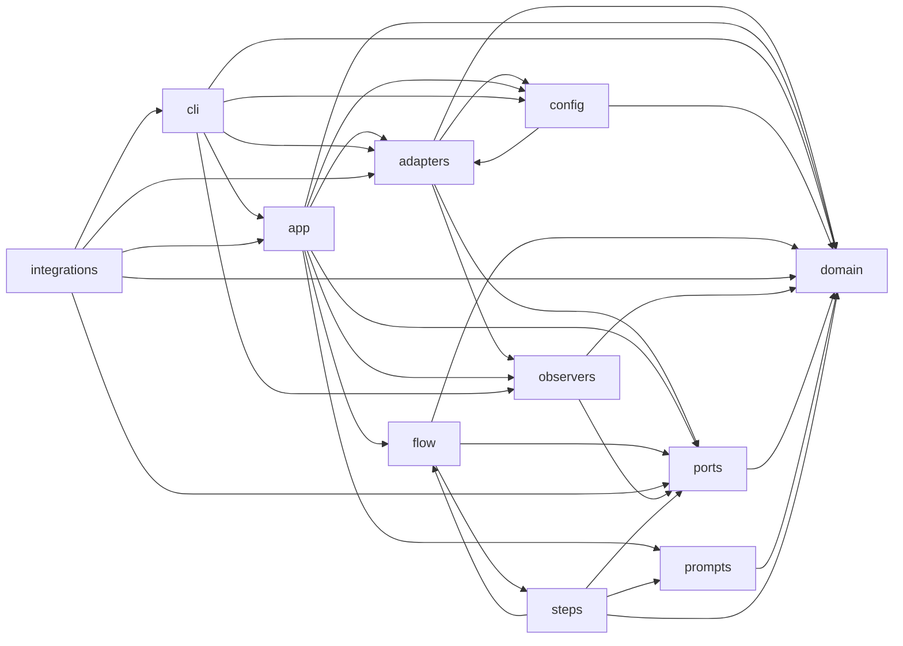
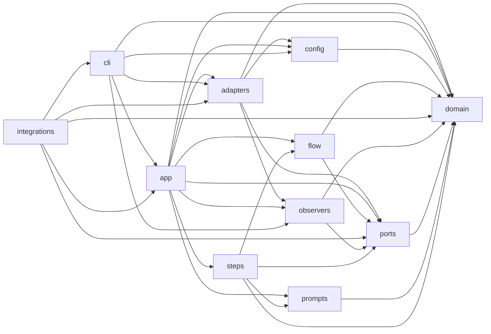

# Workflow ownership and dependency baseline

`src/app/run-flow.ts` owns concrete workflow assembly: step selection, ordered guards,
transitions, halts, resume points, and terminal outcomes. `src/app/run-jig.ts` supplies
that workflow to the engine. `src/flow/define-flow.ts` owns generic flow contracts;
`src/flow/engine.ts` interprets supplied flows. Production `flow` imports neither
`app` nor `steps`. Steps implement the contracts in `flow`; they do not select the
whole workflow. The behavioral workflow spec lives beside the assembly in `app`.

The [interactive map](architecture.html) depicts execution sequence, including an engine
calling supplied steps. Such a runtime call is not a source dependency from `flow` to
`steps`. The source direction after this move is `app → steps → flow`, with `app → flow`
as well. Configuration ownership is unchanged in this slice.

## Prerequisite

Invocation status already belongs to `src/domain/invocation-status.ts`, including
`INVOCATION_STATUSES`, `InvocationStatus`, and `outcomeIsComplete`. The engine imports
the domain type; local-store run artifacts and GitHub orchestration also import this
module directly. They need no engine or app import to classify completion. Both
`done` and `completed` count as complete; `stuck`, `halted`, and `blocked` do not.

## Before the assembly move

This baseline was captured before moving any source files, at commit `8f7c1a142d14644817c6ccf73cbb9b9baa452f8a`.
It deliberately retains the observed cycles rather than presenting the intended
architecture as though it were already enforced.

From the repository root, dependency-cruiser 18.7.2 was run with:

```sh
npx depcruise src --no-config --ts-config tsconfig.json --ts-pre-compilation-deps --include-only '^src/' --exclude '\.spec\.ts$' --output-type json
```

The explicit pre-compilation option includes type imports. The inventory below
contains every production `src/` file (125 files), grouped by top-level owner;
specs are excluded. Each file lists all its resolved internal source dependencies,
including same-owner imports. External packages and Node built-ins are omitted.
Repeated imports of the same file are collapsed. This adjacency list captures the
file graph; the following diagram collapses it by owner.



### Observed cycles and other ownership concerns

- `flow ↔ steps`: `flow/run-flow.ts` imports six concrete step modules, which import
  the contracts in `flow/define-flow.ts`. This slice removes the six `flow → steps`
  edges by moving assembly to `app`. It preserves the reverse contract dependencies.
- `config ↔ adapters`: `config/load-config.ts → adapters/sandcastle/agents.ts` and
  `config/presets.ts → adapters/local-store/run-paths.ts`. Reverse dependencies come
  from `adapters/sandcastle/open-session.ts` (environment and load-config),
  `adapters/telemetry/open-telemetry.ts` (environment), and
  `adapters/terminal/ask-for-preset.ts` (presets). These remain for the configuration slice.
- `adapters → observers`: both `adapters/local-store/metrics-log.ts` and
  `adapters/local-store/run-artefacts.ts` import `observers/metrics.ts`. These are
  additional inward ownership concerns, including type dependencies, for final enforcement.
- `cli → adapters`, `cli → config`, and `cli → observers` bypass application wiring.
  The complete file edges below retain these additional boundary concerns for review;
  this slice does not silently grant exemptions or change enforcement settings.
- Configuration also performs filesystem I/O in `load-config.ts`, `presets.ts`, and
  `write-config.ts`; owner-only source graphs do not show Node built-in dependencies.
  Domain has no imports of other source owners. Ports depend only on domain;
  prompts depend only on domain; no core owner imports `integrations`.

## Production file inventory and baseline graph

Paths below are relative to `src/`. An empty dependency list means no internal source imports.
The inventory intentionally uses the pre-move paths; only `flow/run-flow.ts` moves to
`app/run-flow.ts` in this slice. The production file count stays the same.

### adapters (37 files)

- `adapters/find-symlink.ts` → `domain/errors.ts`
- `adapters/git/branch.ts` → `adapters/git/repository.ts`, `domain/errors.ts`
- `adapters/git/git-workspace.ts` → `adapters/git/merge.ts`, `adapters/git/repository.ts`, `domain/errors.ts`, `domain/protected-paths.ts`, `domain/run-id.ts`, `domain/run-state.ts`, `domain/usage.ts`, `domain/work-facts.ts`, `ports/sandbox-git.ts`, `ports/workspace.ts`
- `adapters/git/merge.ts` → `adapters/git/branch.ts`, `adapters/git/repository.ts`, `domain/errors.ts`
- `adapters/git/remote-ref.ts` → `domain/errors.ts`, `domain/retry.ts`
- `adapters/git/repository.ts` → `domain/errors.ts`
- `adapters/git/run-code.ts` → `adapters/git/remote-ref.ts`, `adapters/git/repository.ts`, `adapters/git/run-history.ts`, `domain/errors.ts`, `domain/run-id.ts`, `domain/run-state.ts`, `ports/run-code.ts`
- `adapters/git/run-history.ts` → `domain/errors.ts`
- `adapters/git/throwaway-branch.ts` → `adapters/git/branch.ts`, `adapters/git/repository.ts`, `domain/errors.ts`
- `adapters/local-store/credentials-file.ts` → `adapters/find-symlink.ts`, `adapters/local-store/local-state.ts`, `adapters/local-store/run-paths.ts`, `domain/errors.ts`
- `adapters/local-store/local-run-store.ts` → `adapters/local-store/local-state.ts`, `adapters/local-store/run-paths.ts`, `domain/errors.ts`, `domain/run-id.ts`, `domain/run-state.ts`, `ports/run-store.ts`
- `adapters/local-store/local-state.ts` → `domain/errors.ts`
- `adapters/local-store/metrics-log.ts` → `adapters/local-store/run-paths.ts`, `domain/agent-role.ts`, `domain/errors.ts`, `domain/events.ts`, `domain/outcome.ts`, `domain/run-id.ts`, `observers/metrics.ts`
- `adapters/local-store/run-artefacts.ts` → `adapters/local-store/local-state.ts`, `adapters/local-store/run-paths.ts`, `domain/design-review-report.ts`, `domain/errors.ts`, `domain/invocation-status.ts`, `domain/run-id.ts`, `domain/run-state.ts`, `observers/metrics.ts`
- `adapters/local-store/run-lock.ts` → `adapters/local-store/local-state.ts`, `adapters/local-store/run-paths.ts`, `domain/errors.ts`, `domain/run-id.ts`
- `adapters/local-store/run-paths.ts` → `adapters/find-symlink.ts`, `domain/run-id.ts`
- `adapters/logging/create-logger.ts` → none
- `adapters/run-store/composite-run-store.ts` → `domain/errors.ts`, `domain/run-id.ts`, `domain/run-state.ts`, `ports/run-code.ts`, `ports/run-store.ts`
- `adapters/run-store/git-remote-run-store.ts` → `adapters/git/remote-ref.ts`, `adapters/git/repository.ts`, `domain/errors.ts`, `domain/run-id.ts`, `domain/run-state.ts`, `ports/run-store.ts`
- `adapters/sandbox-image/docker-images.ts` → `domain/errors.ts`, `ports/sandbox-images.ts`
- `adapters/sandbox-image/image-recipe.ts` → `domain/errors.ts`
- `adapters/sandbox-image/latest-agent-versions.ts` → none
- `adapters/sandcastle/agents.ts` → `adapters/local-store/credentials-file.ts`, `adapters/sandcastle/codex-auth.ts`, `domain/errors.ts`
- `adapters/sandcastle/codex-auth.ts` → `domain/errors.ts`
- `adapters/sandcastle/git-hooks.ts` → none
- `adapters/sandcastle/open-session.ts` → `adapters/local-store/run-paths.ts`, `adapters/sandcastle/agents.ts`, `adapters/sandcastle/sandcastle-env.ts`, `adapters/sandcastle/sandcastle-session.ts`, `adapters/telemetry/open-telemetry.ts`, `config/environment.ts`, `config/load-config.ts`, `domain/agent-role.ts`, `domain/errors.ts`, `domain/run-state.ts`, `ports/observability.ts`
- `adapters/sandcastle/private-clone-docker.ts` → `adapters/git/repository.ts`, `domain/errors.ts`
- `adapters/sandcastle/sandcastle-env.ts` → none
- `adapters/sandcastle/sandcastle-session.ts` → `adapters/find-symlink.ts`, `adapters/sandcastle/codex-auth.ts`, `adapters/sandcastle/git-hooks.ts`, `adapters/sandcastle/private-clone-docker.ts`, `adapters/sandcastle/structured-output.ts`, `adapters/sandcastle/usage.ts`, `domain/errors.ts`, `domain/run-id.ts`, `domain/run-state.ts`, `ports/agent-session.ts`, `ports/observability.ts`, `ports/sandbox-git.ts`
- `adapters/sandcastle/structured-output.ts` → `domain/errors.ts`
- `adapters/sandcastle/usage.ts` → `domain/usage.ts`
- `adapters/telemetry/open-telemetry.ts` → `config/environment.ts`
- `adapters/terminal/ask-for-agents.ts` → `adapters/sandcastle/agents.ts`, `adapters/terminal/terminal.ts`, `domain/agent-role.ts`
- `adapters/terminal/ask-for-credential.ts` → `adapters/local-store/credentials-file.ts`, `adapters/sandcastle/agents.ts`, `adapters/terminal/terminal.ts`
- `adapters/terminal/ask-for-preset.ts` → `adapters/terminal/terminal.ts`, `config/presets.ts`
- `adapters/terminal/standard-input.ts` → none
- `adapters/terminal/terminal.ts` → `domain/errors.ts`

### app (9 files)

- `app/container.ts` → `adapters/git/git-workspace.ts`, `adapters/local-store/metrics-log.ts`, `adapters/local-store/run-artefacts.ts`, `adapters/local-store/run-paths.ts`, `adapters/logging/create-logger.ts`, `adapters/sandbox-image/docker-images.ts`, `adapters/sandbox-image/latest-agent-versions.ts`, `adapters/sandcastle/agents.ts`, `adapters/sandcastle/open-session.ts`, `adapters/sandcastle/sandcastle-session.ts`, `adapters/terminal/ask-for-agents.ts`, `adapters/terminal/ask-for-credential.ts`, `app/observed-events.ts`, `app/report-cleanup.ts`, `app/sandbox-image.ts`, `config/environment.ts`, `config/load-config.ts`, `domain/agent-role.ts`, `domain/retry.ts`, `domain/run-state.ts`, `domain/settings.ts`, `flow/engine.ts`, `observers/logging-observer.ts`, `observers/metrics.ts`, `observers/run-events.ts`, `observers/tracing-observer.ts`, `ports/agent-session.ts`, `ports/observability.ts`, `ports/run-store.ts`, `ports/sandbox-git.ts`, `ports/sandbox-images.ts`, `ports/workspace.ts`
- `app/init-sandbox.ts` → `adapters/find-symlink.ts`, `adapters/local-store/credentials-file.ts`, `adapters/sandbox-image/image-recipe.ts`, `adapters/sandcastle/agents.ts`, `adapters/sandcastle/sandcastle-session.ts`, `app/container.ts`, `app/sandbox-image.ts`, `app/throwaway-sandbox.ts`, `config/environment.ts`, `config/load-config.ts`, `config/write-config.ts`, `domain/errors.ts`, `prompts/toolchain.ts`
- `app/observed-events.ts` → `domain/events.ts`, `observers/run-events.ts`
- `app/report-cleanup.ts` → none
- `app/run-jig.ts` → `adapters/git/branch.ts`, `adapters/git/run-history.ts`, `adapters/local-store/metrics-log.ts`, `adapters/local-store/run-lock.ts`, `adapters/sandcastle/open-session.ts`, `adapters/telemetry/open-telemetry.ts`, `app/container.ts`, `app/run-stores.ts`, `app/sandbox-image.ts`, `config/load-config.ts`, `domain/errors.ts`, `domain/run-id.ts`, `domain/run-state.ts`, `flow/define-flow.ts`, `flow/engine.ts`, `flow/run-flow.ts`, `ports/run-store.ts`
- `app/run-status.ts` → `adapters/local-store/metrics-log.ts`, `adapters/local-store/run-artefacts.ts`, `app/container.ts`, `app/run-stores.ts`, `domain/errors.ts`, `domain/run-id.ts`, `domain/run-state.ts`, `observers/metrics.ts`
- `app/run-stores.ts` → `adapters/git/run-code.ts`, `adapters/local-store/local-run-store.ts`, `adapters/run-store/composite-run-store.ts`, `adapters/run-store/git-remote-run-store.ts`, `app/container.ts`, `domain/errors.ts`, `domain/run-id.ts`, `domain/run-state.ts`, `ports/run-store.ts`
- `app/sandbox-image.ts` → `adapters/sandbox-image/image-recipe.ts`, `adapters/sandcastle/agents.ts`, `config/load-config.ts`, `domain/errors.ts`, `ports/sandbox-images.ts`
- `app/throwaway-sandbox.ts` → `adapters/git/branch.ts`, `adapters/git/throwaway-branch.ts`, `adapters/sandcastle/sandcastle-session.ts`, `app/container.ts`, `app/observed-events.ts`, `app/report-cleanup.ts`, `domain/errors.ts`, `domain/run-id.ts`, `domain/run-state.ts`, `observers/logging-observer.ts`

### cli (13 files)

- `cli/app-action.ts` → `app/container.ts`, `cli/with-app.ts`, `cli/with-error-handling.ts`, `cli/with-input.ts`, `domain/errors.ts`
- `cli/commands/presets.ts` → `adapters/logging/create-logger.ts`, `cli/with-app.ts`, `cli/with-error-handling.ts`, `config/presets.ts`
- `cli/commands/run.ts` → `app/run-jig.ts`, `cli/app-action.ts`, `cli/config-option.ts`, `cli/log-format-option.ts`, `cli/read-request.ts`, `cli/with-app.ts`, `domain/errors.ts`, `domain/run-id.ts`, `domain/run-state.ts`
- `cli/commands/sandbox.ts` → `app/init-sandbox.ts`, `app/sandbox-image.ts`, `cli/app-action.ts`, `cli/config-option.ts`, `cli/log-format-option.ts`
- `cli/commands/status.ts` → `adapters/logging/create-logger.ts`, `app/run-status.ts`, `cli/config-option.ts`, `cli/with-app.ts`, `cli/with-error-handling.ts`, `cli/with-input.ts`, `domain/run-id.ts`, `domain/run-state.ts`, `domain/slice.ts`, `observers/metrics.ts`
- `cli/config-option.ts` → `config/presets.ts`
- `cli/exit-when-done.ts` → none
- `cli/log-format-option.ts` → `adapters/logging/create-logger.ts`
- `cli/main.ts` → `cli/commands/presets.ts`, `cli/commands/run.ts`, `cli/commands/sandbox.ts`, `cli/commands/status.ts`
- `cli/read-request.ts` → `adapters/terminal/standard-input.ts`, `app/run-jig.ts`, `domain/errors.ts`
- `cli/with-app.ts` → `adapters/git/repository.ts`, `adapters/local-store/credentials-file.ts`, `adapters/logging/create-logger.ts`, `adapters/terminal/ask-for-preset.ts`, `adapters/terminal/standard-input.ts`, `app/container.ts`, `cli/config-option.ts`, `config/environment.ts`, `config/load-config.ts`, `config/presets.ts`, `domain/errors.ts`
- `cli/with-error-handling.ts` → `domain/errors.ts`
- `cli/with-input.ts` → `config/describe-issues.ts`, `domain/errors.ts`

### config (5 files)

- `config/describe-issues.ts` → none
- `config/environment.ts` → `config/describe-issues.ts`, `domain/errors.ts`
- `config/load-config.ts` → `adapters/sandcastle/agents.ts`, `config/describe-issues.ts`, `domain/agent-role.ts`, `domain/errors.ts`, `domain/settings.ts`
- `config/presets.ts` → `adapters/local-store/run-paths.ts`, `config/describe-issues.ts`, `config/environment.ts`, `config/load-config.ts`, `domain/agent-role.ts`, `domain/errors.ts`
- `config/write-config.ts` → `config/load-config.ts`, `domain/errors.ts`

### domain (22 files)

- `domain/agent-role.ts` → none
- `domain/apply-outcome.ts` → `domain/completion-reuse.ts`, `domain/design-review.ts`, `domain/diagnostics.ts`, `domain/final-check.ts`, `domain/outcome.ts`, `domain/run-state.ts`, `domain/slice.ts`
- `domain/completion-reuse.ts` → `domain/final-check.ts`, `domain/run-state.ts`, `domain/settings.ts`, `domain/slice.ts`, `domain/work-facts.ts`
- `domain/design-docs.ts` → none
- `domain/design-review-report.ts` → `domain/design-review.ts`, `domain/run-state.ts`
- `domain/design-review.ts` → `domain/design-docs.ts`, `domain/errors.ts`, `domain/run-state.ts`
- `domain/diagnostics.ts` → none
- `domain/errors.ts` → none
- `domain/events.ts` → `domain/agent-role.ts`, `domain/outcome.ts`, `domain/run-id.ts`, `domain/run-state.ts`, `domain/slice.ts`, `domain/usage.ts`
- `domain/final-check.ts` → `domain/diagnostics.ts`, `domain/outcome.ts`, `domain/run-state.ts`, `domain/slice.ts`
- `domain/invocation-status.ts` → none
- `domain/outcome.ts` → `domain/completion-reuse.ts`, `domain/design-docs.ts`, `domain/design-review.ts`, `domain/run-state.ts`, `domain/slice.ts`, `domain/usage.ts`, `domain/work-facts.ts`
- `domain/plan-coverage.ts` → `domain/errors.ts`, `domain/slice.ts`
- `domain/protected-paths.ts` → none
- `domain/retry.ts` → `domain/errors.ts`, `domain/settings.ts`
- `domain/run-diagnostics.ts` → `domain/diagnostics.ts`, `domain/run-state.ts`, `domain/slice.ts`
- `domain/run-id.ts` → none
- `domain/run-state.ts` → `domain/completion-reuse.ts`, `domain/design-docs.ts`, `domain/design-review.ts`, `domain/diagnostics.ts`, `domain/final-check.ts`, `domain/run-id.ts`, `domain/settings.ts`, `domain/slice.ts`
- `domain/settings.ts` → `domain/slice.ts`
- `domain/slice.ts` → `domain/diagnostics.ts`, `domain/work-facts.ts`
- `domain/usage.ts` → none
- `domain/work-facts.ts` → none

### flow (3 files)

- `flow/define-flow.ts` → `domain/errors.ts`, `domain/outcome.ts`, `domain/run-state.ts`, `domain/settings.ts`, `domain/slice.ts`, `ports/agent-session.ts`, `ports/workspace.ts`
- `flow/engine.ts` → `domain/apply-outcome.ts`, `domain/errors.ts`, `domain/events.ts`, `domain/invocation-status.ts`, `domain/outcome.ts`, `domain/retry.ts`, `domain/run-id.ts`, `domain/run-state.ts`, `domain/settings.ts`, `flow/define-flow.ts`, `ports/observability.ts`, `ports/run-store.ts`
- `flow/run-flow.ts` → `domain/design-review.ts`, `domain/final-check.ts`, `domain/run-state.ts`, `domain/settings.ts`, `flow/define-flow.ts`, `steps/completion-reuse.ts`, `steps/design-review.ts`, `steps/final-check.ts`, `steps/finishing.ts`, `steps/planning.ts`, `steps/slice.ts`

### integrations (12 files)

- `integrations/github/cli.ts` → `cli/app-action.ts`, `cli/exit-when-done.ts`, `cli/main.ts`, `integrations/github/command.ts`, `integrations/github/github-port.ts`
- `integrations/github/command.ts` → `cli/app-action.ts`, `cli/config-option.ts`, `cli/log-format-option.ts`, `cli/with-app.ts`, `integrations/github/errors.ts`, `integrations/github/github-port.ts`, `integrations/github/implement-issue.ts`, `integrations/github/octokit-github.ts`, `integrations/github/repository-identity.ts`
- `integrations/github/errors.ts` → none
- `integrations/github/findings-comment.ts` → `domain/diagnostics.ts`, `domain/run-diagnostics.ts`, `domain/run-state.ts`
- `integrations/github/github-port.ts` → `integrations/github/errors.ts`
- `integrations/github/implement-issue.ts` → `adapters/git/branch.ts`, `adapters/git/run-history.ts`, `app/container.ts`, `app/run-jig.ts`, `app/run-stores.ts`, `domain/errors.ts`, `domain/invocation-status.ts`, `domain/run-id.ts`, `domain/run-state.ts`, `integrations/github/errors.ts`, `integrations/github/findings-comment.ts`, `integrations/github/github-port.ts`, `integrations/github/orchestration-state.ts`, `integrations/github/orchestration-store.ts`, `integrations/github/request-snapshot.ts`, `integrations/github/run-branch-publication.ts`, `ports/run-store.ts`
- `integrations/github/octokit-github.ts` → `domain/retry.ts`, `integrations/github/errors.ts`, `integrations/github/github-port.ts`
- `integrations/github/orchestration-state.ts` → `domain/invocation-status.ts`, `domain/run-id.ts`, `integrations/github/github-port.ts`
- `integrations/github/orchestration-store.ts` → `adapters/git/remote-ref.ts`, `app/report-cleanup.ts`, `domain/errors.ts`, `domain/retry.ts`, `integrations/github/errors.ts`, `integrations/github/orchestration-state.ts`
- `integrations/github/repository-identity.ts` → `adapters/git/repository.ts`, `integrations/github/errors.ts`, `integrations/github/github-port.ts`
- `integrations/github/request-snapshot.ts` → `integrations/github/github-port.ts`
- `integrations/github/run-branch-publication.ts` → `adapters/git/remote-ref.ts`, `adapters/git/repository.ts`, `adapters/git/run-history.ts`, `domain/errors.ts`, `domain/run-id.ts`, `domain/run-state.ts`, `integrations/github/errors.ts`

### observers (4 files)

- `observers/logging-observer.ts` → `domain/events.ts`
- `observers/metrics.ts` → `domain/agent-role.ts`, `domain/events.ts`, `domain/outcome.ts`, `domain/run-id.ts`, `domain/usage.ts`, `ports/observability.ts`
- `observers/run-events.ts` → `domain/errors.ts`, `domain/events.ts`, `ports/observability.ts`
- `observers/tracing-observer.ts` → `domain/events.ts`

### ports (7 files)

- `ports/agent-session.ts` → `domain/agent-role.ts`, `domain/errors.ts`
- `ports/observability.ts` → `domain/events.ts`
- `ports/run-code.ts` → `domain/errors.ts`, `domain/run-id.ts`
- `ports/run-store.ts` → `domain/errors.ts`, `domain/run-id.ts`, `domain/run-state.ts`
- `ports/sandbox-git.ts` → `domain/errors.ts`, `ports/agent-session.ts`
- `ports/sandbox-images.ts` → `domain/errors.ts`
- `ports/workspace.ts` → `domain/errors.ts`, `domain/protected-paths.ts`, `domain/usage.ts`, `domain/work-facts.ts`

### prompts (6 files)

- `prompts/design-review.ts` → `domain/design-docs.ts`, `domain/design-review.ts`, `domain/run-state.ts`
- `prompts/final-check.ts` → `domain/final-check.ts`
- `prompts/planning.ts` → `domain/run-state.ts`
- `prompts/pull-request.ts` → `domain/completion-reuse.ts`, `domain/final-check.ts`, `domain/run-state.ts`, `domain/slice.ts`
- `prompts/slice.ts` → `domain/protected-paths.ts`, `domain/slice.ts`
- `prompts/toolchain.ts` → none

### steps (7 files)

- `steps/completion-reuse.ts` → `domain/completion-reuse.ts`, `domain/errors.ts`, `domain/outcome.ts`, `flow/define-flow.ts`
- `steps/design-review.ts` → `domain/design-review.ts`, `domain/run-state.ts`, `flow/define-flow.ts`, `prompts/design-review.ts`
- `steps/final-check.ts` → `domain/final-check.ts`, `domain/outcome.ts`, `flow/define-flow.ts`, `ports/agent-session.ts`, `prompts/final-check.ts`
- `steps/finishing.ts` → `domain/completion-reuse.ts`, `domain/outcome.ts`, `domain/run-state.ts`, `domain/slice.ts`, `flow/define-flow.ts`, `prompts/pull-request.ts`, `steps/completion-reuse.ts`, `steps/pull-request-description.ts`
- `steps/planning.ts` → `domain/design-docs.ts`, `domain/errors.ts`, `domain/outcome.ts`, `domain/plan-coverage.ts`, `domain/retry.ts`, `domain/run-state.ts`, `domain/slice.ts`, `flow/define-flow.ts`, `prompts/planning.ts`
- `steps/pull-request-description.ts` → `domain/completion-reuse.ts`, `domain/final-check.ts`, `domain/run-state.ts`, `domain/settings.ts`, `domain/slice.ts`
- `steps/slice.ts` → `domain/completion-reuse.ts`, `domain/errors.ts`, `domain/final-check.ts`, `domain/outcome.ts`, `domain/protected-paths.ts`, `domain/run-state.ts`, `domain/slice.ts`, `flow/define-flow.ts`, `prompts/slice.ts`

## After configuration ownership

The complete production graph was recomputed with the dependency-cruiser command above,
including type imports: 127 source files. The aggregate graph is acyclic.
Configuration imports only domain; adapters consume configuration policy.
Provider construction, credential checks, authentication and filesystem operations
remain with their existing owners. No enforcement settings changed.

Dependency-first topological order: `domain`, `ports`, `config`, `observers`, `adapters`, `flow`, `prompts`, `steps`, `app`, `cli`, `integrations`.



## Configuration I/O and defaults

Configuration file reading and writing, preset discovery and reading, and environment capture
have left `src/config`.

Presets cross the `PresetSource` contract in `src/config/preset-source.ts`. A source names the
places it looks in, highest precedence first; for one name it yields the present candidates in
that order, looking at each place only when reached; and it lists every present candidate, each
place's in name order. A candidate carries the name its place gives it, an opaque label (source,
path and whether it is a shipped starter) and a `read` that decodes its JSON only when called.
The source fails narrowly as not findable, unlistable, unreadable or not JSON.
`src/config/presets.ts` owns the selection rule: it skips candidates whose names are not valid
preset names without reading them, lets the first candidate of a name win and shadow the rest
unread, refuses a broken winner instead of falling back, validates the strict preset schema,
replaces whole roles, and turns source failures into `ConfigInvalid` messages that name the
location. A named lookup reads only its winner and lists nothing; only a missing name lists the
places to say which presets exist. `src/adapters/filesystem/preset-source.ts` owns the ordering:
the repository's `.jig/presets`, the home directory's `.jig/presets`, the XDG config home's
`jig/presets` (`~/.config` unless `XDG_CONFIG_HOME` is absolute) and the packaged starters, a
directory two sources share looked in once. It maps a name to its `.json` file, counts any entry
`lstat` finds as present, a dangling link included, and reads and parses the file.

Settings cross one boundary, the `ConfigSource` contract in `src/config/config-source.ts`. A
source reports its destination's name, whether the operator chose it with `--config`, and either
the raw JSON it holds or that nothing is there, with the native reason; it fails narrowly as
unreadable, not JSON or unwritable, and writes whole settings. `loadConfig` in
`src/config/load-config.ts` decides that only the repository's own settings may be absent,
applies the strict schema and its defaults, and so refuses the retry defaults as keys.
`updateConfig` in `src/config/update-config.ts` merges new keys over the current object, creates
absent settings and refuses anything that is not an object. Both turn source failures into
`ConfigInvalid` messages. `src/adapters/filesystem/config-source.ts` resolves the destination
(`jig.config.json` in the repository root, or a `--config` path resolved against it), reads and
parses its JSON and writes it atomically. `jig init` takes that concrete destination separately to
write the starter file and to refuse symbolic links at both starter destinations before writing
either.
`src/cli/with-app.ts` captures `process.env`, the working directory and the fallback home
directory at the process edge and passes them to `parseEnvironment`. Config keeps the schemas,
defaults, provider and model policy, preset-name validation, first-winner selection and the
preset schema.

The step retry count (2) and first retry delay (5000 ms) are private defaults in
`src/config/load-config.ts`, which `runSettingsFrom` resolves into `RunSettings`. They are not
configuration keys, and presets still override agent roles only. `src/domain/settings.ts` keeps
`RunSettings`, `reviewCapReached`, `sliceNeedsVerification` and the stopping caps
(`HOOK_FAILURE_CAP`, `VERIFICATION_FAILURE_CAP`, `EMPTY_ATTEMPT_CAP`, `RULE_FIX_CAP`).
`retryResult` reads the resolved count and delay unchanged.

Dependency-cruiser's `config-does-no-io` rule rejects config imports of adapters, `node:fs`,
`node:fs/promises`, `node:os` and `write-file-atomic`. Adapters may import config, and ports
still depend only on domain. CLI commands still receive the container through
`src/cli/with-app.ts` and `src/cli/app-action.ts`, which also prepares the invocation, and
`src/app/container.ts` remains the composition root; moving preparation into application
operations and composition out of `app` are separate slices.
