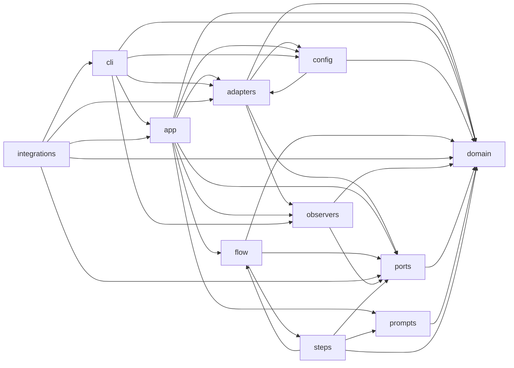
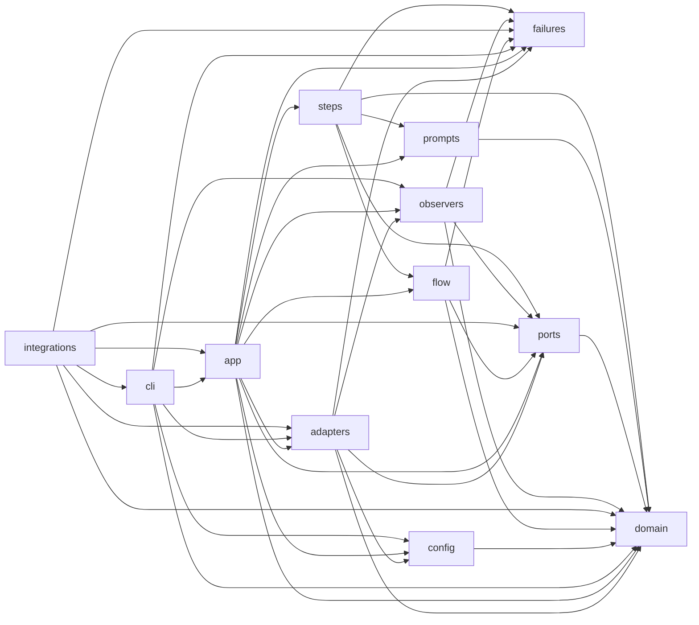

# Workflow ownership and dependency baseline

`src/app/run-flow.ts` owns concrete workflow assembly: step selection, ordered guards,
transitions, halts, resume points, and terminal outcomes. `src/app/run-jig.ts` supplies
that workflow to the engine. `src/flow/define-flow.ts` owns generic flow contracts;
`src/flow/engine.ts` interprets supplied flows. Production `flow` imports neither
`app` nor `steps`. Steps implement the contracts in `flow`; they do not select the
whole workflow. The behavioral workflow spec lives beside the assembly in `app`.

The [interactive map](architecture.html) depicts execution sequence, including an engine
calling supplied steps. Such a runtime call is not a source dependency from `flow` to
`steps`. The source direction after this move is `app → steps → flow`, with `app → flow`
as well. Configuration ownership is unchanged in this slice.

## Prerequisite

Invocation status already belongs to `src/domain/invocation-status.ts`, including
`INVOCATION_STATUSES`, `InvocationStatus`, and `outcomeIsComplete`. The engine imports
the domain type; local-store run artifacts and GitHub orchestration also import this
module directly. They need no engine or app import to classify completion. Both
`done` and `completed` count as complete; `stuck`, `halted`, and `blocked` do not.

## Before the assembly move

This baseline was captured before moving any source files, at commit `8f7c1a142d14644817c6ccf73cbb9b9baa452f8a`.
It deliberately retains the observed cycles rather than presenting the intended
architecture as though it were already enforced.

From the repository root, dependency-cruiser 18.7.2 was run with:

```sh
npx depcruise src --no-config --ts-config tsconfig.json --ts-pre-compilation-deps --include-only '^src/' --exclude '\.spec\.ts$' --output-type json
```

The explicit pre-compilation option includes type imports. The inventory below
contains every production `src/` file (125 files), grouped by top-level owner;
specs are excluded. Each file lists all its resolved internal source dependencies,
including same-owner imports. External packages and Node built-ins are omitted.
Repeated imports of the same file are collapsed. This adjacency list captures the
file graph; the following diagram collapses it by owner.



### Observed cycles and other ownership concerns

- `flow ↔ steps`: `flow/run-flow.ts` imports six concrete step modules, which import
  the contracts in `flow/define-flow.ts`. This slice removes the six `flow → steps`
  edges by moving assembly to `app`. It preserves the reverse contract dependencies.
- `config ↔ adapters`: `config/load-config.ts → adapters/sandcastle/agents.ts` and
  `config/presets.ts → adapters/local-store/run-paths.ts`. Reverse dependencies come
  from `adapters/sandcastle/open-session.ts` (environment and load-config),
  `adapters/telemetry/open-telemetry.ts` (environment), and
  `adapters/terminal/ask-for-preset.ts` (presets). These remain for the configuration slice.
- `adapters → observers`: both `adapters/local-store/metrics-log.ts` and
  `adapters/local-store/run-artefacts.ts` import `observers/metrics.ts`. These are
  additional inward ownership concerns, including type dependencies, for final enforcement.
- `cli → adapters`, `cli → config`, and `cli → observers` bypass application wiring.
  The complete file edges below retain these additional boundary concerns for review;
  this slice does not silently grant exemptions or change enforcement settings.
- Configuration also performs filesystem I/O in `load-config.ts`, `presets.ts`, and
  `write-config.ts`; owner-only source graphs do not show Node built-in dependencies.
  Domain has no imports of other source owners. Ports depend only on domain;
  prompts depend only on domain; no core owner imports `integrations`.

## Production file inventory and baseline graph

Paths below are relative to `src/`. An empty dependency list means no internal source imports.
The inventory intentionally uses the pre-move paths; only `flow/run-flow.ts` moves to
`app/run-flow.ts` in this slice. The production file count stays the same.

### adapters (37 files)

- `adapters/find-symlink.ts` → `domain/errors.ts`
- `adapters/git/branch.ts` → `adapters/git/repository.ts`, `domain/errors.ts`
- `adapters/git/git-workspace.ts` → `adapters/git/merge.ts`, `adapters/git/repository.ts`, `domain/errors.ts`, `domain/protected-paths.ts`, `domain/run-id.ts`, `domain/run-state.ts`, `domain/usage.ts`, `domain/work-facts.ts`, `ports/sandbox-git.ts`, `ports/workspace.ts`
- `adapters/git/merge.ts` → `adapters/git/branch.ts`, `adapters/git/repository.ts`, `domain/errors.ts`
- `adapters/git/remote-ref.ts` → `domain/errors.ts`, `domain/retry.ts`
- `adapters/git/repository.ts` → `domain/errors.ts`
- `adapters/git/run-code.ts` → `adapters/git/remote-ref.ts`, `adapters/git/repository.ts`, `adapters/git/run-history.ts`, `domain/errors.ts`, `domain/run-id.ts`, `domain/run-state.ts`, `ports/run-code.ts`
- `adapters/git/run-history.ts` → `domain/errors.ts`
- `adapters/git/throwaway-branch.ts` → `adapters/git/branch.ts`, `adapters/git/repository.ts`, `domain/errors.ts`
- `adapters/local-store/credentials-file.ts` → `adapters/find-symlink.ts`, `adapters/local-store/local-state.ts`, `adapters/local-store/run-paths.ts`, `domain/errors.ts`
- `adapters/local-store/local-run-store.ts` → `adapters/local-store/local-state.ts`, `adapters/local-store/run-paths.ts`, `domain/errors.ts`, `domain/run-id.ts`, `domain/run-state.ts`, `ports/run-store.ts`
- `adapters/local-store/local-state.ts` → `domain/errors.ts`
- `adapters/local-store/metrics-log.ts` → `adapters/local-store/run-paths.ts`, `domain/agent-role.ts`, `domain/errors.ts`, `domain/events.ts`, `domain/outcome.ts`, `domain/run-id.ts`, `observers/metrics.ts`
- `adapters/local-store/run-artefacts.ts` → `adapters/local-store/local-state.ts`, `adapters/local-store/run-paths.ts`, `domain/design-review-report.ts`, `domain/errors.ts`, `domain/invocation-status.ts`, `domain/run-id.ts`, `domain/run-state.ts`, `observers/metrics.ts`
- `adapters/local-store/run-lock.ts` → `adapters/local-store/local-state.ts`, `adapters/local-store/run-paths.ts`, `domain/errors.ts`, `domain/run-id.ts`
- `adapters/local-store/run-paths.ts` → `adapters/find-symlink.ts`, `domain/run-id.ts`
- `adapters/logging/create-logger.ts` → none
- `adapters/run-store/composite-run-store.ts` → `domain/errors.ts`, `domain/run-id.ts`, `domain/run-state.ts`, `ports/run-code.ts`, `ports/run-store.ts`
- `adapters/run-store/git-remote-run-store.ts` → `adapters/git/remote-ref.ts`, `adapters/git/repository.ts`, `domain/errors.ts`, `domain/run-id.ts`, `domain/run-state.ts`, `ports/run-store.ts`
- `adapters/sandbox-image/docker-images.ts` → `domain/errors.ts`, `ports/sandbox-images.ts`
- `adapters/sandbox-image/image-recipe.ts` → `domain/errors.ts`
- `adapters/sandbox-image/latest-agent-versions.ts` → none
- `adapters/sandcastle/agents.ts` → `adapters/local-store/credentials-file.ts`, `adapters/sandcastle/codex-auth.ts`, `domain/errors.ts`
- `adapters/sandcastle/codex-auth.ts` → `domain/errors.ts`
- `adapters/sandcastle/git-hooks.ts` → none
- `adapters/sandcastle/open-session.ts` → `adapters/local-store/run-paths.ts`, `adapters/sandcastle/agents.ts`, `adapters/sandcastle/sandcastle-env.ts`, `adapters/sandcastle/sandcastle-session.ts`, `adapters/telemetry/open-telemetry.ts`, `config/environment.ts`, `config/load-config.ts`, `domain/agent-role.ts`, `domain/errors.ts`, `domain/run-state.ts`, `ports/observability.ts`
- `adapters/sandcastle/private-clone-docker.ts` → `adapters/git/repository.ts`, `domain/errors.ts`
- `adapters/sandcastle/sandcastle-env.ts` → none
- `adapters/sandcastle/sandcastle-session.ts` → `adapters/find-symlink.ts`, `adapters/sandcastle/codex-auth.ts`, `adapters/sandcastle/git-hooks.ts`, `adapters/sandcastle/private-clone-docker.ts`, `adapters/sandcastle/structured-output.ts`, `adapters/sandcastle/usage.ts`, `domain/errors.ts`, `domain/run-id.ts`, `domain/run-state.ts`, `ports/agent-session.ts`, `ports/observability.ts`, `ports/sandbox-git.ts`
- `adapters/sandcastle/structured-output.ts` → `domain/errors.ts`
- `adapters/sandcastle/usage.ts` → `domain/usage.ts`
- `adapters/telemetry/open-telemetry.ts` → `config/environment.ts`
- `adapters/terminal/ask-for-agents.ts` → `adapters/sandcastle/agents.ts`, `adapters/terminal/terminal.ts`, `domain/agent-role.ts`
- `adapters/terminal/ask-for-credential.ts` → `adapters/local-store/credentials-file.ts`, `adapters/sandcastle/agents.ts`, `adapters/terminal/terminal.ts`
- `adapters/terminal/ask-for-preset.ts` → `adapters/terminal/terminal.ts`, `config/presets.ts`
- `adapters/terminal/standard-input.ts` → none
- `adapters/terminal/terminal.ts` → `domain/errors.ts`

### app (9 files)

- `app/container.ts` → `adapters/git/git-workspace.ts`, `adapters/local-store/metrics-log.ts`, `adapters/local-store/run-artefacts.ts`, `adapters/local-store/run-paths.ts`, `adapters/logging/create-logger.ts`, `adapters/sandbox-image/docker-images.ts`, `adapters/sandbox-image/latest-agent-versions.ts`, `adapters/sandcastle/agents.ts`, `adapters/sandcastle/open-session.ts`, `adapters/sandcastle/sandcastle-session.ts`, `adapters/terminal/ask-for-agents.ts`, `adapters/terminal/ask-for-credential.ts`, `app/observed-events.ts`, `app/report-cleanup.ts`, `app/sandbox-image.ts`, `config/environment.ts`, `config/load-config.ts`, `domain/agent-role.ts`, `domain/retry.ts`, `domain/run-state.ts`, `domain/settings.ts`, `flow/engine.ts`, `observers/logging-observer.ts`, `observers/metrics.ts`, `observers/run-events.ts`, `observers/tracing-observer.ts`, `ports/agent-session.ts`, `ports/observability.ts`, `ports/run-store.ts`, `ports/sandbox-git.ts`, `ports/sandbox-images.ts`, `ports/workspace.ts`
- `app/init-sandbox.ts` → `adapters/find-symlink.ts`, `adapters/local-store/credentials-file.ts`, `adapters/sandbox-image/image-recipe.ts`, `adapters/sandcastle/agents.ts`, `adapters/sandcastle/sandcastle-session.ts`, `app/container.ts`, `app/sandbox-image.ts`, `app/throwaway-sandbox.ts`, `config/environment.ts`, `config/load-config.ts`, `config/write-config.ts`, `domain/errors.ts`, `prompts/toolchain.ts`
- `app/observed-events.ts` → `domain/events.ts`, `observers/run-events.ts`
- `app/report-cleanup.ts` → none
- `app/run-jig.ts` → `adapters/git/branch.ts`, `adapters/git/run-history.ts`, `adapters/local-store/metrics-log.ts`, `adapters/local-store/run-lock.ts`, `adapters/sandcastle/open-session.ts`, `adapters/telemetry/open-telemetry.ts`, `app/container.ts`, `app/run-stores.ts`, `app/sandbox-image.ts`, `config/load-config.ts`, `domain/errors.ts`, `domain/run-id.ts`, `domain/run-state.ts`, `flow/define-flow.ts`, `flow/engine.ts`, `flow/run-flow.ts`, `ports/run-store.ts`
- `app/run-status.ts` → `adapters/local-store/metrics-log.ts`, `adapters/local-store/run-artefacts.ts`, `app/container.ts`, `app/run-stores.ts`, `domain/errors.ts`, `domain/run-id.ts`, `domain/run-state.ts`, `observers/metrics.ts`
- `app/run-stores.ts` → `adapters/git/run-code.ts`, `adapters/local-store/local-run-store.ts`, `adapters/run-store/composite-run-store.ts`, `adapters/run-store/git-remote-run-store.ts`, `app/container.ts`, `domain/errors.ts`, `domain/run-id.ts`, `domain/run-state.ts`, `ports/run-store.ts`
- `app/sandbox-image.ts` → `adapters/sandbox-image/image-recipe.ts`, `adapters/sandcastle/agents.ts`, `config/load-config.ts`, `domain/errors.ts`, `ports/sandbox-images.ts`
- `app/throwaway-sandbox.ts` → `adapters/git/branch.ts`, `adapters/git/throwaway-branch.ts`, `adapters/sandcastle/sandcastle-session.ts`, `app/container.ts`, `app/observed-events.ts`, `app/report-cleanup.ts`, `domain/errors.ts`, `domain/run-id.ts`, `domain/run-state.ts`, `observers/logging-observer.ts`

### cli (13 files)

- `cli/app-action.ts` → `app/container.ts`, `cli/with-app.ts`, `cli/with-error-handling.ts`, `cli/with-input.ts`, `domain/errors.ts`
- `cli/commands/presets.ts` → `adapters/logging/create-logger.ts`, `cli/with-app.ts`, `cli/with-error-handling.ts`, `config/presets.ts`
- `cli/commands/run.ts` → `app/run-jig.ts`, `cli/app-action.ts`, `cli/config-option.ts`, `cli/log-format-option.ts`, `cli/read-request.ts`, `cli/with-app.ts`, `domain/errors.ts`, `domain/run-id.ts`, `domain/run-state.ts`
- `cli/commands/sandbox.ts` → `app/init-sandbox.ts`, `app/sandbox-image.ts`, `cli/app-action.ts`, `cli/config-option.ts`, `cli/log-format-option.ts`
- `cli/commands/status.ts` → `adapters/logging/create-logger.ts`, `app/run-status.ts`, `cli/config-option.ts`, `cli/with-app.ts`, `cli/with-error-handling.ts`, `cli/with-input.ts`, `domain/run-id.ts`, `domain/run-state.ts`, `domain/slice.ts`, `observers/metrics.ts`
- `cli/config-option.ts` → `config/presets.ts`
- `cli/exit-when-done.ts` → none
- `cli/log-format-option.ts` → `adapters/logging/create-logger.ts`
- `cli/main.ts` → `cli/commands/presets.ts`, `cli/commands/run.ts`, `cli/commands/sandbox.ts`, `cli/commands/status.ts`
- `cli/read-request.ts` → `adapters/terminal/standard-input.ts`, `app/run-jig.ts`, `domain/errors.ts`
- `cli/with-app.ts` → `adapters/git/repository.ts`, `adapters/local-store/credentials-file.ts`, `adapters/logging/create-logger.ts`, `adapters/terminal/ask-for-preset.ts`, `adapters/terminal/standard-input.ts`, `app/container.ts`, `cli/config-option.ts`, `config/environment.ts`, `config/load-config.ts`, `config/presets.ts`, `domain/errors.ts`
- `cli/with-error-handling.ts` → `domain/errors.ts`
- `cli/with-input.ts` → `config/describe-issues.ts`, `domain/errors.ts`

### config (5 files)

- `config/describe-issues.ts` → none
- `config/environment.ts` → `config/describe-issues.ts`, `domain/errors.ts`
- `config/load-config.ts` → `adapters/sandcastle/agents.ts`, `config/describe-issues.ts`, `domain/agent-role.ts`, `domain/errors.ts`, `domain/settings.ts`
- `config/presets.ts` → `adapters/local-store/run-paths.ts`, `config/describe-issues.ts`, `config/environment.ts`, `config/load-config.ts`, `domain/agent-role.ts`, `domain/errors.ts`
- `config/write-config.ts` → `config/load-config.ts`, `domain/errors.ts`

### domain (22 files)

- `domain/agent-role.ts` → none
- `domain/apply-outcome.ts` → `domain/completion-reuse.ts`, `domain/design-review.ts`, `domain/diagnostics.ts`, `domain/final-check.ts`, `domain/outcome.ts`, `domain/run-state.ts`, `domain/slice.ts`
- `domain/completion-reuse.ts` → `domain/final-check.ts`, `domain/run-state.ts`, `domain/settings.ts`, `domain/slice.ts`, `domain/work-facts.ts`
- `domain/design-docs.ts` → none
- `domain/design-review-report.ts` → `domain/design-review.ts`, `domain/run-state.ts`
- `domain/design-review.ts` → `domain/design-docs.ts`, `domain/errors.ts`, `domain/run-state.ts`
- `domain/diagnostics.ts` → none
- `domain/errors.ts` → none
- `domain/events.ts` → `domain/agent-role.ts`, `domain/outcome.ts`, `domain/run-id.ts`, `domain/run-state.ts`, `domain/slice.ts`, `domain/usage.ts`
- `domain/final-check.ts` → `domain/diagnostics.ts`, `domain/outcome.ts`, `domain/run-state.ts`, `domain/slice.ts`
- `domain/invocation-status.ts` → none
- `domain/outcome.ts` → `domain/completion-reuse.ts`, `domain/design-docs.ts`, `domain/design-review.ts`, `domain/run-state.ts`, `domain/slice.ts`, `domain/usage.ts`, `domain/work-facts.ts`
- `domain/plan-coverage.ts` → `domain/errors.ts`, `domain/slice.ts`
- `domain/protected-paths.ts` → none
- `domain/retry.ts` → `domain/errors.ts`, `domain/settings.ts`
- `domain/run-diagnostics.ts` → `domain/diagnostics.ts`, `domain/run-state.ts`, `domain/slice.ts`
- `domain/run-id.ts` → none
- `domain/run-state.ts` → `domain/completion-reuse.ts`, `domain/design-docs.ts`, `domain/design-review.ts`, `domain/diagnostics.ts`, `domain/final-check.ts`, `domain/run-id.ts`, `domain/settings.ts`, `domain/slice.ts`
- `domain/settings.ts` → `domain/slice.ts`
- `domain/slice.ts` → `domain/diagnostics.ts`, `domain/work-facts.ts`
- `domain/usage.ts` → none
- `domain/work-facts.ts` → none

### flow (3 files)

- `flow/define-flow.ts` → `domain/errors.ts`, `domain/outcome.ts`, `domain/run-state.ts`, `domain/settings.ts`, `domain/slice.ts`, `ports/agent-session.ts`, `ports/workspace.ts`
- `flow/engine.ts` → `domain/apply-outcome.ts`, `domain/errors.ts`, `domain/events.ts`, `domain/invocation-status.ts`, `domain/outcome.ts`, `domain/retry.ts`, `domain/run-id.ts`, `domain/run-state.ts`, `domain/settings.ts`, `flow/define-flow.ts`, `ports/observability.ts`, `ports/run-store.ts`
- `flow/run-flow.ts` → `domain/design-review.ts`, `domain/final-check.ts`, `domain/run-state.ts`, `domain/settings.ts`, `flow/define-flow.ts`, `steps/completion-reuse.ts`, `steps/design-review.ts`, `steps/final-check.ts`, `steps/finishing.ts`, `steps/planning.ts`, `steps/slice.ts`

### integrations (12 files)

- `integrations/github/cli.ts` → `cli/app-action.ts`, `cli/exit-when-done.ts`, `cli/main.ts`, `integrations/github/command.ts`, `integrations/github/github-port.ts`
- `integrations/github/command.ts` → `cli/app-action.ts`, `cli/config-option.ts`, `cli/log-format-option.ts`, `cli/with-app.ts`, `integrations/github/errors.ts`, `integrations/github/github-port.ts`, `integrations/github/implement-issue.ts`, `integrations/github/octokit-github.ts`, `integrations/github/repository-identity.ts`
- `integrations/github/errors.ts` → none
- `integrations/github/findings-comment.ts` → `domain/diagnostics.ts`, `domain/run-diagnostics.ts`, `domain/run-state.ts`
- `integrations/github/github-port.ts` → `integrations/github/errors.ts`
- `integrations/github/implement-issue.ts` → `adapters/git/branch.ts`, `adapters/git/run-history.ts`, `app/container.ts`, `app/run-jig.ts`, `app/run-stores.ts`, `domain/errors.ts`, `domain/invocation-status.ts`, `domain/run-id.ts`, `domain/run-state.ts`, `integrations/github/errors.ts`, `integrations/github/findings-comment.ts`, `integrations/github/github-port.ts`, `integrations/github/orchestration-state.ts`, `integrations/github/orchestration-store.ts`, `integrations/github/request-snapshot.ts`, `integrations/github/run-branch-publication.ts`, `ports/run-store.ts`
- `integrations/github/octokit-github.ts` → `domain/retry.ts`, `integrations/github/errors.ts`, `integrations/github/github-port.ts`
- `integrations/github/orchestration-state.ts` → `domain/invocation-status.ts`, `domain/run-id.ts`, `integrations/github/github-port.ts`
- `integrations/github/orchestration-store.ts` → `adapters/git/remote-ref.ts`, `app/report-cleanup.ts`, `domain/errors.ts`, `domain/retry.ts`, `integrations/github/errors.ts`, `integrations/github/orchestration-state.ts`
- `integrations/github/repository-identity.ts` → `adapters/git/repository.ts`, `integrations/github/errors.ts`, `integrations/github/github-port.ts`
- `integrations/github/request-snapshot.ts` → `integrations/github/github-port.ts`
- `integrations/github/run-branch-publication.ts` → `adapters/git/remote-ref.ts`, `adapters/git/repository.ts`, `adapters/git/run-history.ts`, `domain/errors.ts`, `domain/run-id.ts`, `domain/run-state.ts`, `integrations/github/errors.ts`

### observers (4 files)

- `observers/logging-observer.ts` → `domain/events.ts`
- `observers/metrics.ts` → `domain/agent-role.ts`, `domain/events.ts`, `domain/outcome.ts`, `domain/run-id.ts`, `domain/usage.ts`, `ports/observability.ts`
- `observers/run-events.ts` → `domain/errors.ts`, `domain/events.ts`, `ports/observability.ts`
- `observers/tracing-observer.ts` → `domain/events.ts`

### ports (7 files)

- `ports/agent-session.ts` → `domain/agent-role.ts`, `domain/errors.ts`
- `ports/observability.ts` → `domain/events.ts`
- `ports/run-code.ts` → `domain/errors.ts`, `domain/run-id.ts`
- `ports/run-store.ts` → `domain/errors.ts`, `domain/run-id.ts`, `domain/run-state.ts`
- `ports/sandbox-git.ts` → `domain/errors.ts`, `ports/agent-session.ts`
- `ports/sandbox-images.ts` → `domain/errors.ts`
- `ports/workspace.ts` → `domain/errors.ts`, `domain/protected-paths.ts`, `domain/usage.ts`, `domain/work-facts.ts`

### prompts (6 files)

- `prompts/design-review.ts` → `domain/design-docs.ts`, `domain/design-review.ts`, `domain/run-state.ts`
- `prompts/final-check.ts` → `domain/final-check.ts`
- `prompts/planning.ts` → `domain/run-state.ts`
- `prompts/pull-request.ts` → `domain/completion-reuse.ts`, `domain/final-check.ts`, `domain/run-state.ts`, `domain/slice.ts`
- `prompts/slice.ts` → `domain/protected-paths.ts`, `domain/slice.ts`
- `prompts/toolchain.ts` → none

### steps (7 files)

- `steps/completion-reuse.ts` → `domain/completion-reuse.ts`, `domain/errors.ts`, `domain/outcome.ts`, `flow/define-flow.ts`
- `steps/design-review.ts` → `domain/design-review.ts`, `domain/run-state.ts`, `flow/define-flow.ts`, `prompts/design-review.ts`
- `steps/final-check.ts` → `domain/final-check.ts`, `domain/outcome.ts`, `flow/define-flow.ts`, `ports/agent-session.ts`, `prompts/final-check.ts`
- `steps/finishing.ts` → `domain/completion-reuse.ts`, `domain/outcome.ts`, `domain/run-state.ts`, `domain/slice.ts`, `flow/define-flow.ts`, `prompts/pull-request.ts`, `steps/completion-reuse.ts`, `steps/pull-request-description.ts`
- `steps/planning.ts` → `domain/design-docs.ts`, `domain/errors.ts`, `domain/outcome.ts`, `domain/plan-coverage.ts`, `domain/retry.ts`, `domain/run-state.ts`, `domain/slice.ts`, `flow/define-flow.ts`, `prompts/planning.ts`
- `steps/pull-request-description.ts` → `domain/completion-reuse.ts`, `domain/final-check.ts`, `domain/run-state.ts`, `domain/settings.ts`, `domain/slice.ts`
- `steps/slice.ts` → `domain/completion-reuse.ts`, `domain/errors.ts`, `domain/final-check.ts`, `domain/outcome.ts`, `domain/protected-paths.ts`, `domain/run-state.ts`, `domain/slice.ts`, `flow/define-flow.ts`, `prompts/slice.ts`

## Current ownership graph

The complete production graph was recomputed with the dependency-cruiser command above,
including type imports: 133 source files. The aggregate graph is acyclic.
Configuration imports only domain; adapters consume configuration policy.
Provider construction, credential checks, authentication and filesystem operations
remain with their existing owners.

Dependency-first topological order: `domain`, `failures`, `ports`, `config`, `observers`, `adapters`, `flow`, `prompts`, `steps`, `app`, `cli`, `integrations`.



### Shared failure helpers

`src/failures/messages.ts` owns `messageOf` and `rootCause`, and `src/failures/retry.ts` owns
`retryResult` and `RetryPolicy`. Callers import them directly from those modules; they are not
ports and are not injected, and no other module declares or re-exports them. Domain keeps the
failure classes, `FailureKind` and `isTransient` in `src/domain/errors.ts`; `isTransient` accepts
any `{ kind: FailureKind }`. Flow owns assembling the step retry policy:
`transientRetryPolicy` in `src/flow/retry-policy.ts` returns `RetryPolicy<{ kind: FailureKind }>`
from the resolved `maxStepRetries` and `retryDelayMs` and `isTransient`, leaving
`onFailedAttempt` to each caller. `flow/engine.ts` and `app/container.ts` import it directly; it
is not a port or an injected dependency. The engine still decides what a failure's kind means for
the run.

The baseline inventory above is the snapshot from before the assembly move. Since then, these
production imports replace the baseline's `domain/errors.ts` and `domain/retry.ts` references for
the shared helpers and the retry policy:

- `failures/messages.ts` ← every adapter that reports a thrown cause (`filesystem/config-source.ts`,
  `filesystem/preset-source.ts`, `find-symlink.ts`, `git/git-workspace.ts`, `git/merge.ts`,
  `git/repository.ts`, `git/run-history.ts`, `local-store/credentials-file.ts`,
  `local-store/local-run-store.ts`, `local-store/local-state.ts`, `local-store/run-lock.ts`,
  `run-store/git-remote-run-store.ts`, `sandbox-image/docker-images.ts`,
  `sandcastle/codex-auth.ts`, `sandcastle/private-clone-docker.ts`,
  `sandcastle/sandcastle-session.ts`, `sandcastle/structured-output.ts`, `terminal/terminal.ts`),
  `app/init-sandbox.ts`, `app/run-stores.ts`, `app/sandbox-image.ts`, `cli/read-request.ts`,
  `cli/with-error-handling.ts`, `flow/engine.ts`, `integrations/github/orchestration-store.ts` and
  `observers/run-events.ts`.
- `failures/retry.ts` ← `adapters/git/remote-ref.ts`, `app/container.ts`, `flow/engine.ts`,
  `flow/retry-policy.ts`, `integrations/github/octokit-github.ts`,
  `integrations/github/orchestration-store.ts` and `steps/planning.ts`.
- `flow/retry-policy.ts` → `domain/errors.ts`, `domain/settings.ts`, `failures/retry.ts`; it
  replaces `domain/retry.ts`, which no longer exists. `app/container.ts` and `flow/engine.ts`
  import it.

Dependency-cruiser's `failures-imports-only-better-result-and-node` rule allows production
`failures` to import only itself, `better-result` and Node built-ins, and
`failures-is-imported-only-by-listed-owners` lets only adapters, app, cli, flow, integrations,
observers and steps import it; domain, ports, config and prompts cannot. `integrations` stands in
for the planned composition owner until that slice moves executable wiring out of it.

`failures` is a one-off owner, not a home for shared utilities. A new helper belongs with the rule
it expresses: a business rule in domain, a capability contract in its port, a configuration policy
in config. Moving the error classes to their owners, moving composition out of `app` and
`integrations`, and separating the GitHub integration are separate slices.

## Failure ownership audit

This audit is the inventory the error-ownership slice works from. Locations are as of the retry
policy move. The retry policy columns record where the policy is assembled; the class rows record
where each class is defined today and the owner the
[application boundaries spec](specs/application-boundaries.md#error-ownership-and-technical-failure-handling)
assigns by what the failure means to callers. The error-ownership slice settles the exact module
and any split, and keeps every tag, field, message and retry/block/fatal classification.

The spec requires diagnostic compatibility: tags, messages and kinds stay as they are, and a
surface that shows or stores an old tag gets an explicit translation, even though the issue that
asked for the move accepted changed log output. The tables below say which surfaces show or store
what, so that requirement applies where a tag actually appears.

### Retry policy ownership

| Responsibility                            | Old location                                                       | New location                                                                                  |
| ----------------------------------------- | ------------------------------------------------------------------ | --------------------------------------------------------------------------------------------- |
| Default count and first delay             | `config/load-config.ts:147`, `:150`                                | unchanged                                                                                     |
| Resolved `maxStepRetries`, `retryDelayMs` | `domain/settings.ts`, from `config/load-config.ts:138-139`         | unchanged                                                                                     |
| Retryable kind (`isTransient`)            | `domain/errors.ts:33`, over `JigError`                             | `domain/errors.ts:33`, over `{ kind: FailureKind }`                                           |
| Step policy assembly                      | `domain/retry.ts` (`transientRetryPolicy`, `TransientRetryPolicy`) | `flow/retry-policy.ts` (`transientRetryPolicy`, returns `RetryPolicy<{ kind: FailureKind }>`) |
| Policy shape and retry loop               | `failures/retry.ts` (`RetryPolicy`, `retryResult`)                 | unchanged                                                                                     |
| Step retry decision and events            | `flow/engine.ts:214-229`                                           | unchanged                                                                                     |
| Sandbox start retry                       | `app/container.ts:252-256`                                         | unchanged, imports `flow/retry-policy.ts`                                                     |

Local policies that do not use the step settings stay with their callers: `adapters/git/remote-ref.ts:57`
(`RemoteUnavailable`), `steps/planning.ts:55-61` (one `PlanNotCovered` correction),
`integrations/github/octokit-github.ts:62` (`GithubUnavailable`) and
`integrations/github/orchestration-store.ts:137` (`RunStateConflict`).

### Failure classes

Every class below is defined in `src/domain/errors.ts` (old owner, at the line given), is a member
of `JigError` (`domain/errors.ts:9-30`) and of `jigErrorClasses` (`domain/errors.ts:186`), and has
`_tag` equal to its class name. Constructors are every `new <Class>(` in production files under
`src/`. The new owner is the one the spec assigns by what the failure means to callers; a class
that moves keeps its tag, fields, message and kind.

| Class                  | Old owner | Kind  | Fields beyond `message` | Constructed at                                                                                                                                                                                                               | New owner by meaning                                                |
| ---------------------- | --------- | ----- | ----------------------- | ---------------------------------------------------------------------------------------------------------------------------------------------------------------------------------------------------------------------------- | ------------------------------------------------------------------- |
| `AgentRunFailed`       | `:41`     | retry |                         | `adapters/sandcastle/sandcastle-session.ts:170`                                                                                                                                                                              | agent session port (`ports/agent-session.ts`)                       |
| `AgentOutputInvalid`   | `:46`     | retry |                         | `adapters/sandcastle/structured-output.ts:37`, `steps/planning.ts:64`, `:97`                                                                                                                                                 | agent session port                                                  |
| `PlanNotCovered`       | `:54`     | retry |                         | `domain/plan-coverage.ts:24`                                                                                                                                                                                                 | domain                                                              |
| `DesignUnresolved`     | `:62`     | block | `findingIds`            | `domain/design-review.ts:240`                                                                                                                                                                                                | domain                                                              |
| `RemoteUnavailable`    | `:70`     | retry |                         | `adapters/git/merge.ts:85`, `adapters/git/remote-ref.ts:49`                                                                                                                                                                  | Git capability contract shared by workspace, run store and run code |
| `SandboxUnavailable`   | `:78`     | retry |                         | `adapters/sandcastle/sandcastle-session.ts:308`, `:365`, `:407`, `:464`                                                                                                                                                      | agent session port, shared by sandbox Git and workspace             |
| `SetupCommandFailed`   | `:87`     | retry | `output`                | `adapters/sandcastle/sandcastle-session.ts:385`, `:392`                                                                                                                                                                      | agent session open contract                                         |
| `RunStateConflict`     | `:95`     | block |                         | `adapters/git/remote-ref.ts:46`, `adapters/git/run-code.ts:40`, `adapters/run-store/composite-run-store.ts:107`, `adapters/run-store/git-remote-run-store.ts:102`                                                            | run store and run code ports                                        |
| `RunCodeUnavailable`   | `:103`    | block |                         | `adapters/git/run-code.ts:62`, `adapters/run-store/composite-run-store.ts:140`                                                                                                                                               | run code port                                                       |
| `MergeFailed`          | `:107`    | block |                         | `adapters/git/git-workspace.ts:280`, `:297`, `:301`, `:310`, `:318`, `adapters/git/merge.ts:108`, `:115`, `:122`, `:134`                                                                                                     | workspace port                                                      |
| `GitCommandFailed`     | `:115`    | block | `command`, `output`     | `adapters/git/git-workspace.ts:91`, `adapters/git/merge.ts:63`, `adapters/git/remote-ref.ts:86`, `adapters/git/repository.ts:34`, `:71`, `adapters/git/run-history.ts:29`, `adapters/sandcastle/private-clone-docker.ts:293` | Git capability contract                                             |
| `CommitImportRefused`  | `:124`    | block |                         | `adapters/git/git-workspace.ts:111`, `:118`                                                                                                                                                                                  | workspace port                                                      |
| `CommitRejected`       | `:129`    | block | `output`                | `adapters/git/git-workspace.ts:75`                                                                                                                                                                                           | workspace port                                                      |
| `ConfigInvalid`        | `:136`    | fatal |                         | 42 sites, each listed with its meaning under [`ConfigInvalid` by meaning](#configinvalid-by-meaning)                                                                                                                         | split by meaning, see below                                         |
| `RunRequestInvalid`    | `:140`    | fatal |                         | `app/run-jig.ts:112`, `:118`, `app/run-status.ts:31`, `cli/read-request.ts:30`, `:42`, `:51`, `:60`                                                                                                                          | app use case; the CLI's request-file reads stay the same class      |
| `RunInProgress`        | `:145`    | fatal |                         | `adapters/local-store/run-lock.ts:44`                                                                                                                                                                                        | run lock contract                                                   |
| `MetricsLogCorrupt`    | `:150`    | fatal |                         | `adapters/local-store/metrics-log.ts:70`                                                                                                                                                                                     | metrics log contract                                                |
| `LocalStateUnwritable` | `:158`    | fatal | `path`                  | `adapters/git/git-workspace.ts:332`, `adapters/local-store/local-state.ts:14`, `adapters/local-store/run-lock.ts:26`, `:47`                                                                                                  | local state contract shared by workspace and run store              |
| `CodexLoginNotSaved`   | `:169`    | fatal |                         | `adapters/sandcastle/codex-auth.ts:144`, `:161`, `:167`, `:203`, `:218`, `:223`, `:231`                                                                                                                                      | agent session close contract                                        |
| `ImageBuildFailed`     | `:174`    | fatal | `output`                | `adapters/sandbox-image/docker-images.ts:55`, `:68`, `:82`, `:91`                                                                                                                                                            | sandbox images port (`ports/sandbox-images.ts`)                     |
| `CommandInputInvalid`  | `:182`    | fatal |                         | `cli/with-input.ts:21`                                                                                                                                                                                                       | CLI                                                                 |

`isTransient` (`domain/errors.ts:33`) and `FailureKind` (`:7`) stay in domain; `isJigError`
(`:37`) has no production caller.

#### `ConfigInvalid` by meaning

`ConfigInvalid` carries seven meanings. Only the first is configuration validation, so only it keeps
the `ConfigInvalid` class and tag, owned by config. Each other meaning becomes its own class with
its own `_tag` equal to its class name, kind `fatal` and the same message text; the next slice
names those classes. Saved run state must not move to config, because `RunStoreFailure` in
`ports/run-store.ts:26` would then make ports depend on config.

| Meaning                                                  | Constructed at                                                                                                                                                                                                                     | Reaches callers through                                                                                                                       | New owner                                 |
| -------------------------------------------------------- | ---------------------------------------------------------------------------------------------------------------------------------------------------------------------------------------------------------------------------------- | --------------------------------------------------------------------------------------------------------------------------------------------- | ----------------------------------------- |
| configuration, environment, preset or step model invalid | `config/environment.ts:40`, `config/load-config.ts:29`, `:43`, `:52`, `:103`, `config/presets.ts:47`, `:102`, `:146`, `config/update-config.ts:19`, `:29`, `:43`, `cli/with-app.ts:131`, `adapters/sandcastle/agents.ts:75`, `:86` | `loadConfig`, `discoverPresets`, `loadPreset`, `updateConfig`, `cli/with-app.ts:92`, `open-session.ts:63`, `:104`                             | config; keeps `ConfigInvalid` and its tag |
| saved run state invalid, or a run store module failed    | `adapters/local-store/local-run-store.ts:50`, `adapters/run-store/git-remote-run-store.ts:192`, `app/run-stores.ts:120`, and `app/run-stores.ts:87` when reached from `ModuleRunStore.call` (`:129`)                               | `RunStoreFailure` (`ports/run-store.ts:23-29`)                                                                                                | run store port, below its consumers       |
| configured run store module unusable                     | `app/run-stores.ts:65`, `:77`, and `:87` when reached from `storeNamed` (`:59`, `:72`)                                                                                                                                             | `openRunStore` (`app/run-stores.ts:40`)                                                                                                       | app run-store selection                   |
| repository precondition unmet                            | `adapters/git/branch.ts:13`, `adapters/git/repository.ts:57`                                                                                                                                                                       | `getCurrentBranch` (`branch.ts:8`), `ensureRepositoryRoot` (`repository.ts:51`); `merge.ts:134` re-raises as `MergeFailed`                    | Git capability contract                   |
| sandbox cannot open for a configuration reason           | `adapters/sandcastle/sandcastle-session.ts:98`, `:277`, `:307`, `adapters/sandcastle/agents.ts:111`, `:126`, `adapters/sandcastle/codex-auth.ts:38`, `:43`, `:66`, `:75`, `:104`, `:122`                                           | `SessionOpenFailure` (`sandcastle-session.ts:45`), `collectCredentials` (`agents.ts:101`)                                                     | agent session open contract               |
| credentials file unreadable or not saved                 | `adapters/local-store/credentials-file.ts:27`, `:37`, `:68`                                                                                                                                                                        | `readCredentialsFile` (`credentials-file.ts:17`, read at `cli/with-app.ts:96`), `saveCredential` (`:51`, called at `app/init-sandbox.ts:182`) | local state contract for `.jig/.env`      |
| a file jig writes is a link, or cannot be checked        | `adapters/find-symlink.ts:11`, `:16`                                                                                                                                                                                               | `refuseSymlinks` at `credentials-file.ts:21`, `:59`, `sandcastle-session.ts:268`, `app/init-sandbox.ts:120`                                   | local state contract                      |
| sandbox recipe missing or unusable, or `jig init` write  | `adapters/sandbox-image/image-recipe.ts:67`, `app/sandbox-image.ts:108`, `:114`, `app/init-sandbox.ts:135`                                                                                                                         | `withToolchain` (`image-recipe.ts:59`), `readRecipe` (`sandbox-image.ts:90`), `writeRepoFile` (`init-sandbox.ts:131`)                         | app sandbox-image and init use cases      |

Every split meaning is fatal today and stays fatal, so the engine (`flow/engine.ts:228`) and the
sandbox start retry (`app/container.ts:252`, through `isTransient`) decide exactly as before.

### Failure signatures

Contracts that name these classes. Adapter-private helpers return the classes they construct, at
the lines above.

| Contract                                                                          | Location                                                                                                               | Failures                                                                                                                   |
| --------------------------------------------------------------------------------- | ---------------------------------------------------------------------------------------------------------------------- | -------------------------------------------------------------------------------------------------------------------------- |
| `AgentSession.run`                                                                | `ports/agent-session.ts:12`                                                                                            | `AgentRunFailed`                                                                                                           |
| `AgentSession.runForOutput`                                                       | `ports/agent-session.ts:13-15`                                                                                         | `AgentRunFailed \| AgentOutputInvalid`                                                                                     |
| `AgentSession.exec`                                                               | `ports/agent-session.ts:17`                                                                                            | `SandboxUnavailable`                                                                                                       |
| `SandboxGit.execGit`, `copyOut`                                                   | `ports/sandbox-git.ts:9`, `:11`                                                                                        | `SandboxUnavailable`; `GitCommandFailed`                                                                                   |
| `Workspace.saveWork` → `SaveWorkFailure`                                          | `ports/workspace.ts:22`, `:45-50`                                                                                      | `GitCommandFailed \| CommitImportRefused \| CommitRejected \| SandboxUnavailable \| LocalStateUnwritable`                  |
| `Workspace.headCommit`, `forkPoint`, `summariseCommitsSince`, `changedFilesSince` | `ports/workspace.ts:24`, `:26`, `:28`, `:30`                                                                           | `GitCommandFailed`                                                                                                         |
| `Workspace.collectFacts`                                                          | `ports/workspace.ts:32`                                                                                                | `GitCommandFailed \| SandboxUnavailable`                                                                                   |
| `Workspace.mergeRunBranch`                                                        | `ports/workspace.ts:39`                                                                                                | `MergeFailed`                                                                                                              |
| `Workspace.isRunBranchMerged`                                                     | `ports/workspace.ts:41`                                                                                                | `GitCommandFailed \| RemoteUnavailable`                                                                                    |
| `RunStore.load`, `peek`, `save` → `RunStoreFailure`                               | `ports/run-store.ts:17`, `:19`, `:20`, `:23-29`                                                                        | `RunStateConflict \| RemoteUnavailable \| ConfigInvalid \| GitCommandFailed \| LocalStateUnwritable \| RunCodeUnavailable` |
| `RunCode.checkpoint`                                                              | `ports/run-code.ts:14`                                                                                                 | `GitCommandFailed`                                                                                                         |
| `RunCode.restore` → `RunCodeRestoreFailure`                                       | `ports/run-code.ts:19`, `:22-23`                                                                                       | `GitCommandFailed \| RemoteUnavailable \| RunStateConflict \| RunCodeUnavailable`                                          |
| `SandboxImages.labels`, `build`                                                   | `ports/sandbox-images.ts:8`, `:9`                                                                                      | `ImageBuildFailed`                                                                                                         |
| `SessionOpenFailure`, `SessionCloseFailure`                                       | `adapters/sandcastle/sandcastle-session.ts:45`, `:48`                                                                  | `ConfigInvalid \| SandboxUnavailable \| SetupCommandFailed`; `SandboxUnavailable \| CodexLoginNotSaved`                    |
| `RunSession` open and close                                                       | `app/container.ts:76`, `:86`, `:189`, `:251`                                                                           | `SessionOpenFailure`; `SessionCloseFailure`                                                                                |
| `InitFailure`, `SandboxCheckFailure`                                              | `app/init-sandbox.ts:53-54`, `:57-58`                                                                                  | session, image, config, Git, agent and local state failures                                                                |
| `withThrowawaySandbox`                                                            | `app/throwaway-sandbox.ts:28`, `:46`                                                                                   | `SessionOpenFailure \| SessionCloseFailure \| GitCommandFailed` plus the work's own                                        |
| flow step contracts                                                               | `flow/define-flow.ts:37`, `:74`                                                                                        | `JigError`                                                                                                                 |
| engine attempt and run                                                            | `flow/engine.ts:62`, `:74`, `:212-214`, `:236-237`                                                                     | `JigError`                                                                                                                 |
| step-local unions                                                                 | `steps/planning.ts:19`, `steps/completion-reuse.ts:12`, `steps/slice.ts:124`                                           | the agent, Git and sandbox classes they name                                                                               |
| app use cases                                                                     | `app/run-jig.ts:62`, `:88`, `:106`, `:156`, `:175`, `app/run-status.ts:26`                                             | `JigError`, `RunStoreFailure \| RunRequestInvalid`, `MetricsLogCorrupt \| LocalStateUnwritable`                            |
| CLI boundary                                                                      | `cli/with-app.ts:58`, `:92`, `cli/app-action.ts:42`, `cli/with-input.ts:16`                                            | `JigError`, `CommandInputInvalid`                                                                                          |
| GitHub integration                                                                | `integrations/github/orchestration-store.ts:35-36`, `run-branch-publication.ts:22-23`, `implement-issue.ts:63`, `:244` | Git, remote and run-state classes; `JigError`                                                                              |

The GitHub integration's own classes in `integrations/github/errors.ts` carry no `kind` and are
outside `JigError`.

### Where failures are read, shown and stored

| Use   | Location                                                                                                                                                                                                                                                                                                                                              | What it relies on                                                                                                                                                                   |
| ----- | ----------------------------------------------------------------------------------------------------------------------------------------------------------------------------------------------------------------------------------------------------------------------------------------------------------------------------------------------------- | ----------------------------------------------------------------------------------------------------------------------------------------------------------------------------------- |
| read  | `flow/engine.ts:217`, `flow/retry-policy.ts`                                                                                                                                                                                                                                                                                                          | `kind` through `isTransient`                                                                                                                                                        |
| read  | `flow/engine.ts:228-229`                                                                                                                                                                                                                                                                                                                              | `kind === 'fatal'` returns the error, anything else blocks with its `message`                                                                                                       |
| read  | `app/container.ts:253`                                                                                                                                                                                                                                                                                                                                | `kind` of `SessionOpenFailure` through `transientRetryPolicy`                                                                                                                       |
| read  | `adapters/git/remote-ref.ts:57`                                                                                                                                                                                                                                                                                                                       | `_tag === 'RemoteUnavailable'`                                                                                                                                                      |
| read  | `integrations/github/orchestration-store.ts:137`, `:140`                                                                                                                                                                                                                                                                                              | `_tag === 'RunStateConflict'`                                                                                                                                                       |
| read  | `steps/planning.ts:58`, `:60`, `:64`                                                                                                                                                                                                                                                                                                                  | `instanceof PlanNotCovered`, re-raised as `AgentOutputInvalid` with the same message                                                                                                |
| read  | `steps/slice.ts:54`                                                                                                                                                                                                                                                                                                                                   | `CommitRejected.is`, an `instanceof` check                                                                                                                                          |
| read  | `steps/slice.ts:83`                                                                                                                                                                                                                                                                                                                                   | `AgentOutputInvalid.is`, an `instanceof` check                                                                                                                                      |
| read  | `adapters/git/merge.ts:134`                                                                                                                                                                                                                                                                                                                           | `GitCommandFailed.is`; anything else from `getCurrentBranch` becomes `MergeFailed` with its message                                                                                 |
| read  | `app/init-sandbox.ts:210`                                                                                                                                                                                                                                                                                                                             | `instanceof SetupCommandFailed`, its message becomes the check's output                                                                                                             |
| read  | `domain/errors.ts:37` (`isJigError`)                                                                                                                                                                                                                                                                                                                  | `instanceof` over `jigErrorClasses`; only `domain/errors.spec.ts` calls it                                                                                                          |
| show  | `cli/with-error-handling.ts:22`                                                                                                                                                                                                                                                                                                                       | `message` only, exit 1                                                                                                                                                              |
| show  | `flow/engine.ts:223`, `:241-258` → `observers/logging-observer.ts:20-29`, `observers/tracing-observer.ts:30-33`                                                                                                                                                                                                                                       | `stepRetried` and `stepFailed` carry `message` as `reason`; no tag or kind                                                                                                          |
| show  | console `{ err }` fields at `app/report-cleanup.ts:12` (from `app/container.ts:181`, `app/throwaway-sandbox.ts:66`, `integrations/github/orchestration-store.ts:80`), `app/throwaway-sandbox.ts:61`, `adapters/sandcastle/sandcastle-session.ts:254`, `:342`, `:370`                                                                                  | the app console logger (`app/container.ts:128-129`); pino's error serializer prints the class name as `type`, `message`, `stack` and own fields, `_tag`, `name` and `kind` included |
| show  | `cli/commands/status.ts:42`                                                                                                                                                                                                                                                                                                                           | the stored `blockedReason` text                                                                                                                                                     |
| store | `run.log`: `{ err }` at `app/container.ts:255` (sandbox start failures) and `app/observed-events.ts:13` (observer failures), through the run logger built at `app/container.ts:196` by `createRunLogger` (`adapters/logging/create-logger.ts:29-38`, file stream at `:35`) into `.jig/<id>/state/run.log` (`adapters/local-store/run-paths.ts:10-12`) | pino's error serializer writes each failure as JSON: `type` (class name), `message`, `stack` and own enumerable fields — `_tag`, `name`, `kind` and fields such as `output`         |
| store | `run.log`: `stepRetried` and `stepFailed` lines from `observers/logging-observer.ts:20-29` on the same run logger                                                                                                                                                                                                                                     | the failure's `message` as `reason`; no tag or kind                                                                                                                                 |
| store | `domain/run-state.ts:119`, written at `flow/engine.ts:313`                                                                                                                                                                                                                                                                                            | `blockedReason`, the failure's `message`                                                                                                                                            |
| store | `adapters/local-store/run-artefacts.ts:83`                                                                                                                                                                                                                                                                                                            | `blockedReason` in the run's result file                                                                                                                                            |
| store | `observers/metrics.ts:80-87`                                                                                                                                                                                                                                                                                                                          | a `retry` record in `metrics.jsonl` with the `message` as `reason`                                                                                                                  |

Run state, run artefacts and metrics store only the message. The run log is the one surface that
persists a failure's tag, class name and kind: the sandbox start retry writes every failed
`SessionOpenFailure` attempt there with its `_tag`, `type`, `name` and `kind`. That is where the
spec's diagnostic compatibility applies. A moved class keeps its name, tag and kind, so its
`run.log` entries do not change. A class split out of `ConfigInvalid` that reaches
`app/container.ts:255` — the sandbox configuration meaning, from `sandcastle-session.ts:98`,
`:277`, `:307`, `codex-auth.ts` and `agents.ts:111`, `:126` — writes its new tag and class name
where `run.log` used to say `ConfigInvalid`. The next slice keeps that compatible with an explicit
translation at that log call, for example a field that still names the old tag, so a reader of
existing logs can match both. The console `{ err }` lines show the same fields but are not stored.
No spec asserts on a logged `err` field.

Serialization that is not failure persistence: `adapters/sandcastle/sandcastle-session.ts:311-320`
reads sandcastle's own Effect failure `_tag` to tell a configuration problem from an unavailable
sandbox; `kind` on metrics records (`observers/metrics.ts:62`, `:72`, `:82`), config contents
(`config/load-config.ts:41`, `config/update-config.ts:33`), agent selection (`cli/with-app.ts:126`,
`:136`) and GitHub publication outcomes is unrelated to `FailureKind`; `config/presets.ts:51`
switches on `PresetSource` failure tags that config already owns.

### Spec assertions on classes, tags and kinds

Every spec line that asserts a `JigError` class (`toBeInstanceOf`), a `_tag` or a `kind`, by class.
A moved class keeps these passing unchanged; a split class needs its assertion pointed at the new
class.

| Class                  | Assertions                                                                                                                                                                                                                                                                                                                                                                                                                                                                                                                                                                                                                                                                                                                                                                                                                                                                                                                                                                                                                                                                                                                                                                                                                                                                                                                                                                                                                                |
| ---------------------- | ----------------------------------------------------------------------------------------------------------------------------------------------------------------------------------------------------------------------------------------------------------------------------------------------------------------------------------------------------------------------------------------------------------------------------------------------------------------------------------------------------------------------------------------------------------------------------------------------------------------------------------------------------------------------------------------------------------------------------------------------------------------------------------------------------------------------------------------------------------------------------------------------------------------------------------------------------------------------------------------------------------------------------------------------------------------------------------------------------------------------------------------------------------------------------------------------------------------------------------------------------------------------------------------------------------------------------------------------------------------------------------------------------------------------------------------- |
| `AgentRunFailed`       | `adapters/sandcastle/sandcastle-session.spec.ts:93`                                                                                                                                                                                                                                                                                                                                                                                                                                                                                                                                                                                                                                                                                                                                                                                                                                                                                                                                                                                                                                                                                                                                                                                                                                                                                                                                                                                       |
| `AgentOutputInvalid`   | `adapters/sandcastle/sandcastle-session.spec.ts:79`, `adapters/sandcastle/structured-output.spec.ts:72`, `steps/design-review.spec.ts:70`, `:71`, `:106`, `steps/final-check.spec.ts:123`, `steps/planning.spec.ts:113`, `:132`, `:156`, `:157`, `:197`, `:216`                                                                                                                                                                                                                                                                                                                                                                                                                                                                                                                                                                                                                                                                                                                                                                                                                                                                                                                                                                                                                                                                                                                                                                           |
| `PlanNotCovered`       | `domain/plan-coverage.spec.ts:67`, `:88`, `:98`, `:108`, `:118`, `:128`, `:193`, `:203`, `:219`, `:229`, `:240`                                                                                                                                                                                                                                                                                                                                                                                                                                                                                                                                                                                                                                                                                                                                                                                                                                                                                                                                                                                                                                                                                                                                                                                                                                                                                                                           |
| `DesignUnresolved`     | `domain/design-review.spec.ts:200`, `:201` (kind `block`), `steps/design-review.spec.ts:130`                                                                                                                                                                                                                                                                                                                                                                                                                                                                                                                                                                                                                                                                                                                                                                                                                                                                                                                                                                                                                                                                                                                                                                                                                                                                                                                                              |
| `RemoteUnavailable`    | `adapters/git/merge.spec.ts:174`, `adapters/run-store/git-remote-run-store.spec.ts:191`                                                                                                                                                                                                                                                                                                                                                                                                                                                                                                                                                                                                                                                                                                                                                                                                                                                                                                                                                                                                                                                                                                                                                                                                                                                                                                                                                   |
| `SandboxUnavailable`   | `adapters/sandcastle/sandcastle-session.spec.ts:172`, `:183`, `:214`, `:215` (kind `retry`), `:224`, `:233`, `:314`, `app/container.spec.ts:35`                                                                                                                                                                                                                                                                                                                                                                                                                                                                                                                                                                                                                                                                                                                                                                                                                                                                                                                                                                                                                                                                                                                                                                                                                                                                                           |
| `SetupCommandFailed`   | `adapters/sandcastle/sandcastle-session.spec.ts:277`, `:292`, `:304`, `:325`                                                                                                                                                                                                                                                                                                                                                                                                                                                                                                                                                                                                                                                                                                                                                                                                                                                                                                                                                                                                                                                                                                                                                                                                                                                                                                                                                              |
| `RunStateConflict`     | `adapters/git/remote-ref.spec.ts:54`, `adapters/git/run-code.spec.ts:81` (`_tag`), `adapters/run-store/composite-run-store.spec.ts:180`, `:199`, `:200`, `:218`, `:219`, `:230` (`_tag`), `adapters/run-store/git-remote-run-store.spec.ts:155`, `:207`                                                                                                                                                                                                                                                                                                                                                                                                                                                                                                                                                                                                                                                                                                                                                                                                                                                                                                                                                                                                                                                                                                                                                                                   |
| `RunCodeUnavailable`   | `adapters/git/run-code.spec.ts:53` (`_tag`), `adapters/run-store/composite-run-store.spec.ts:275`, `:276`, `:353`, `app/run-stores.spec.ts:210` (`_tag`), `integrations/github/implement-issue.spec.ts:640` (`_tag`)                                                                                                                                                                                                                                                                                                                                                                                                                                                                                                                                                                                                                                                                                                                                                                                                                                                                                                                                                                                                                                                                                                                                                                                                                      |
| `MergeFailed`          | `adapters/git/git-workspace.spec.ts:285`, `:349`, `:437`, `adapters/git/merge.spec.ts:46`, `:57`, `:70`, `:83`, `steps/finishing.spec.ts:44`, `:77`                                                                                                                                                                                                                                                                                                                                                                                                                                                                                                                                                                                                                                                                                                                                                                                                                                                                                                                                                                                                                                                                                                                                                                                                                                                                                       |
| `GitCommandFailed`     | `adapters/git/branch.spec.ts:23`, `adapters/git/git-workspace.spec.ts:242`, `:370`, `adapters/git/merge.spec.ts:30`, `:182`, `adapters/git/repository.spec.ts:29`, `:41`, `adapters/git/run-code.spec.ts:119` (`_tag`), `adapters/git/run-history.spec.ts:112`, `:113` (`_tag`), `adapters/run-store/git-remote-run-store.spec.ts:172`, `adapters/sandcastle/private-clone-docker.spec.ts:225`, `:238`, `:248`, `app/run-jig.spec.ts:80`, `app/throwaway-sandbox.spec.ts:37`                                                                                                                                                                                                                                                                                                                                                                                                                                                                                                                                                                                                                                                                                                                                                                                                                                                                                                                                                              |
| `CommitImportRefused`  | `adapters/git/git-workspace.spec.ts:203`, `:226`                                                                                                                                                                                                                                                                                                                                                                                                                                                                                                                                                                                                                                                                                                                                                                                                                                                                                                                                                                                                                                                                                                                                                                                                                                                                                                                                                                                          |
| `CommitRejected`       | `adapters/git/git-workspace.spec.ts:162`                                                                                                                                                                                                                                                                                                                                                                                                                                                                                                                                                                                                                                                                                                                                                                                                                                                                                                                                                                                                                                                                                                                                                                                                                                                                                                                                                                                                  |
| `ConfigInvalid`        | configuration: `adapters/filesystem/config-source.spec.ts:254`, `adapters/filesystem/preset-source.spec.ts:345`, `adapters/sandcastle/agents.spec.ts:31`, `:39`, `app/init-sandbox.spec.ts:314`, `app/sandbox-image.spec.ts:55`, `cli/with-app.spec.ts:80`, `:91`, `:102`, `:172`, `:260`, `:275`, `config/environment.spec.ts:139`, `config/load-config.spec.ts:42`, `:121`, `:152`, `config/presets.spec.ts:102`, `:114`, `:145`, `:210`, `:223`, `:243`, `:259`, `:274`, `:290`, `:303`, `:357`, `config/update-config.spec.ts:66`; saved run state or store module failure: `adapters/local-store/local-run-store.spec.ts:140`, `:170`, `app/run-stores.spec.ts:140`, `:157`; run store module unusable: `app/run-stores.spec.ts:171`, `:181`; repository precondition: `adapters/git/branch.spec.ts:39`, `adapters/git/repository.spec.ts:70`, `cli/with-app.spec.ts:286`; sandbox open: `adapters/sandcastle/agents.spec.ts:86`, `:95`, `adapters/sandcastle/codex-auth.spec.ts:35`, `:100`, `adapters/sandcastle/sandcastle-session.spec.ts:196`, `:204`, `app/init-sandbox.spec.ts:119`, `app/run-jig.spec.ts:245`; credentials file: `adapters/local-store/credentials-file.spec.ts:35`, `:72`, `:86`, `:87`; link refusal: `app/init-sandbox.spec.ts:186`, `:201`, `:212`, `:349`; sandbox recipe: `adapters/sandbox-image/image-recipe.spec.ts:48`, `app/sandbox-image.spec.ts:139`; fatal handling: `flow/engine.spec.ts:351` |
| `RunRequestInvalid`    | `app/run-jig.spec.ts:257`, `:265`, `:274`, `app/run-status.spec.ts:85`, `cli/read-request.spec.ts:37`, `:46`, `:54`, `:62`, `:75`                                                                                                                                                                                                                                                                                                                                                                                                                                                                                                                                                                                                                                                                                                                                                                                                                                                                                                                                                                                                                                                                                                                                                                                                                                                                                                         |
| `RunInProgress`        | `adapters/local-store/run-lock.spec.ts:39`, `app/run-jig.spec.ts:210`, `integrations/github/implement-issue.spec.ts:339` (`_tag`)                                                                                                                                                                                                                                                                                                                                                                                                                                                                                                                                                                                                                                                                                                                                                                                                                                                                                                                                                                                                                                                                                                                                                                                                                                                                                                         |
| `MetricsLogCorrupt`    | `adapters/local-store/metrics-log.spec.ts:86`                                                                                                                                                                                                                                                                                                                                                                                                                                                                                                                                                                                                                                                                                                                                                                                                                                                                                                                                                                                                                                                                                                                                                                                                                                                                                                                                                                                             |
| `LocalStateUnwritable` | `adapters/local-store/run-lock.spec.ts:27`, `app/run-jig.spec.ts:152`                                                                                                                                                                                                                                                                                                                                                                                                                                                                                                                                                                                                                                                                                                                                                                                                                                                                                                                                                                                                                                                                                                                                                                                                                                                                                                                                                                     |
| `CodexLoginNotSaved`   | `adapters/sandcastle/codex-auth.spec.ts:59`, `:72`, `:88`                                                                                                                                                                                                                                                                                                                                                                                                                                                                                                                                                                                                                                                                                                                                                                                                                                                                                                                                                                                                                                                                                                                                                                                                                                                                                                                                                                                 |
| `ImageBuildFailed`     | `adapters/sandbox-image/docker-images.spec.ts:32`, `:44`, `app/run-jig.spec.ts:345`                                                                                                                                                                                                                                                                                                                                                                                                                                                                                                                                                                                                                                                                                                                                                                                                                                                                                                                                                                                                                                                                                                                                                                                                                                                                                                                                                       |
| `CommandInputInvalid`  | `cli/config-option.spec.ts:41`, `cli/log-format-option.spec.ts:26`, `cli/with-input.spec.ts:37`                                                                                                                                                                                                                                                                                                                                                                                                                                                                                                                                                                                                                                                                                                                                                                                                                                                                                                                                                                                                                                                                                                                                                                                                                                                                                                                                           |

Across classes: `domain/errors.spec.ts:28`, `:32`, `:33` (`isTransient` on retry, block and fatal),
`:41`, `:42` (`isJigError`), `:87`, `:88` (the kind of fourteen classes, and `_tag` equal to the
class name); `flow/retry-policy.spec.ts:18`, `:24`, `:25` (retry, block and fatal decisions) and
`:8-15` (settings propagation); `flow/engine.spec.ts:114`, `:380`, `:411`, `:426`, `:441`, `:455`,
`:487` (retry budget, blocking and fatal returns, with `AgentRunFailed`, `MergeFailed` and `ConfigInvalid` built in the spec; `ConfigInvalid` there stands for any fatal failure, so it takes the configuration class); `tests/support/fakes.ts:134`, `:142` (the fake agent returns `AgentOutputInvalid`); `app/container.spec.ts:27-36` (sandbox start retries). The `_tag` assertions in
`integrations/github/*.spec.ts` other than the lines above, `adapters/sandcastle/sandcastle-session.spec.ts:459`
(sandcastle's own Effect tags) and the `kind` reads in `adapters/local-store/metrics-log.spec.ts:130`,
`app/run-jig.spec.ts:466`, `:470` and `tests/e2e/feature-repository.ts:102` (metrics records) are
not about `JigError`.

## Configuration I/O and defaults

Adapters read and write the settings file and find and read presets, and the process edge captures
the environment. `src/config` does none of these: it owns the contracts and the policy over them.

Presets cross the `PresetSource` contract in `src/config/preset-source.ts`. A source names the
places it looks in, highest precedence first; for one name it yields the present candidates in
that order, looking at each place only when reached; and it lists every present candidate, each
place's in name order. A candidate carries the name its place gives it, an opaque label (source,
location and whether it is a shipped starter) and a `read` that decodes its JSON only when called.
The source fails narrowly as not findable, unlistable, unreadable or not JSON.
`src/config/presets.ts` owns the selection rule: it skips candidates whose names are not valid
preset names without reading them, lets the first candidate of a name win and shadow the rest
unread, refuses a broken winner instead of falling back, validates the strict preset schema,
replaces whole roles, and turns source failures into `ConfigInvalid` messages that name the
location. A named lookup reads only its winner and lists nothing; only a missing name lists the
places to say which presets exist. `src/adapters/filesystem/preset-source.ts` owns the ordering:
the repository's `.jig/presets`, the home directory's `.jig/presets`, the XDG config home's
`jig/presets` (`~/.config` unless `XDG_CONFIG_HOME` is absolute) and the packaged starters, a
directory two sources share looked in once. It maps a name to its `.json` file, counts any entry
`lstat` finds as present, a dangling link included, and reads and parses the file.

Settings cross one boundary, the `ConfigSource` contract in `src/config/config-source.ts`. A
source reports its destination's name, whether the operator chose it with `--config`, and either
the raw JSON it holds or that nothing is there, with the native reason; it fails narrowly as
unreadable, not JSON or unwritable, and writes whole settings. `loadConfig` in
`src/config/load-config.ts` decides that only the repository's own settings may be absent,
applies the strict schema and its defaults, and so refuses the retry defaults as keys.
`updateConfig` in `src/config/update-config.ts` merges new keys over the current object, creates
absent settings and refuses anything that is not an object. Both turn source failures into
`ConfigInvalid` messages. `src/adapters/filesystem/config-source.ts` resolves the destination
(`jig.config.json` in the repository root, or a `--config` path resolved against it), reads and
parses its JSON and writes it atomically. `jig init` takes that concrete destination separately to
write the starter file and to refuse symbolic links at both starter destinations before writing
either.
`src/cli/with-app.ts` captures `process.env`, the working directory and the fallback home
directory at the process edge and passes them to `parseEnvironment`. Config keeps the schemas,
defaults, provider and model policy, preset-name validation, first-winner selection and the
preset schema.

The step retry count (2) and first retry delay (5000 ms) are private defaults in
`src/config/load-config.ts`, which `runSettingsFrom` resolves into `RunSettings`. They are not
configuration keys, and presets still override agent roles only. `src/domain/settings.ts` keeps
`RunSettings`, `reviewCapReached`, `sliceNeedsVerification` and the stopping caps
(`HOOK_FAILURE_CAP`, `VERIFICATION_FAILURE_CAP`, `EMPTY_ATTEMPT_CAP`, `RULE_FIX_CAP`).
`retryResult` in `src/failures/retry.ts` reads the resolved count and delay unchanged.

Dependency-cruiser's `config-imports-only-approved-dependencies` rule allows production config to
import only `src/config`, `src/domain`, `better-result` and `zod`. Anything else fails, including
adapters, ports, `node:fs`, `node:os`, `node:path`, `node:child_process`, `execa` and
`write-file-atomic`. Config specs and the test packages they use are exempt. Adapters may import
config's contracts, and ports still depend only on domain. CLI commands still receive the container through
`src/cli/with-app.ts` and `src/cli/app-action.ts`, which also prepares the invocation, and
`src/app/container.ts` remains the composition root; moving preparation into application
operations and composition out of `app` are separate slices.
