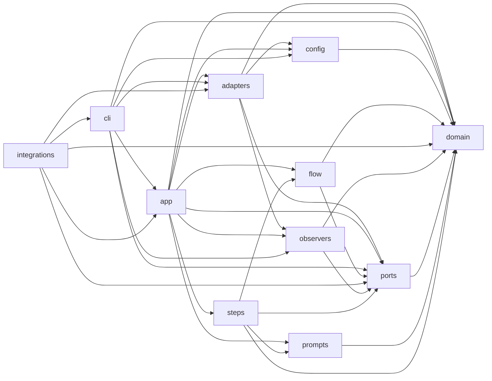

# Workflow ownership and failure contracts

`src/app/run-flow.ts` owns concrete workflow assembly: step selection, ordered guards,
transitions, halts, resume points, and terminal outcomes. `src/app/run-jig.ts` supplies
that workflow to the engine. `src/flow/define-flow.ts` owns generic flow contracts;
`src/flow/engine.ts` interprets supplied flows. Production `flow` imports neither
`app` nor `steps`. Steps implement the contracts in `flow`; they do not select the
whole workflow. The behavioral workflow spec lives beside the assembly in `app`.

The [interactive map](architecture.html) depicts execution sequence, including an engine
calling supplied steps. Such a runtime call is not a source dependency from `flow` to
`steps`. The source direction after this move is `app → steps → flow`, with `app → flow`
as well. Configuration owns schemas, defaults and resolution policy.

## Invocation status

Invocation status belongs to `src/domain/invocation-status.ts`, including
`INVOCATION_STATUSES`, `InvocationStatus`, and `outcomeIsComplete`. The engine imports
the domain type; local-store run artifacts and GitHub orchestration also import this
module directly. They need no engine or app import to classify completion. Both
`done` and `completed` count as complete; `stuck`, `halted`, and `blocked` do not.

## Current production dependency graph

The graph below is dependency-cruiser 18.7.2 output, including type imports, nested paths and
same-owner file imports in the inventory. The aggregate owner graph is acyclic. Runtime file
cycles are checked separately after type erasure; intra-owner type cycles may be erased.

```sh
npx depcruise src --no-config --ts-config tsconfig.json --ts-pre-compilation-deps --include-only '^src/' --exclude '\.spec\.ts$' --output-type json
```

The inventory contains 145 production source files across 11 existing owners. External
packages and Node built-ins are omitted here; dependency enforcement checks them too.



App owns assembly and still supplies concrete adapters and observers through the container.
CLI invocation preparation and GitHub executable composition retain their current boundaries;
separating those is later application-boundary work. Config imports only domain across owners.
Flow depends on domain and ports; steps depend on domain, ports, flow and prompts. Shared Git
and run-state failures are inward leaf port dependencies. No new source owner is introduced.

## Production file inventory

### adapters (41 files)

- `adapters/exception-details.ts` → `ports/exception-details.ts`
- `adapters/filesystem/config-source.ts` → `adapters/exception-details.ts`, `config/config-source.ts`
- `adapters/filesystem/preset-source.ts` → `adapters/exception-details.ts`, `config/environment.ts`, `config/preset-source.ts`, `config/presets.ts`, `config/scratch-directory.ts`
- `adapters/find-symlink.ts` → `adapters/exception-details.ts`, `ports/filesystem.ts`
- `adapters/git/branch.ts` → `adapters/git/repository.ts`, `ports/git-failures.ts`
- `adapters/git/git-workspace.ts` → `adapters/exception-details.ts`, `adapters/git/merge.ts`, `adapters/git/repository.ts`, `domain/protected-paths.ts`, `domain/run-id.ts`, `domain/run-state.ts`, `domain/usage.ts`, `domain/work-facts.ts`, `ports/filesystem.ts`, `ports/git-failures.ts`, `ports/sandbox-git.ts`, `ports/sandbox.ts`, `ports/workspace.ts`
- `adapters/git/merge.ts` → `adapters/exception-details.ts`, `adapters/git/branch.ts`, `adapters/git/repository.ts`, `ports/git-failures.ts`, `ports/workspace.ts`
- `adapters/git/remote-ref.ts` → `adapters/retry.ts`, `ports/git-failures.ts`, `ports/run-state-failures.ts`
- `adapters/git/repository.ts` → `adapters/exception-details.ts`, `ports/git-failures.ts`
- `adapters/git/run-code.ts` → `adapters/git/remote-ref.ts`, `adapters/git/repository.ts`, `adapters/git/run-history.ts`, `domain/run-id.ts`, `domain/run-state.ts`, `ports/git-failures.ts`, `ports/run-code.ts`, `ports/run-state-failures.ts`
- `adapters/git/run-history.ts` → `adapters/exception-details.ts`, `ports/git-failures.ts`
- `adapters/git/throwaway-branch.ts` → `adapters/git/branch.ts`, `adapters/git/repository.ts`, `ports/git-failures.ts`
- `adapters/local-store/credentials-file.ts` → `adapters/exception-details.ts`, `adapters/find-symlink.ts`, `adapters/local-store/local-state.ts`, `adapters/local-store/run-paths.ts`, `config/scratch-directory.ts`, `ports/credentials.ts`, `ports/filesystem.ts`
- `adapters/local-store/local-run-store.ts` → `adapters/exception-details.ts`, `adapters/local-store/local-state.ts`, `adapters/local-store/run-paths.ts`, `domain/run-id.ts`, `domain/run-state.ts`, `ports/filesystem.ts`, `ports/run-state-failures.ts`, `ports/run-store.ts`
- `adapters/local-store/local-state.ts` → `adapters/exception-details.ts`, `ports/filesystem.ts`
- `adapters/local-store/metrics-log.ts` → `adapters/local-store/run-paths.ts`, `domain/agent-role.ts`, `domain/events.ts`, `domain/outcome.ts`, `domain/run-id.ts`, `observers/metrics.ts`, `ports/metrics.ts`
- `adapters/local-store/run-artefacts.ts` → `adapters/local-store/local-state.ts`, `adapters/local-store/run-paths.ts`, `domain/design-review-report.ts`, `domain/invocation-status.ts`, `domain/run-id.ts`, `domain/run-state.ts`, `observers/metrics.ts`, `ports/filesystem.ts`
- `adapters/local-store/run-lock.ts` → `adapters/exception-details.ts`, `adapters/local-store/local-state.ts`, `adapters/local-store/run-paths.ts`, `domain/run-id.ts`, `ports/filesystem.ts`, `ports/run-state-failures.ts`
- `adapters/local-store/run-paths.ts` → `adapters/find-symlink.ts`, `config/scratch-directory.ts`, `domain/run-id.ts`
- `adapters/logging/create-logger.ts` → none
- `adapters/retry.ts` → `ports/retry.ts`
- `adapters/run-store/composite-run-store.ts` → `domain/run-id.ts`, `domain/run-state.ts`, `ports/git-failures.ts`, `ports/run-code.ts`, `ports/run-state-failures.ts`, `ports/run-store.ts`
- `adapters/run-store/git-remote-run-store.ts` → `adapters/exception-details.ts`, `adapters/git/remote-ref.ts`, `adapters/git/repository.ts`, `domain/run-id.ts`, `domain/run-state.ts`, `ports/git-failures.ts`, `ports/run-state-failures.ts`, `ports/run-store.ts`
- `adapters/sandbox-image/docker-images.ts` → `adapters/exception-details.ts`, `ports/sandbox-images.ts`, `ports/sandbox.ts`
- `adapters/sandbox-image/image-recipe.ts` → `ports/sandbox.ts`
- `adapters/sandbox-image/latest-agent-versions.ts` → none
- `adapters/sandcastle/agents.ts` → `adapters/local-store/credentials-file.ts`, `adapters/sandcastle/codex-auth.ts`, `config/agent-policy.ts`, `config/errors.ts`, `ports/credentials.ts`
- `adapters/sandcastle/codex-auth.ts` → `adapters/exception-details.ts`, `ports/credentials.ts`
- `adapters/sandcastle/git-hooks.ts` → none
- `adapters/sandcastle/open-session.ts` → `adapters/local-store/run-paths.ts`, `adapters/sandcastle/agents.ts`, `adapters/sandcastle/sandcastle-env.ts`, `adapters/sandcastle/sandcastle-session.ts`, `adapters/telemetry/open-telemetry.ts`, `config/environment.ts`, `config/errors.ts`, `config/load-config.ts`, `domain/agent-role.ts`, `domain/run-state.ts`, `ports/credentials.ts`, `ports/observability.ts`, `ports/sandbox.ts`
- `adapters/sandcastle/private-clone-docker.ts` → `adapters/exception-details.ts`, `adapters/git/repository.ts`, `ports/git-failures.ts`
- `adapters/sandcastle/sandcastle-env.ts` → none
- `adapters/sandcastle/sandcastle-session.ts` → `adapters/exception-details.ts`, `adapters/find-symlink.ts`, `adapters/sandcastle/codex-auth.ts`, `adapters/sandcastle/git-hooks.ts`, `adapters/sandcastle/private-clone-docker.ts`, `adapters/sandcastle/structured-output.ts`, `adapters/sandcastle/usage.ts`, `domain/run-id.ts`, `domain/run-state.ts`, `ports/agent-session.ts`, `ports/credentials.ts`, `ports/filesystem.ts`, `ports/git-failures.ts`, `ports/observability.ts`, `ports/sandbox-git.ts`, `ports/sandbox.ts`
- `adapters/sandcastle/structured-output.ts` → `adapters/exception-details.ts`, `ports/agent-session.ts`
- `adapters/sandcastle/usage.ts` → `domain/usage.ts`
- `adapters/telemetry/open-telemetry.ts` → `config/environment.ts`
- `adapters/terminal/ask-for-agents.ts` → `adapters/sandcastle/agents.ts`, `adapters/terminal/terminal.ts`, `config/agent-policy.ts`, `domain/agent-role.ts`
- `adapters/terminal/ask-for-credential.ts` → `adapters/local-store/credentials-file.ts`, `adapters/sandcastle/agents.ts`, `adapters/terminal/terminal.ts`
- `adapters/terminal/ask-for-preset.ts` → `adapters/terminal/terminal.ts`, `config/presets.ts`
- `adapters/terminal/standard-input.ts` → none
- `adapters/terminal/terminal.ts` → `adapters/exception-details.ts`

### app (12 files)

- `app/container.ts` → `adapters/exception-details.ts`, `adapters/filesystem/config-source.ts`, `adapters/filesystem/preset-source.ts`, `adapters/git/git-workspace.ts`, `adapters/local-store/metrics-log.ts`, `adapters/local-store/run-artefacts.ts`, `adapters/local-store/run-paths.ts`, `adapters/logging/create-logger.ts`, `adapters/retry.ts`, `adapters/sandbox-image/docker-images.ts`, `adapters/sandbox-image/latest-agent-versions.ts`, `adapters/sandcastle/agents.ts`, `adapters/sandcastle/open-session.ts`, `adapters/terminal/ask-for-agents.ts`, `adapters/terminal/ask-for-credential.ts`, `app/observed-events.ts`, `app/report-cleanup.ts`, `app/sandbox-image.ts`, `config/agent-policy.ts`, `config/config-source.ts`, `config/environment.ts`, `config/load-config.ts`, `config/preset-source.ts`, `domain/agent-role.ts`, `domain/retry.ts`, `domain/run-state.ts`, `domain/settings.ts`, `flow/engine.ts`, `observers/logging-observer.ts`, `observers/metrics.ts`, `observers/run-events.ts`, `observers/tracing-observer.ts`, `ports/agent-session.ts`, `ports/exception-details.ts`, `ports/observability.ts`, `ports/retry.ts`, `ports/run-store.ts`, `ports/sandbox-git.ts`, `ports/sandbox-images.ts`, `ports/sandbox.ts`, `ports/workspace.ts`
- `app/init-sandbox.ts` → `adapters/exception-details.ts`, `adapters/filesystem/config-source.ts`, `adapters/find-symlink.ts`, `adapters/local-store/credentials-file.ts`, `adapters/sandbox-image/image-recipe.ts`, `adapters/sandcastle/agents.ts`, `adapters/sandcastle/sandcastle-session.ts`, `app/container.ts`, `app/sandbox-image.ts`, `app/throwaway-sandbox.ts`, `config/environment.ts`, `config/errors.ts`, `config/load-config.ts`, `config/update-config.ts`, `ports/agent-session.ts`, `ports/credentials.ts`, `ports/filesystem.ts`, `ports/git-failures.ts`, `ports/sandbox.ts`, `prompts/toolchain.ts`
- `app/observed-events.ts` → `domain/events.ts`, `observers/run-events.ts`
- `app/report-cleanup.ts` → none
- `app/run-flow.ts` → `domain/design-review.ts`, `domain/final-check.ts`, `domain/run-state.ts`, `domain/settings.ts`, `flow/define-flow.ts`, `steps/completion-reuse.ts`, `steps/design-review.ts`, `steps/final-check.ts`, `steps/finishing.ts`, `steps/planning.ts`, `steps/slice.ts`
- `app/run-jig.ts` → `adapters/git/branch.ts`, `adapters/git/run-history.ts`, `adapters/local-store/metrics-log.ts`, `adapters/local-store/run-lock.ts`, `adapters/sandcastle/open-session.ts`, `adapters/telemetry/open-telemetry.ts`, `app/container.ts`, `app/run-flow.ts`, `app/run-request-invalid.ts`, `app/run-store-setup-invalid.ts`, `app/run-stores.ts`, `app/sandbox-image.ts`, `config/errors.ts`, `config/load-config.ts`, `domain/run-id.ts`, `domain/run-state.ts`, `flow/define-flow.ts`, `flow/engine.ts`, `ports/credentials.ts`, `ports/filesystem.ts`, `ports/git-failures.ts`, `ports/metrics.ts`, `ports/run-state-failures.ts`, `ports/run-store.ts`, `ports/sandbox.ts`
- `app/run-request-invalid.ts` → none
- `app/run-status.ts` → `adapters/local-store/metrics-log.ts`, `adapters/local-store/run-artefacts.ts`, `app/container.ts`, `app/run-request-invalid.ts`, `app/run-store-setup-invalid.ts`, `app/run-stores.ts`, `domain/run-id.ts`, `domain/run-state.ts`, `observers/metrics.ts`, `ports/metrics.ts`, `ports/run-store.ts`
- `app/run-store-setup-invalid.ts` → none
- `app/run-stores.ts` → `adapters/exception-details.ts`, `adapters/git/run-code.ts`, `adapters/local-store/local-run-store.ts`, `adapters/run-store/composite-run-store.ts`, `adapters/run-store/git-remote-run-store.ts`, `app/container.ts`, `app/run-store-setup-invalid.ts`, `domain/run-id.ts`, `domain/run-state.ts`, `ports/run-state-failures.ts`, `ports/run-store.ts`
- `app/sandbox-image.ts` → `adapters/exception-details.ts`, `adapters/sandbox-image/image-recipe.ts`, `adapters/sandcastle/agents.ts`, `config/errors.ts`, `config/load-config.ts`, `ports/sandbox-images.ts`, `ports/sandbox.ts`
- `app/throwaway-sandbox.ts` → `adapters/git/branch.ts`, `adapters/git/throwaway-branch.ts`, `adapters/sandcastle/open-session.ts`, `app/container.ts`, `app/observed-events.ts`, `app/report-cleanup.ts`, `domain/run-id.ts`, `domain/run-state.ts`, `observers/logging-observer.ts`, `ports/git-failures.ts`, `ports/sandbox.ts`

### cli (14 files)

- `cli/app-action.ts` → `app/container.ts`, `cli/with-app.ts`, `cli/with-error-handling.ts`, `cli/with-input.ts`, `ports/exception-details.ts`
- `cli/command-input-invalid.ts` → none
- `cli/commands/presets.ts` → `adapters/logging/create-logger.ts`, `cli/with-app.ts`, `cli/with-error-handling.ts`, `config/presets.ts`, `ports/exception-details.ts`
- `cli/commands/run.ts` → `app/run-jig.ts`, `app/run-request-invalid.ts`, `cli/app-action.ts`, `cli/config-option.ts`, `cli/log-format-option.ts`, `cli/read-request.ts`, `cli/with-app.ts`, `domain/run-id.ts`, `domain/run-state.ts`, `ports/exception-details.ts`
- `cli/commands/sandbox.ts` → `app/init-sandbox.ts`, `app/sandbox-image.ts`, `cli/app-action.ts`, `cli/config-option.ts`, `cli/log-format-option.ts`
- `cli/commands/status.ts` → `adapters/logging/create-logger.ts`, `app/run-status.ts`, `cli/config-option.ts`, `cli/with-app.ts`, `cli/with-error-handling.ts`, `cli/with-input.ts`, `domain/run-id.ts`, `domain/run-state.ts`, `domain/slice.ts`, `observers/metrics.ts`, `ports/exception-details.ts`
- `cli/config-option.ts` → `config/presets.ts`
- `cli/exit-when-done.ts` → none
- `cli/log-format-option.ts` → `adapters/logging/create-logger.ts`
- `cli/main.ts` → `cli/commands/presets.ts`, `cli/commands/run.ts`, `cli/commands/sandbox.ts`, `cli/commands/status.ts`, `ports/exception-details.ts`
- `cli/read-request.ts` → `adapters/terminal/standard-input.ts`, `app/run-jig.ts`, `app/run-request-invalid.ts`, `ports/exception-details.ts`
- `cli/with-app.ts` → `adapters/filesystem/config-source.ts`, `adapters/filesystem/preset-source.ts`, `adapters/git/repository.ts`, `adapters/local-store/credentials-file.ts`, `adapters/logging/create-logger.ts`, `adapters/terminal/ask-for-preset.ts`, `adapters/terminal/standard-input.ts`, `app/container.ts`, `cli/config-option.ts`, `config/config-source.ts`, `config/environment.ts`, `config/errors.ts`, `config/load-config.ts`, `config/preset-source.ts`, `config/presets.ts`, `ports/credentials.ts`, `ports/filesystem.ts`, `ports/git-failures.ts`
- `cli/with-error-handling.ts` → `ports/exception-details.ts`
- `cli/with-input.ts` → `cli/command-input-invalid.ts`, `config/describe-issues.ts`

### config (10 files)

- `config/agent-policy.ts` → none
- `config/config-source.ts` → none
- `config/describe-issues.ts` → none
- `config/environment.ts` → `config/describe-issues.ts`, `config/errors.ts`
- `config/errors.ts` → none
- `config/load-config.ts` → `config/agent-policy.ts`, `config/config-source.ts`, `config/describe-issues.ts`, `config/errors.ts`, `domain/agent-role.ts`, `domain/settings.ts`
- `config/preset-source.ts` → `config/presets.ts`
- `config/presets.ts` → `config/describe-issues.ts`, `config/errors.ts`, `config/load-config.ts`, `config/preset-source.ts`, `domain/agent-role.ts`
- `config/scratch-directory.ts` → none
- `config/update-config.ts` → `config/config-source.ts`, `config/errors.ts`

### domain (22 files)

- `domain/agent-role.ts` → none
- `domain/apply-outcome.ts` → `domain/completion-reuse.ts`, `domain/design-review.ts`, `domain/diagnostics.ts`, `domain/final-check.ts`, `domain/outcome.ts`, `domain/run-state.ts`, `domain/slice.ts`
- `domain/completion-reuse.ts` → `domain/final-check.ts`, `domain/run-state.ts`, `domain/settings.ts`, `domain/slice.ts`, `domain/work-facts.ts`
- `domain/design-docs.ts` → none
- `domain/design-review-report.ts` → `domain/design-review.ts`, `domain/run-state.ts`
- `domain/design-review.ts` → `domain/design-docs.ts`, `domain/run-state.ts`
- `domain/diagnostics.ts` → none
- `domain/events.ts` → `domain/agent-role.ts`, `domain/outcome.ts`, `domain/run-id.ts`, `domain/run-state.ts`, `domain/slice.ts`, `domain/usage.ts`
- `domain/failure-policy.ts` → none
- `domain/final-check.ts` → `domain/diagnostics.ts`, `domain/outcome.ts`, `domain/run-state.ts`, `domain/slice.ts`
- `domain/invocation-status.ts` → none
- `domain/outcome.ts` → `domain/completion-reuse.ts`, `domain/design-docs.ts`, `domain/design-review.ts`, `domain/run-state.ts`, `domain/slice.ts`, `domain/usage.ts`, `domain/work-facts.ts`
- `domain/plan-coverage.ts` → `domain/slice.ts`
- `domain/protected-paths.ts` → none
- `domain/retry.ts` → `domain/failure-policy.ts`, `domain/settings.ts`
- `domain/run-diagnostics.ts` → `domain/diagnostics.ts`, `domain/run-state.ts`, `domain/slice.ts`
- `domain/run-id.ts` → none
- `domain/run-state.ts` → `domain/completion-reuse.ts`, `domain/design-docs.ts`, `domain/design-review.ts`, `domain/diagnostics.ts`, `domain/final-check.ts`, `domain/run-id.ts`, `domain/settings.ts`, `domain/slice.ts`
- `domain/settings.ts` → `domain/slice.ts`
- `domain/slice.ts` → `domain/diagnostics.ts`, `domain/work-facts.ts`
- `domain/usage.ts` → none
- `domain/work-facts.ts` → none

### flow (2 files)

- `flow/define-flow.ts` → `domain/design-review.ts`, `domain/outcome.ts`, `domain/run-state.ts`, `domain/settings.ts`, `domain/slice.ts`, `ports/agent-session.ts`, `ports/retry.ts`, `ports/workspace.ts`
- `flow/engine.ts` → `domain/apply-outcome.ts`, `domain/events.ts`, `domain/failure-policy.ts`, `domain/invocation-status.ts`, `domain/outcome.ts`, `domain/retry.ts`, `domain/run-id.ts`, `domain/run-state.ts`, `domain/settings.ts`, `flow/define-flow.ts`, `ports/exception-details.ts`, `ports/observability.ts`, `ports/run-store.ts`

### integrations (12 files)

- `integrations/github/cli.ts` → `adapters/exception-details.ts`, `cli/app-action.ts`, `cli/exit-when-done.ts`, `cli/main.ts`, `integrations/github/command.ts`, `integrations/github/github-port.ts`
- `integrations/github/command.ts` → `cli/app-action.ts`, `cli/config-option.ts`, `cli/log-format-option.ts`, `cli/with-app.ts`, `integrations/github/errors.ts`, `integrations/github/github-port.ts`, `integrations/github/implement-issue.ts`, `integrations/github/octokit-github.ts`, `integrations/github/repository-identity.ts`
- `integrations/github/errors.ts` → none
- `integrations/github/findings-comment.ts` → `domain/diagnostics.ts`, `domain/run-diagnostics.ts`, `domain/run-state.ts`
- `integrations/github/github-port.ts` → `integrations/github/errors.ts`
- `integrations/github/implement-issue.ts` → `adapters/git/branch.ts`, `adapters/git/run-history.ts`, `app/container.ts`, `app/run-jig.ts`, `app/run-store-setup-invalid.ts`, `app/run-stores.ts`, `domain/invocation-status.ts`, `domain/run-id.ts`, `domain/run-state.ts`, `integrations/github/errors.ts`, `integrations/github/findings-comment.ts`, `integrations/github/github-port.ts`, `integrations/github/orchestration-state.ts`, `integrations/github/orchestration-store.ts`, `integrations/github/request-snapshot.ts`, `integrations/github/run-branch-publication.ts`, `ports/git-failures.ts`, `ports/run-store.ts`
- `integrations/github/octokit-github.ts` → `adapters/retry.ts`, `integrations/github/errors.ts`, `integrations/github/github-port.ts`
- `integrations/github/orchestration-state.ts` → `domain/invocation-status.ts`, `domain/run-id.ts`, `integrations/github/github-port.ts`
- `integrations/github/orchestration-store.ts` → `adapters/exception-details.ts`, `adapters/git/remote-ref.ts`, `adapters/retry.ts`, `app/report-cleanup.ts`, `integrations/github/errors.ts`, `integrations/github/orchestration-state.ts`, `ports/git-failures.ts`, `ports/run-state-failures.ts`
- `integrations/github/repository-identity.ts` → `adapters/git/repository.ts`, `integrations/github/errors.ts`, `integrations/github/github-port.ts`
- `integrations/github/request-snapshot.ts` → `integrations/github/github-port.ts`
- `integrations/github/run-branch-publication.ts` → `adapters/git/remote-ref.ts`, `adapters/git/repository.ts`, `adapters/git/run-history.ts`, `domain/run-id.ts`, `domain/run-state.ts`, `integrations/github/errors.ts`, `ports/git-failures.ts`, `ports/run-state-failures.ts`

### observers (4 files)

- `observers/logging-observer.ts` → `domain/events.ts`
- `observers/metrics.ts` → `domain/agent-role.ts`, `domain/events.ts`, `domain/outcome.ts`, `domain/run-id.ts`, `domain/usage.ts`, `ports/observability.ts`
- `observers/run-events.ts` → `domain/events.ts`, `ports/observability.ts`
- `observers/tracing-observer.ts` → `domain/events.ts`

### ports (15 files)

- `ports/agent-session.ts` → `domain/agent-role.ts`, `ports/sandbox.ts`
- `ports/credentials.ts` → none
- `ports/exception-details.ts` → none
- `ports/filesystem.ts` → none
- `ports/git-failures.ts` → none
- `ports/metrics.ts` → none
- `ports/observability.ts` → `domain/events.ts`
- `ports/retry.ts` → none
- `ports/run-code.ts` → `domain/run-id.ts`, `ports/git-failures.ts`, `ports/run-state-failures.ts`
- `ports/run-state-failures.ts` → none
- `ports/run-store.ts` → `domain/run-id.ts`, `domain/run-state.ts`, `ports/filesystem.ts`, `ports/git-failures.ts`, `ports/run-state-failures.ts`
- `ports/sandbox-git.ts` → `ports/agent-session.ts`, `ports/git-failures.ts`, `ports/sandbox.ts`
- `ports/sandbox-images.ts` → `ports/sandbox.ts`
- `ports/sandbox.ts` → `ports/credentials.ts`, `ports/filesystem.ts`
- `ports/workspace.ts` → `domain/protected-paths.ts`, `domain/usage.ts`, `domain/work-facts.ts`, `ports/filesystem.ts`, `ports/git-failures.ts`, `ports/sandbox.ts`

### prompts (6 files)

- `prompts/design-review.ts` → `domain/design-docs.ts`, `domain/design-review.ts`, `domain/run-state.ts`
- `prompts/final-check.ts` → `domain/final-check.ts`
- `prompts/planning.ts` → `domain/run-state.ts`
- `prompts/pull-request.ts` → `domain/completion-reuse.ts`, `domain/final-check.ts`, `domain/run-state.ts`, `domain/slice.ts`
- `prompts/slice.ts` → `domain/protected-paths.ts`, `domain/slice.ts`
- `prompts/toolchain.ts` → none

### steps (7 files)

- `steps/completion-reuse.ts` → `domain/completion-reuse.ts`, `domain/outcome.ts`, `flow/define-flow.ts`, `ports/git-failures.ts`, `ports/sandbox.ts`
- `steps/design-review.ts` → `domain/design-review.ts`, `domain/run-state.ts`, `flow/define-flow.ts`, `ports/agent-session.ts`, `prompts/design-review.ts`
- `steps/final-check.ts` → `domain/final-check.ts`, `domain/outcome.ts`, `flow/define-flow.ts`, `ports/agent-session.ts`, `ports/git-failures.ts`, `ports/sandbox.ts`, `prompts/final-check.ts`
- `steps/finishing.ts` → `domain/completion-reuse.ts`, `domain/outcome.ts`, `domain/run-state.ts`, `domain/slice.ts`, `flow/define-flow.ts`, `ports/git-failures.ts`, `ports/sandbox.ts`, `ports/workspace.ts`, `prompts/pull-request.ts`, `steps/completion-reuse.ts`, `steps/pull-request-description.ts`
- `steps/planning.ts` → `domain/design-docs.ts`, `domain/outcome.ts`, `domain/plan-coverage.ts`, `domain/run-state.ts`, `domain/slice.ts`, `flow/define-flow.ts`, `ports/agent-session.ts`, `prompts/planning.ts`
- `steps/pull-request-description.ts` → `domain/completion-reuse.ts`, `domain/final-check.ts`, `domain/run-state.ts`, `domain/settings.ts`, `domain/slice.ts`
- `steps/slice.ts` → `domain/completion-reuse.ts`, `domain/final-check.ts`, `domain/outcome.ts`, `domain/protected-paths.ts`, `domain/run-state.ts`, `domain/slice.ts`, `flow/define-flow.ts`, `ports/agent-session.ts`, `ports/git-failures.ts`, `ports/sandbox.ts`, `ports/workspace.ts`, `prompts/slice.ts`

## Configuration I/O and defaults

Adapters read and write the settings file and find and read presets, and the process edge captures
the environment. `src/config` does none of these: it owns the contracts and the policy over them.

Presets cross the `PresetSource` contract in `src/config/preset-source.ts`. A source names the
places it looks in, highest precedence first; for one name it yields the present candidates in
that order, looking at each place only when reached; and it lists every present candidate, each
place's in name order. A candidate carries the name its place gives it, an opaque label (source,
location and whether it is a shipped starter) and a `read` that decodes its JSON only when called.
The source fails narrowly as not findable, unlistable, unreadable or not JSON.
`src/config/presets.ts` owns the selection rule: it skips candidates whose names are not valid
preset names without reading them, lets the first candidate of a name win and shadow the rest
unread, refuses a broken winner instead of falling back, validates the strict preset schema,
replaces whole roles, and turns source failures into `ConfigInvalid` messages that name the
location. A named lookup reads only its winner and lists nothing; only a missing name lists the
places to say which presets exist. `src/adapters/filesystem/preset-source.ts` owns the ordering:
the repository's `.jig/presets`, the home directory's `.jig/presets`, the XDG config home's
`jig/presets` (`~/.config` unless `XDG_CONFIG_HOME` is absolute) and the packaged starters, a
directory two sources share looked in once. It maps a name to its `.json` file, counts any entry
`lstat` finds as present, a dangling link included, and reads and parses the file.

Settings cross one boundary, the `ConfigSource` contract in `src/config/config-source.ts`. A
source reports its destination's name, whether the operator chose it with `--config`, and either
the raw JSON it holds or that nothing is there, with the native reason; it fails narrowly as
unreadable, not JSON or unwritable, and writes whole settings. `loadConfig` in
`src/config/load-config.ts` decides that only the repository's own settings may be absent,
applies the strict schema and its defaults, and so refuses the retry defaults as keys.
`updateConfig` in `src/config/update-config.ts` merges new keys over the current object, creates
absent settings and refuses anything that is not an object. Both turn source failures into
`ConfigInvalid` messages. `src/adapters/filesystem/config-source.ts` resolves the destination
(`jig.config.json` in the repository root, or a `--config` path resolved against it), reads and
parses its JSON and writes it atomically. `jig init` takes that concrete destination separately to
write the starter file and to refuse symbolic links at both starter destinations before writing
either.
`src/cli/with-app.ts` captures `process.env`, the working directory and the fallback home
directory at the process edge and passes them to `parseEnvironment`. Config keeps the schemas,
defaults, provider and model policy, preset-name validation, first-winner selection and the
preset schema.

The step retry count (2) and first retry delay (5000 ms) are private defaults in
`src/config/load-config.ts`, which `runSettingsFrom` resolves into `RunSettings`. They are not
configuration keys, and presets still override agent roles only. `src/domain/settings.ts` keeps
`RunSettings`, `reviewCapReached`, `sliceNeedsVerification` and the stopping caps
(`HOOK_FAILURE_CAP`, `VERIFICATION_FAILURE_CAP`, `EMPTY_ATTEMPT_CAP`, `RULE_FIX_CAP`).
`transientRetryPolicy` reads the resolved count and delay unchanged.

Dependency-cruiser's `config-imports-only-approved-dependencies` rule allows production config to
import only `src/config`, `src/domain`, `better-result` and `zod`. Anything else fails, including
adapters, ports, `node:fs`, `node:os`, `node:path`, `node:child_process`, `execa` and
`write-file-atomic`. Config specs and the test packages they use are exempt. Adapters may import
config's contracts, and ports still depend only on domain. CLI commands still receive the container through
`src/cli/with-app.ts` and `src/cli/app-action.ts`, which also prepares the invocation, and
`src/app/container.ts` remains the composition root; moving preparation into application
operations and composition out of `app` are separate slices.

## Retry execution and exception details

Retry execution and the reading of thrown values are supplied capabilities. Their contracts are
declaration-only ports; their implementations are adapters:

| Contract                                               | Implementation                                                                      |
| ------------------------------------------------------ | ----------------------------------------------------------------------------------- |
| `RetryResult`, `RetryPolicy` in `src/ports/retry.ts`   | `retryResult` in `src/adapters/retry.ts`                                            |
| `ExceptionDetails` in `src/ports/exception-details.ts` | `exceptionDetails`, `messageOf`, `rootCause` in `src/adapters/exception-details.ts` |

better-result 3.0.1 retries only a `Result.tryPromise` whose `try` throws, so it cannot retry an
operation that already returns its failure as an `Err` without turning that `Err` back into a
rejection. `retryResult` keeps that behaviour thin: it calls the operation, reports each failed
attempt with the retries left, stops on success, exhaustion or a failure the policy refuses, waits
`delayMs × 2^(attempt − 1)` with `node:timers/promises`, and lets a throw through. better-result
supplies `Panic`, `isPanic` and `panic`, but nothing that unwraps a chain of panics; `rootCause`
follows `Panic.cause` until it reaches a non-`Panic` or a `Panic` without a cause, and never
follows an ordinary `Error`'s cause. `messageOf` reads an `Error`'s message and turns anything
else into text with `String`. A broad catch that already knows it holds a `Panic` uses its
`message` directly.

Each consumer receives the capability through its existing construction path:

| Consumer                                             | How it receives the capability                                              |
| ---------------------------------------------------- | --------------------------------------------------------------------------- |
| `src/flow/engine.ts` step retries                    | `EngineDependencies.ports.retryResult`, under `transientRetryPolicy`        |
| `src/flow/engine.ts` bug reports                     | `EngineDependencies.exceptionDetails`                                       |
| `src/steps/planning.ts` slicing correction           | `StepPorts.retryResult`                                                     |
| `src/app/container.ts` sandbox start                 | the `retryResult` the container registers, under `transientRetryPolicy`     |
| `src/cli/with-error-handling.ts`                     | an `ExceptionDetails` argument from the command that registers it           |
| `src/cli/read-request.ts`                            | `RequestReads.messageOf`, from `CommandIo.exceptionDetails`                 |
| `src/cli/main.ts` and every CLI command              | `buildCli(exceptionDetails)` and `CommandIo.exceptionDetails`               |
| `src/observers/run-events.ts`                        | none: a `Panic` is rethrown with its own `message`                          |
| `src/integrations/github/cli.ts`                     | imports the adapter implementation and supplies it to `buildCli` and GitHub |
| GitHub API and orchestration store                   | import the adapter implementations at their third-party boundary            |
| adapters and app modules wrapping a third-party call | import `messageOf` from the adapter                                         |

`src/app/container.ts` registers `retryResult` and `exceptionDetails` as values and builds the
engine's dependencies from them. Domain keeps business failures, `isTransient` and
`transientRetryPolicy`; `TransientRetryPolicy` matches `RetryPolicy<{ kind: FailureKind }>` by shape without
importing the port. The `retry-and-exception-details-are-supplied` dependency rule rejects
production imports of either implementation from flow, steps, CLI and observers, including type
imports, re-exports, literal dynamic imports and nested paths.

## Failure ownership and preservation

The declarations below replace the global registry. Each class still extends better-result's
`TaggedError`; its `_tag`, `message`, additional fields and `kind` remain stable. Business
classes are self-contained in domain. Shared Git and run-state failures are leaf port contracts,
so no consumer needs an outward import or a compatibility barrel. Config owns validation and
source diagnostics; application module setup is distinct from store operations.

### Operation contracts

| Contract                                                            | Owner and path                                       | Errors and consumer classification                                                                                                                                                                                                       |
| ------------------------------------------------------------------- | ---------------------------------------------------- | ---------------------------------------------------------------------------------------------------------------------------------------------------------------------------------------------------------------------------------------- |
| `FailureKind`, `isTransient`                                        | domain, `src/domain/failure-policy.ts`               | Structural `{ kind }` policy only; retry exactly `retry`, without a registry or infrastructure import.                                                                                                                                   |
| `TransientRetryPolicy`, `transientRetryPolicy`                      | domain, `src/domain/retry.ts`                        | Resolved retry count and delay, matching the retry port structurally.                                                                                                                                                                    |
| `StepFailure`, `RunStep`, `SliceStep`                               | flow, `src/flow/define-flow.ts`                      | Business `DesignUnresolved` plus errors derived with better-result `InferErr` from named agent/workspace operation contracts. CLI input and app request failures are excluded. Each concrete step declares its narrower error parameter. |
| `EngineFailure`                                                     | flow, `src/flow/engine.ts`                           | Only fatal step errors plus `RunStoreSaveFailure`; attempt/advance methods return fatal step failures, persistence methods return save failures. Retry exhaustion becomes blocked, block is immediate, fatal propagates.                 |
| `RunStoreLoadFailure`, `RunStorePeekFailure`, `RunStoreSaveFailure` | ports, `src/ports/run-store.ts`                      | Load includes code restoration; peek excludes unavailable code; save excludes malformed saved state. All expose custom operation failures. Persistence errors propagate outside step retries.                                            |
| `SessionOpenFailure`, `SessionCloseFailure`                         | ports, `src/ports/sandbox.ts`                        | Portable sandbox, credential and filesystem preparation failures; closing preserves credential reporting.                                                                                                                                |
| `OpenSessionFailure`                                                | adapter, `src/adapters/sandcastle/open-session.ts`   | Session-open failures plus configuration validation from provider selection; config remains outside ports.                                                                                                                               |
| `RunJigFailure`, `AdvanceFailure`                                   | app, `src/app/run-jig.ts`                            | Run preparation, store, lock, invocation reporting and sandbox/engine failures; advance excludes request/lock/metrics errors.                                                                                                            |
| `RunStatusFailure`                                                  | app, `src/app/run-status.ts`                         | Store setup/peek, missing run and metrics corruption only.                                                                                                                                                                               |
| `InitFailure`, `SandboxCheckFailure`                                | app, `src/app/init-sandbox.ts`                       | Init preparation, config, credentials, image, sandbox and agent operations; setup-command failure remains planner feedback.                                                                                                              |
| `AppPreparationFailure`                                             | CLI, `src/cli/with-app.ts`                           | Config, credentials, filesystem preparation and repository prerequisites; `withApp` and `appAction` preserve each command's own generic error.                                                                                           |
| `IssueFailure`                                                      | GitHub, `src/integrations/github/implement-issue.ts` | Run operation, repository prerequisites, branch mismatch and `PublishOutcomeFailure`; publication errors contain only store peek/setup, branch publication and GitHub publication failures.                                              |

The unused `isJigError` and class registry are removed. Recognition is local: `PlanNotCovered`
constructor checks trigger one planning correction and then `AgentOutputInvalid`; `CommitRejected.is`
produces hook feedback; `AgentOutputInvalid.is` recovers a commit title. Git's `GitCommandFailed.is`
preserves command failures while a missing branch becomes `MergeFailed` with the same message.
No production constructor-name comparison or error deserializer requires the old module. The split
classes retain `name` and `_tag` as `ConfigInvalid` through `TaggedError`; recognition of that tag
cannot distinguish their semantic classes and is not used for dispatch. Logs retain the portable
fields; saved run JSON contains run state, not failure instances.

Cleanup is unchanged: `reportCleanup` returns cleanup failure after success, otherwise logs it
and keeps the work failure. The CLI prints any returned failure's message, including errors outside
the step contract; thrown bugs report their original cause's stack through supplied exception details.

### Classes

All classes carry `message`. Tags equal the original class name; the split classes in the next
table all retain the legacy `ConfigInvalid` tag and `fatal` classification. Constructors keep
payloads unchanged.

| Class                  | Declaration owner/path             | `kind` | Fields beyond `message` | Constructed at                                                                                                                                                                                                             | Consumer evidence                                                                                                                                                                            |
| ---------------------- | ---------------------------------- | ------ | ----------------------- | -------------------------------------------------------------------------------------------------------------------------------------------------------------------------------------------------------------------------- | -------------------------------------------------------------------------------------------------------------------------------------------------------------------------------------------- |
| `AgentRunFailed`       | `src/ports/agent-session.ts`       | retry  | —                       | `src/adapters/sandcastle/sandcastle-session.ts`                                                                                                                                                                            | none; `src/steps/slice.ts` passes it through where it recovers `AgentOutputInvalid`                                                                                                          |
| `AgentOutputInvalid`   | `src/ports/agent-session.ts`       | retry  | —                       | `src/adapters/sandcastle/structured-output.ts`, `src/steps/planning.ts` (from `PlanNotCovered`), `src/steps/planning.ts` (repeated slice ids)                                                                              | `src/steps/slice.ts` `AgentOutputInvalid.is`: the slice title stands in for an unreadable commit message                                                                                     |
| `PlanNotCovered`       | `src/domain/plan-coverage.ts`      | retry  | —                       | `src/domain/plan-coverage.ts`                                                                                                                                                                                              | `src/steps/planning.ts` `instanceof` retries slicing once; `keeps its message as the correction;` maps a second one to `AgentOutputInvalid`                                                  |
| `DesignUnresolved`     | `src/domain/design-review.ts`      | block  | `findingIds`            | `src/domain/design-review.ts`, returned by `src/steps/design-review.ts`                                                                                                                                                    | none by class; `findingIds` is set and not read outside specs                                                                                                                                |
| `RemoteUnavailable`    | `src/ports/git-failures.ts`        | retry  | —                       | `src/adapters/git/merge.ts`, `src/adapters/git/remote-ref.ts`                                                                                                                                                              | `src/adapters/git/remote-ref.ts` `_tag` retries the Git remote call                                                                                                                          |
| `SandboxUnavailable`   | `src/ports/sandbox.ts`             | retry  | —                       | `src/adapters/sandcastle/sandcastle-session.ts` (start failure not caused by configuration)                                                                                                                                | none by class                                                                                                                                                                                |
| `SetupCommandFailed`   | `src/ports/sandbox.ts`             | retry  | `output`                | `src/adapters/sandcastle/sandcastle-session.ts`                                                                                                                                                                            | `src/app/init-sandbox.ts` `instanceof`: its `message` becomes the failure handed back to the planner                                                                                         |
| `RunStateConflict`     | `src/ports/run-state-failures.ts`  | block  | —                       | `src/adapters/git/remote-ref.ts`, `src/adapters/git/run-code.ts`, `src/adapters/run-store/composite-run-store.ts`, `src/adapters/run-store/git-remote-run-store.ts`                                                        | `src/integrations/github/orchestration-store.ts` `_tag` retries the update; `` maps the last one to `OrchestrationStateInvalid`                                                              |
| `RunCodeUnavailable`   | `src/ports/run-state-failures.ts`  | block  | —                       | `src/adapters/git/run-code.ts`, `src/adapters/run-store/composite-run-store.ts`                                                                                                                                            | none by class                                                                                                                                                                                |
| `MergeFailed`          | `src/ports/workspace.ts`           | block  | —                       | `src/adapters/git/merge.ts` (from `RepositoryInvalid`); `src/adapters/git/git-workspace.ts`                                                                                                                                | none by class                                                                                                                                                                                |
| `GitCommandFailed`     | `src/ports/git-failures.ts`        | block  | `command`, `output`     | `src/adapters/git/repository.ts`; `src/adapters/git/merge.ts`; `src/adapters/git/run-history.ts`; `src/adapters/git/git-workspace.ts`; `src/adapters/git/remote-ref.ts`; `src/adapters/sandcastle/private-clone-docker.ts` | `src/adapters/git/merge.ts` `GitCommandFailed.is` keeps it while mapping `RepositoryInvalid` to `MergeFailed`; `src/adapters/sandcastle/private-clone-docker.ts` reads `output` for `EEXIST` |
| `CommitImportRefused`  | `src/ports/workspace.ts`           | block  | —                       | `src/adapters/git/git-workspace.ts`                                                                                                                                                                                        | none by class                                                                                                                                                                                |
| `CommitRejected`       | `src/ports/workspace.ts`           | block  | `output`                | `src/adapters/git/git-workspace.ts`                                                                                                                                                                                        | `src/steps/slice.ts` `CommitRejected.is`: becomes a `hookRejected` outcome whose feedback quotes `output`                                                                                    |
| `ConfigInvalid`        | `src/config/errors.ts`             | fatal  | —                       | Configuration validation, provider/model policy and source diagnostics; rows 1–18 below                                                                                                                                    | Config specs, init needs-agents and config-update caller specs                                                                                                                               |
| `RunRequestInvalid`    | `src/app/run-request-invalid.ts`   | fatal  | —                       | `src/cli/read-request.ts`; `src/app/run-jig.ts`; `src/app/run-status.ts`                                                                                                                                                   | none by class                                                                                                                                                                                |
| `RunInProgress`        | `src/ports/run-state-failures.ts`  | fatal  | —                       | `src/adapters/local-store/run-lock.ts`                                                                                                                                                                                     | none by class                                                                                                                                                                                |
| `MetricsLogCorrupt`    | `src/ports/metrics.ts`             | fatal  | —                       | `src/adapters/local-store/metrics-log.ts`                                                                                                                                                                                  | none by class                                                                                                                                                                                |
| `LocalStateUnwritable` | `src/ports/filesystem.ts`          | fatal  | `path`                  | `src/adapters/local-store/local-state.ts`, `src/adapters/local-store/run-lock.ts`, `src/adapters/git/git-workspace.ts`                                                                                                     | none by class; `path` is not read outside specs                                                                                                                                              |
| `CodexLoginNotSaved`   | `src/ports/credentials.ts`         | fatal  | —                       | `src/adapters/sandcastle/codex-auth.ts`                                                                                                                                                                                    | none by class; as a `SessionCloseFailure` it goes through `reportCleanup` (`src/app/container.ts`, `src/app/throwaway-sandbox.ts`)                                                           |
| `ImageBuildFailed`     | `src/ports/sandbox.ts`             | fatal  | `output`                | `src/adapters/sandbox-image/docker-images.ts`                                                                                                                                                                              | none by class                                                                                                                                                                                |
| `CommandInputInvalid`  | `src/cli/command-input-invalid.ts` | fatal  | —                       | `src/cli/with-input.ts`                                                                                                                                                                                                    | none by class                                                                                                                                                                                |

### Legacy ConfigInvalid meanings

Every numbered message payload is preserved from the supplied preservation baseline. Each row
carries only `message`, tag `ConfigInvalid`, kind `fatal`. Unless its handling says otherwise,
the error propagates to CLI message-only reporting with exit 1. Filesystem, Git prerequisite,
credential and saved-state translations now use their semantic capability contracts.

| #   | Meaning                                             | Declaration owner/class                                                                                                                                     | Construction site                                | Message template                                                                                                                                                                | Caller handling                                                                                                                                                                                                |
| --- | --------------------------------------------------- | ----------------------------------------------------------------------------------------------------------------------------------------------------------- | ------------------------------------------------ | ------------------------------------------------------------------------------------------------------------------------------------------------------------------------------- | -------------------------------------------------------------------------------------------------------------------------------------------------------------------------------------------------------------- |
| 1   | Config file is not JSON                             | `ConfigInvalid` in `src/config/errors.ts`                                                                                                                   | `src/config/load-config.ts`                      | `${source.name} is not valid JSON: ${failure.detail}`                                                                                                                           | `loadConfig` callers: `src/cli/with-app.ts`, `src/app/init-sandbox.ts`                                                                                                                                         |
| 2   | Config file unreadable                              | `ConfigInvalid` in `src/config/errors.ts`                                                                                                                   | `src/config/load-config.ts`                      | `Cannot read ${source.name}: ${failure.detail}`                                                                                                                                 | as 1                                                                                                                                                                                                           |
| 3   | `--config` file absent                              | `ConfigInvalid` in `src/config/errors.ts`                                                                                                                   | `src/config/load-config.ts`                      | `Cannot read ${source.name}: ${contents.detail}`                                                                                                                                | as 1; an absent repository config is `{}` instead                                                                                                                                                              |
| 4   | Config fails the schema                             | `ConfigInvalid` in `src/config/errors.ts`                                                                                                                   | `src/config/load-config.ts`                      | `${source.name} is not valid — ${describeIssues(parsed.error)}`                                                                                                                 | as 1                                                                                                                                                                                                           |
| 5   | A step has no agent                                 | `ConfigInvalid` in `src/config/errors.ts`                                                                                                                   | `src/config/load-config.ts`                      | `No agent set for ${steps} — set each in the config to { "provider": "claude \| opencode \| codex", "model": "..." }.`                                                          | `src/app/init-sandbox.ts` turns it into an `Ok` `needs-agents` result carrying the message; `src/adapters/sandcastle/open-session.ts` fail the session open; `src/app/sandbox-image.ts` fails the image        |
| 6   | Config cannot be written                            | `ConfigInvalid` in `src/config/errors.ts`                                                                                                                   | `src/config/update-config.ts`                    | `Cannot read or write ${location}: ${detail}`                                                                                                                                   | `src/app/init-sandbox.ts`                                                                                                                                                                                      |
| 7   | Config cannot be read for an update                 | `ConfigInvalid` in `src/config/errors.ts`                                                                                                                   | `src/config/update-config.ts`                    | `Cannot read or write ${location}: ${detail}`                                                                                                                                   | as 6                                                                                                                                                                                                           |
| 8   | Config is not a JSON object to update               | `ConfigInvalid` in `src/config/errors.ts`                                                                                                                   | `src/config/update-config.ts`                    | `${source.name} must hold a JSON object to add settings to.`                                                                                                                    | as 6; built for a non-JSON read and for a non-object value                                                                                                                                                     |
| 9   | Environment fails its schema                        | `ConfigInvalid` in `src/config/errors.ts`                                                                                                                   | `src/config/environment.ts`                      | `The environment is not valid — ${describeIssues(parsed.error)}`                                                                                                                | `src/cli/with-app.ts`                                                                                                                                                                                          |
| 10  | Preset place cannot be looked for                   | `ConfigInvalid` in `src/config/errors.ts`                                                                                                                   | `src/config/presets.ts` (`PresetNotFindable`)    | `Cannot look for ${failure.location}: ${failure.detail}`                                                                                                                        | `discoverPresets` (`src/cli/with-app.ts`, `src/cli/commands/presets.ts`) and `loadPreset` (`src/cli/with-app.ts`)                                                                                              |
| 11  | Preset directory cannot be listed                   | `ConfigInvalid` in `src/config/errors.ts`                                                                                                                   | `src/config/presets.ts` (`PresetsUnlistable`)    | `Cannot list presets in ${failure.location}: ${failure.detail}`                                                                                                                 | as 10                                                                                                                                                                                                          |
| 12  | Preset file unreadable                              | `ConfigInvalid` in `src/config/errors.ts`                                                                                                                   | `src/config/presets.ts` (`PresetUnreadable`)     | `Cannot read ${failure.location}: ${failure.detail}`                                                                                                                            | as 10                                                                                                                                                                                                          |
| 13  | Preset file is not JSON                             | `ConfigInvalid` in `src/config/errors.ts`                                                                                                                   | `src/config/presets.ts` (`PresetNotJson`)        | `${failure.location} is not valid JSON: ${failure.detail}`                                                                                                                      | as 10                                                                                                                                                                                                          |
| 14  | Preset fails the schema                             | `ConfigInvalid` in `src/config/errors.ts`                                                                                                                   | `src/config/presets.ts`                          | `${label.location} is not valid — ${describeIssues(parsed.error)}`                                                                                                              | as 10                                                                                                                                                                                                          |
| 15  | Named preset does not exist                         | `ConfigInvalid` in `src/config/errors.ts`                                                                                                                   | `src/config/presets.ts`                          | `No preset named ${name} — looked in ${places}; available: ${names}.` or `…; there are none.`                                                                                   | `src/cli/with-app.ts`                                                                                                                                                                                          |
| 16  | `--preset` asked and none picked                    | `ConfigInvalid` in `src/config/errors.ts`                                                                                                                   | `src/cli/with-app.ts`                            | `No preset was picked — pass --preset <name>; jig presets lists them.`                                                                                                          | `src/cli/with-app.ts`                                                                                                                                                                                          |
| 17  | codex step without a model                          | `ConfigInvalid` in `src/config/errors.ts`                                                                                                                   | `src/adapters/sandcastle/agents.ts`              | `codex needs an explicit model — set "model" on the step.`                                                                                                                      | `src/adapters/sandcastle/open-session.ts` fail the open; `modelProblem` (`agents.ts`) hands the message to `src/adapters/terminal/ask-for-agents.ts` as prompt validation                                      |
| 18  | opencode step without a `provider/model`            | `ConfigInvalid` in `src/config/errors.ts`                                                                                                                   | `src/adapters/sandcastle/agents.ts`              | `opencode needs a model as "provider/model" (e.g. "openrouter/<model>") — set "model" on the step.`                                                                             | as 17, and through `credentialKeys` (`agents.ts`) to `missingCredentials` and `collectCredentials`                                                                                                             |
| 19  | Agent credentials missing                           | `CredentialsInvalid` in `src/ports/credentials.ts`                                                                                                          | `src/adapters/sandcastle/agents.ts`              | `Agent credentials are missing — set ${provider}: ${keys}; … in the environment or in .jig/.env.`                                                                               | `src/adapters/sandcastle/open-session.ts` fails the open; `src/app/init-sandbox.ts` fails init after prompting                                                                                                 |
| 20  | Agent credential unusable                           | `CredentialsInvalid` in `src/ports/credentials.ts`                                                                                                          | `src/adapters/sandcastle/agents.ts`              | `${key}: ${problem}`, `problem` from `codexLoginProblem` (`codex-auth.ts`: ``No Codex login at ${file}: expected the auth.json of `codex login`.``, or the message of 31 or 32) | as 19                                                                                                                                                                                                          |
| 21  | `.jig/.env` unreadable                              | `CredentialsInvalid` in `src/ports/credentials.ts`                                                                                                          | `src/adapters/local-store/credentials-file.ts`   | `Cannot read .jig/.env: ${messageOf(cause)}`                                                                                                                                    | `src/cli/with-app.ts`                                                                                                                                                                                          |
| 22  | `.jig/.env` not a dotenv file of strings            | `CredentialsInvalid` in `src/ports/credentials.ts`                                                                                                          | `src/adapters/local-store/credentials-file.ts`   | `Cannot parse .jig/.env as a dotenv file.`                                                                                                                                      | as 21; built when `parseEnv` throws and when the schema fails, never quoting the file                                                                                                                          |
| 23  | `.jig/.env` not ignored by git                      | `CredentialsInvalid` in `src/ports/credentials.ts`                                                                                                          | `src/adapters/local-store/credentials-file.ts`   | `Not saving a credential to .jig/.env: git tracks that file or does not ignore it.`                                                                                             | `saveCredential` caller `src/app/init-sandbox.ts`                                                                                                                                                              |
| 24  | Symbolic link cannot be checked                     | `FilesystemPreparationFailed` in `src/ports/filesystem.ts`                                                                                                  | `src/adapters/find-symlink.ts`                   | `Cannot check ${paths}: ${messageOf(cause)}`                                                                                                                                    | `refuseSymlinks` callers: `src/adapters/local-store/credentials-file.ts`; `src/adapters/sandcastle/sandcastle-session.ts`; `src/app/init-sandbox.ts`                                                           |
| 25  | Write through a symbolic link refused               | `FilesystemPreparationFailed` in `src/ports/filesystem.ts`                                                                                                  | `src/adapters/find-symlink.ts`                   | `Refusing to write through the symbolic link ${link}.`                                                                                                                          | as 24                                                                                                                                                                                                          |
| 26  | Not started at the repository root                  | `RepositoryInvalid` in `src/ports/git-failures.ts`                                                                                                          | `src/adapters/git/repository.ts`                 | `Run jig from the repository's root, ${root} — not from ${cwd}.`                                                                                                                | `src/cli/with-app.ts`                                                                                                                                                                                          |
| 27  | No branch checked out                               | `RepositoryInvalid` in `src/ports/git-failures.ts`                                                                                                          | `src/adapters/git/branch.ts`                     | `${cwd} has no branch checked out — check out the branch the run should start from.`                                                                                            | `src/app/run-jig.ts`, `src/app/throwaway-sandbox.ts`, `src/integrations/github/implement-issue.ts`; `src/adapters/git/merge.ts` maps it to `MergeFailed` with the same message (`merge.ts`)                    |
| 28  | Repository path cannot be resolved for the sandbox  | `SandboxPreparationFailed` in `src/ports/sandbox.ts`                                                                                                        | `src/adapters/sandcastle/sandcastle-session.ts`  | `Cannot resolve the repository path ${repoRoot}: ${messageOf(cause)}`                                                                                                           | `SessionOpenFailure`: not retried by `src/app/container.ts`; `src/app/throwaway-sandbox.ts`                                                                                                                    |
| 29  | `.sandcastle/.gitignore` cannot be written          | `FilesystemPreparationFailed` in `src/ports/filesystem.ts`                                                                                                  | `src/adapters/sandcastle/sandcastle-session.ts`  | `Could not write ${gitignore}: ${messageOf(cause)}`                                                                                                                             | as 28                                                                                                                                                                                                          |
| 30  | Sandcastle refused the repository path (`CwdError`) | `SandboxPreparationFailed` in `src/ports/sandbox.ts`                                                                                                        | `src/adapters/sandcastle/sandcastle-session.ts`  | `Could not start the sandbox: ${messageOf(error)}`                                                                                                                              | as 28; the same message as a retried `SandboxUnavailable` for any other sandcastle tag                                                                                                                         |
| 31  | Codex login is not JSON                             | `CredentialsInvalid` in `src/ports/credentials.ts`                                                                                                          | `src/adapters/sandcastle/codex-auth.ts`          | `Invalid Codex subscription login JSON.`                                                                                                                                        | session open via `src/adapters/sandcastle/sandcastle-session.ts`, as 28; its message also feeds 20                                                                                                             |
| 32  | Codex login is not a full ChatGPT bundle            | `CredentialsInvalid` in `src/ports/credentials.ts`                                                                                                          | `src/adapters/sandcastle/codex-auth.ts`          | `Invalid Codex subscription login: expected the full ChatGPT token bundle.`                                                                                                     | as 31                                                                                                                                                                                                          |
| 33  | Codex login not found                               | `CredentialsInvalid` in `src/ports/credentials.ts`                                                                                                          | `src/adapters/sandcastle/codex-auth.ts`          | `Could not find the Codex login in ${location}: ${messageOf(cause)}`                                                                                                            | session open, as 28                                                                                                                                                                                            |
| 34  | Codex login held by another run                     | `CredentialsInvalid` in `src/ports/credentials.ts`                                                                                                          | `src/adapters/sandcastle/codex-auth.ts`          | `The Codex login is in use by another jig run. Serialize runs using this login.`                                                                                                | as 33                                                                                                                                                                                                          |
| 35  | Codex login cannot be locked                        | `CredentialsInvalid` in `src/ports/credentials.ts`                                                                                                          | `src/adapters/sandcastle/codex-auth.ts`          | `Could not lock the Codex login: ${messageOf(cause)}`                                                                                                                           | as 33                                                                                                                                                                                                          |
| 36  | Codex login unreadable                              | `CredentialsInvalid` in `src/ports/credentials.ts`                                                                                                          | `src/adapters/sandcastle/codex-auth.ts`          | `Could not read the Codex login: ${messageOf(cause)}`                                                                                                                           | as 33; the lock is released                                                                                                                                                                                    |
| 37  | Codex login cannot be copied                        | `CredentialsInvalid` in `src/ports/credentials.ts`                                                                                                          | `src/adapters/sandcastle/codex-auth.ts`          | `Could not copy the Codex login: ${messageOf(cause)}`                                                                                                                           | as 36                                                                                                                                                                                                          |
| 38  | Custom store module has no factory                  | `RunStoreSetupInvalid` in `src/app/run-store-setup-invalid.ts`                                                                                              | `src/app/run-stores.ts`                          | `Run store "${name}" must default-export a function that returns a store.`                                                                                                      | `openRunStore` callers: `src/app/run-jig.ts`, `src/app/run-status.ts`, `src/integrations/github/implement-issue.ts`                                                                                            |
| 39  | Custom store factory returns the wrong shape        | `RunStoreSetupInvalid` in `src/app/run-store-setup-invalid.ts`                                                                                              | `src/app/run-stores.ts`                          | `Run store "${name}" must return an object with load and save methods.`                                                                                                         | as 38                                                                                                                                                                                                          |
| 40  | Custom store threw                                  | `RunStoreSetupInvalid` in `src/app/run-store-setup-invalid.ts` for import/factory; `RunStoreFailed` in `src/ports/run-state-failures.ts` for load/peek/save | `src/app/run-stores.ts`                          | `Run store "${name}" failed: ${messageOf(cause)}`                                                                                                                               | built for an import throw, a factory throw as 38, and a `load`, `peek` or `save` throw through the operation-specific store contract to `src/app/run-jig.ts`, `src/app/run-status.ts` and `src/flow/engine.ts` |
| 41  | Custom store returned a malformed run               | `RunStateInvalid` in `src/ports/run-state-failures.ts`                                                                                                      | `src/app/run-stores.ts`                          | `Run store "${name}" returned a malformed run: ${parsed.error.message}`                                                                                                         | `RunStoreLoadFailure` / `RunStorePeekFailure`, as the last part of 40                                                                                                                                          |
| 42  | Local saved run invalid                             | `RunStateInvalid` in `src/ports/run-state-failures.ts`                                                                                                      | `src/adapters/local-store/local-run-store.ts`    | `The saved run in ${file} is not valid: ${messageOf(cause)}`                                                                                                                    | Operation-specific store failures, as 41; `CompositeRunStore` returns the first `Err`                                                                                                                          |
| 43  | Git-remote saved run invalid                        | `RunStateInvalid` in `src/ports/run-state-failures.ts`                                                                                                      | `src/adapters/run-store/git-remote-run-store.ts` | `The run's state on ${remote} is not valid: ${messageOf(cause)}`                                                                                                                | as 42; built from both `load` and `peek`                                                                                                                                                                       |
| 44  | Sandbox Dockerfile missing                          | `ImageRecipeInvalid` in `src/ports/sandbox.ts`                                                                                                              | `src/app/sandbox-image.ts`                       | `No sandbox Dockerfile at .sandcastle/Dockerfile — run jig init first.`                                                                                                         | `readSandboxDockerfile` callers: `src/app/sandbox-image.ts` (`ensureSandboxImage`, from `src/app/run-jig.ts`, `src/cli/commands/sandbox.ts`, `src/app/init-sandbox.ts`), `src/app/init-sandbox.ts`             |
| 45  | Sandbox Dockerfile unreadable                       | `ImageRecipeInvalid` in `src/ports/sandbox.ts`                                                                                                              | `src/app/sandbox-image.ts`                       | `Could not read the sandbox Dockerfile at .sandcastle/Dockerfile: ${messageOf(cause)}`                                                                                          | as 44                                                                                                                                                                                                          |
| 46  | Dockerfile lacks the toolchain section              | `ImageRecipeInvalid` in `src/ports/sandbox.ts`                                                                                                              | `src/adapters/sandbox-image/image-recipe.ts`     | `The Dockerfile has no "${TOOLCHAIN_START}" section to fill in.`                                                                                                                | `withToolchain` caller `src/app/init-sandbox.ts`                                                                                                                                                               |
| 47  | Init could not write a repository file              | `FilesystemPreparationFailed` in `src/ports/filesystem.ts`                                                                                                  | `src/app/init-sandbox.ts`                        | `Could not write ${file}: ${messageOf(cause)}`                                                                                                                                  | the starter Dockerfile and `jig.config.json` (`src/app/init-sandbox.ts`) and the filled Dockerfile                                                                                                             |

### Behavioral evidence and verification

`src/flow/engine.spec.ts` covers exhausted retries becoming blocked, immediate blocking, fatal
propagation, run/step failure events and persistence errors bypassing step retries. Planning specs
exercise correction diagnostics and the second-failure conversion. `src/app/run-flow.spec.ts`
checks assembled workflows and type exclusions for CLI-only and app request failures.
`src/app/run-stores.spec.ts` exercises custom import/factory and load/peek/save failures;
`src/app/run-status.spec.ts` exercises malformed saved state and custom peek errors at the reader.
Local/remote store specs exercise parsing and conflicts. Init, sandbox-session, credential-file
and Codex-auth specs exercise preparation refusal, credential reporting and cleanup. CLI error
handling specs preserve message-only reporting, foreign errors and original-cause stacks.

Dependency fixtures run the actual checker in temporary repositories: domain independence,
inward port imports, erased outward edges, nested paths, aggregate owner cycles, runtime file
cycles and supplied capability implementation boundaries. The config allowlist and existing
composition boundaries stay in force; no source scanner or owner is added. Pure domain uses of
crypto/path, picomatch and stable serialization remain supported.

Verification uses Node 26.13.0. Validation orchestration runs npm checks only; the default unit
project excludes live agents and E2E. Publishing remains confined to the main-push workflow's
semantic-release step. Full validation, coverage and mutation testing are left to jig's separate
verification run as directed by this slice's execution instructions. Focused verification results:

- `npm run typecheck`: passed under Node 26.13.0.
- `npm run lint:dependencies`: passed both the type-inclusive owner graph and runtime file graph.
- ESLint on changed source, specs, dependency configuration/checker and shared fixtures: passed.
- Focused contract/workflow run: 7 files, 259 tests passed (dependency fixtures, assembled workflows,
  slice/design-review behavior, Git merge and composite/remote stores).
- Focused caller correction run: 5 files, 89 tests passed (init, CLI preparation, credentials,
  provider credential reporting and sandbox preparation).
- Focused new-regression run: 7 files, 249 tests passed (store setup/operations, status reader,
  assembled workflow/type contracts, engine, image preparation, failure policy and dependency fixtures).
- Focused cleanup/CLI/retry run: 8 files, 48 tests passed, covering cleanup precedence, run scopes,
  throwaway sandboxes, command parsing, request reading and retry compatibility.
- The initial focused run also passed run-jig, local saved-state parsing, Codex authentication,
  planning correction and original-cause CLI reporting specs. All identified migration failures
  were corrected and the affected caller specs rerun successfully.

Full build/lint/format checks, coverage and the complete unit suite remain for jig's validation;
mutation and live E2E were not run. Prettier checking of changed files passed. No release/version, credential artifact or target-repository write is part of this migration.

Colocated failure specs in `src/ports/{agent-session,git-failures,run-state-failures,
sandbox,credentials,filesystem,metrics,workspace}.spec.ts`, `src/config/errors.spec.ts`,
`src/app/run-request-invalid.spec.ts`, `src/app/run-store-setup-invalid.spec.ts` and
`src/cli/command-input-invalid.spec.ts` preserve kind, tag and payload contracts. The sandbox
spec includes setup-command output; every split class asserts the legacy `ConfigInvalid` tag
and fatal classification. Domain caller specs assert `PlanNotCovered` and `DesignUnresolved`
kinds and tags on their returned failures.

Review follow-up verification under Node 26.13.0: 14 focused files passed (121 tests), including
all 52 dependency-checker fixtures after removing the redundant configuration override.
The remaining configuration failure spec passed separately. Changed-file ESLint and Prettier
checks passed after import sorting and formatting corrections. Full validation remains for jig.
